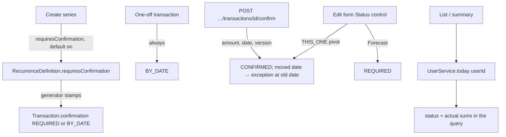

# Actual vs Forecast (Recurrence v3) Design

**Spec**: `.specs/features/actual-vs-forecast/spec.md`
**Status**: Approved
**Approved**: 2026-11-05 - user: "Sim"

---

## Architecture Overview

Each transaction stores how it becomes actual - `confirmation`: `BY_DATE`, `REQUIRED` or `CONFIRMED`. Whether it is actual today is derived at read time from that column, its date and the reader's today (the user's saved time zone). Nothing changes state at midnight, so no job is added. The series definition holds the "Requires confirmation" flag as the template for new occurrences; toggling it rewrites only the occurrences still forecast.

```text
actual(tx, today) = tx.confirmation = CONFIRMED
                 OR (tx.confirmation = BY_DATE AND tx.startDate <= today)
status(tx, today) = ACTUAL   if actual
                  = PENDING  if tx.confirmation = REQUIRED AND tx.startDate < today
                  = FORECAST otherwise
```



### Approaches considered

| Approach | Verdict |
| -------- | ------- |
| **A. Stored `confirmation` per occurrence, status derived at read** | **Chosen.** One column answers every rule; flag toggles touch only forecast rows (spec assumption d); "today" follows each reader's time zone. |
| B. Stored `status` advanced by a daily job | A job and a race at midnight; one time zone per job run, wrong for the other member's zone. |
| C. Flag only on the definition, joined at read | Toggling the flag would turn already-actual past occurrences into pending, against spec assumption d. |

---

## Code Reuse Analysis

### Existing Components to Leverage

| Component | Location | How to Use |
| --------- | -------- | ---------- |
| `editSeries` / `SeriesRegenerator.reconcile` | `transaction/service/TransactionService.java:408`, `SeriesRegenerator.java:50` | Confirmed occurrences other than the pivot leave `existing`, and their dates leave the target list: they are frozen (AC 12) |
| `RecurrenceDefinition.except(date)` | `transaction/model/RecurrenceDefinition.java` | A confirm that moves the date records the old date, so no regeneration refills it (recurrence decision 2026-10-29) |
| `claimVersion` + `StaleVersionException` | `TransactionService.java:220` | Confirm carries `version` → 409 stale (AC 13) |
| `PlanAuthorization.requireCanModifyTransaction` / `TransactionPermissionsResponse` | `TransactionService.java:120` | Confirm is an edit (spec assumption "Who confirms") |
| `sumByPlanAndTypeAndDateRange` | `dashboard/repository/DashboardReportRepository.java:22` | Twin query with the `actual` predicate |
| `User.timeZone` (V14, not null) | `user/model/User.java:54` | `UserService.today(userId)` = `LocalDate.now(clock.withZone(zone))` |
| `TimeZoneDialog` / `FormSheet` / `useConfirm` / `CurrencyInput` / `DatePicker` | `frontend/src/components/…`, `features/profile` | Confirm dialog and form controls |
| Row actions, cells, mobile list | `features/transactions/components/useTransactionActions.ts`, `TransactionCells.tsx`, `TransactionMobileList.tsx` | "Confirm" action; "Forecast" / "Pending" badges |
| `SummaryCards` | `features/overview/components/SummaryCards.tsx` | Actual and forecast per card |

### Integration Points

| System | Integration Method |
| ------ | ------------------ |
| Database | Flyway `V23__add_transaction_confirmation.sql` (below) |
| API contract | `TransactionResponse.status` + `requiresConfirmation`; `CreateSeriesRequest.requiresConfirmation`; `UpdateSeriesRequest.pivotConfirmed`; `POST /plans/{planId}/transactions/{id}/confirm`; `DashboardSummaryResponse.actualIncome/actualExpenses/actualBalance`; new problem `transaction-not-awaiting-confirmation`; `openapi.json` regenerated in the same commit (AD-019) |
| Frontend | Types regenerated; service hook `useConfirmTransaction` + MSW handler factory; copy in `en.json` / `pt-BR.json` |

---

## Components

### Confirmation model (backend)

- **Purpose**: Store how an occurrence becomes actual and derive its status.
- **Location**: `transaction/model/Confirmation.java` (enum), `Transaction.confirmation`, `RecurrenceDefinition.requiresConfirmation`
- **Interfaces**:
  - `Transaction.status(LocalDate today): TransactionStatus` - the rule above, unit-tested
  - `Transaction.confirm(BigDecimal amount, LocalDate date)` - only from `REQUIRED`, else `TransactionNotAwaitingConfirmationException` (409)
  - `Transaction.setConfirmed(boolean)` - pivot Status control: `REQUIRED` ↔ `CONFIRMED`; a no-op on `BY_DATE`
  - `RecurrenceDefinition.changeRequiresConfirmation(boolean, occurrences, today)` - flips only forecast occurrences (`REQUIRED` → `BY_DATE`, or `BY_DATE` with date > today → `REQUIRED`)
- **Reuses**: guarded-aggregate pattern (one creation method, no public setters)

### Confirm endpoint

- **Purpose**: AC 6-7, 11, 13.
- **Location**: `TransactionRoutes.CONFIRM`, `TransactionController.confirm`, `TransactionService.confirm`, `request/ConfirmTransactionRequest(amount, startDate, version)` - amount `@Positive`, bounded as `UpdateTransactionRequest`
- **Behaviour**: load in plan (404) → `requireCanModifyTransaction` → `claimVersion` → when the date moves, `definition.except(oldDate)` → `confirm` → 200 `TransactionResponse`

### Series edit changes

- `createSeries`: `requiresConfirmation` (null → `true`) stamps the definition and every generated occurrence.
- `editSeries`: `series.requiresConfirmation` changes the flag through `changeRequiresConfirmation`; `pivotConfirmed` (THIS_ONE only, nullable = unchanged) applies to the pivot; for THIS_AND_FOLLOWING / ALL, `CONFIRMED` occurrences except the pivot are excluded from `reconcile` and their dates join the exceptions for that call.
- Generator and top-up: stamp `REQUIRED` or `BY_DATE` from the definition.

### Status in reads

- `TransactionResponse.from(tx, permissions, today)` adds `status` and `requiresConfirmation` (`confirmation != BY_DATE`).
- `DashboardService.summary` adds `sumActualByPlanAndTypeAndDateRange(..., today)`; trend and per-person queries unchanged (AC 1.6).

### Frontend

- **Badges**: "Forecast" / "Pending" in `TransactionCells` and `TransactionMobileList` from `status`.
- **Confirm**: row action shown when `requiresConfirmation && status !== "ACTUAL" && permissions.edit`; `ConfirmTransactionDialog` (container) + view + story + flow test; form module `confirmTransactionForm.ts` (zod: amount > 0, date) + unit test.
- **Transaction form**: "Requires confirmation" switch on series create/edit (default on for create, the definition's value for edit); "Status: Forecast · Actual" control when editing an occurrence with `requiresConfirmation`, preset from `status`, sent as `pivotConfirmed`.
- **SummaryCards**: income, expenses, balance each show actual and forecast; the view gets two values per card.

---

## Data Models

```sql
-- V23__add_transaction_confirmation.sql
ALTER TABLE recurrence_definitions ADD COLUMN requires_confirmation boolean NOT NULL DEFAULT false;
ALTER TABLE recurrence_definitions ALTER COLUMN requires_confirmation DROP DEFAULT;
ALTER TABLE financial_transactions ADD COLUMN confirmation varchar(16) NOT NULL DEFAULT 'BY_DATE';
ALTER TABLE financial_transactions ALTER COLUMN confirmation DROP DEFAULT;
ALTER TABLE financial_transactions ADD CONSTRAINT ck_financial_transactions_confirmation
    CHECK (confirmation IN ('BY_DATE', 'REQUIRED', 'CONFIRMED'));
```

Existing rows become `BY_DATE` and definitions `false`: past rows count as actual, future rows of existing series as forecast, none pending (story 3).

```typescript
type TransactionStatus = "ACTUAL" | "FORECAST" | "PENDING";
type TransactionResponse = { /* … */ status: TransactionStatus; requiresConfirmation: boolean };
type ConfirmTransactionRequest = { amount: number; startDate: string; version: number };
type DashboardSummaryResponse = { totalIncome; totalExpenses; netBalance; actualIncome; actualExpenses; actualBalance; personBreakdown };
```

---

## Error Handling Strategy

| Error Scenario | Handling | User Impact |
| -------------- | -------- | ----------- |
| Confirm on a `BY_DATE` or `CONFIRMED` transaction | 409 `transaction-not-awaiting-confirmation` | Toast with its copy; list refreshes |
| Confirm with stale `version` | 409 stale-version | Existing stale toast; dialog closes, list refreshes |
| Transaction outside the plan / role denied | 404 / role-denied problem | Action hidden; problem copy if reached |
| Amount ≤ 0 or missing date | Client zod message; server 422 validation-failed | Field error, no submit |

---

## Risks & Concerns

| Concern | Location (file:line) | Impact | Mitigation |
| ------- | -------------------- | ------ | ---------- |
| `reconcile` matches occurrences by date; a confirmed occurrence with a moved date would be deleted and refilled | `SeriesRegenerator.java:73-91` | Confirmed data lost on a series edit | Confirmed (non-pivot) occurrences leave `existing`; a moved date records an exception; IT per scope |
| Freezing confirmed occurrences also freezes their description and category on a series rename | `SeriesRegenerator.stampOccurrence` | A rename does not reach past confirmed rows | Accepted: a confirmed row is a record; the pivot always takes the form's values |
| THIS_ONE edit keeps the pivot's date today | `TransactionService.java:463` | The form cannot move a date; only Confirm can | Unchanged; Confirm owns the date move (spec AC 2.7) |
| Dashboard and list need "today" per user | no existing helper | Wrong status across time zones | `UserService.today(userId)` unit-tested with a fixed `Clock` and two zones |
| Summary filter covers any range, not only a month | `DashboardService.java:49` | "Forecast" over a past range equals actual minus pending | Correct by the rule; no special case |

---

## Tech Decisions (only non-obvious ones)

| Decision | Choice | Rationale |
| -------- | ------ | --------- |
| Status storage | `confirmation` enum stored, `status` derived with today | Approach A above |
| Today | User's saved time zone (`users.time_zone`, kept in sync by `TimeZoneInterceptor`) | The reader's calendar day, as the period navigator shows it |
| Response field names | `totalIncome` etc. keep meaning "all" (= forecast); `actual*` added | Backwards-compatible contract; old clients keep working |
| Project decision | Recorded as AD-025: forecast vs actual is derived from a stored `confirmation` per occurrence and the reader's today | Answers the question AD-002 and the 2026-10-29 decision left open |
