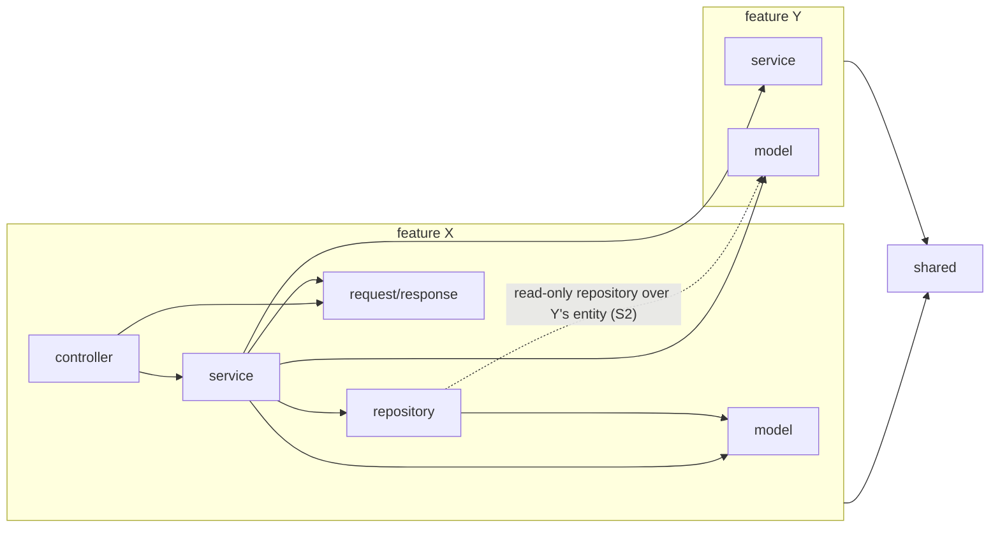
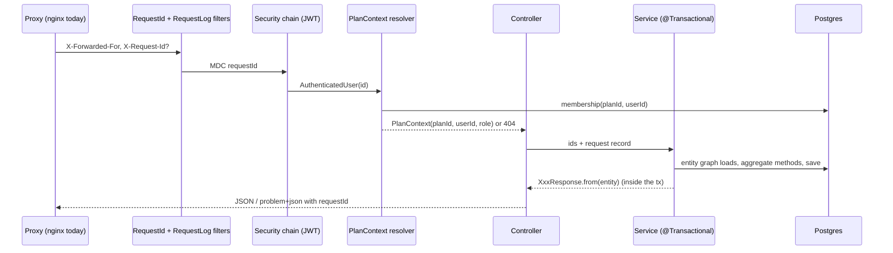

# Backend Standards Design

**Spec**: `.specs/features/backend-standards/spec.md`
**Context**: `.specs/features/backend-standards/context.md` (S1–S27, locked)
**Status**: Approved (2026-10-29)

---

## Architecture Overview

**Approach (user, 2026-10-29): one rule per slice, across the whole codebase.** Each slice brings every feature into line with one rule and lands its check (ArchUnit rule, enforcer rule, compiler flag) already green. The rejected alternative was one feature at a time: each feature would finish sooner, but no global rule could switch on until the last feature was done.

### Target structure

```
com.lcs.findraco
├── FindracoApplication
├── shared/                  depends on no feature (ArchUnit)
│   ├── config/              TimeConfig (Clock), WebConfig, OpenApiConfig, AppProperties records
│   ├── error/               ProblemType, DomainException, Problems, GlobalExceptionHandler,
│   │                        ProblemAuthenticationEntryPoint, ProblemAccessDeniedHandler
│   ├── openapi/             springdoc customizers (S16)
│   ├── security/            AuthenticatedUser, @CurrentUser resolver
│   ├── web/                 RequestIdFilter, RequestLogFilter, @ClientIp resolver, PageRequests (toPageable)
│   └── ratelimit/           RateLimiter, RateLimit enum, RateLimitProperties
├── auth/                    login, register, sessions, password reset, JWT, SecurityConfig
├── user/                    profile, time zone
├── plan/                    plans, memberships, invitations, PlanAuthorization, PlanContext + resolver
├── category/                categories, member limits, category spending (usage)
├── transaction/             transactions, items, participants, splits, series, CSV import
└── dashboard/               summary, partition and trend reports (read-only repository)
```

Every feature uses the same sub-packages, and only the ones it needs: `controller`, `service`, `repository`, `model`, `request`, `response`, `exception`, `config` (its `@ConfigurationProperties`), plus `importer` in `transaction` (the S19 parsers). ArchUnit allows only this list.

### Dependency rules (one ArchUnit class, `ArchitectureTest`)



- `shared` depends on no feature. Feature X may use feature Y's `service` and `model` only. A repository in X may be declared over Y's entity, but it must extend `Repository` and declare no write method (S1, S2).
- `model` depends on no `service`, `repository`, `request`, `response` or Spring Security package (S3).
- `controller` never touches a `repository`. No field injection. No `IllegalArgumentException` thrown as a user error (S5). Clock and zone rules (S11). DTO naming (S10). `@Size` on every request `String` and `List` (S17). No resolver-supplied entity parameter (S18).

### Request path after the feature



### Slice execution order (refines spec ID order, per Assumptions)

The IDs stay the same; only the run order changes, so that each slice finds what it needs already in place.

| Run | Slice | Why here |
|---|---|---|
| 1 | BST-01 Testcontainers + CI + H13 | Everything else needs the full suite |
| 2 | BST-02 Boot 4.1 / Java 25 | On today's code, so a failure is the upgrade's (S23) |
| 3 | BST-03 Enforcement | Formatting commit and tool checks before the big move |
| 4 | BST-04 Structure, names, routes, records, `PlanContext` values, `app.*` properties | The other rules are written against this shape |
| 5 | BST-13 Request id and logging | BST-08 puts `requestId` in every problem |
| 6 | BST-08 Error contract | BST-06/10/14–19 throw typed problems |
| 7 | BST-09 OpenAPI snapshot | Every later contract change shows as a snapshot diff |
| 8 | BST-05 Cross-feature access | Small; moves dashboard queries before BST-07 touches them |
| 9 | BST-07 OSIV off | Services return responses before aggregates rewrite them |
| 10 | BST-06 Aggregates + locking | Needs `stale-version` problem (BST-08) |
| 11 | BST-10 Contract shape + permissions | |
| 12 | BST-11 Time | `timestamptz` migration before BST-12 constraints |
| 13 | BST-12 Migrations and constraints | Needs final table names and columns |
| 14 | BST-14 Rate limits + exposure | |
| 15 | BST-15 Auth hardening | |
| 16 | BST-16 CSV import | Needs BST-12's unique index |
| 17 | BST-17 Category usage | |
| 18 | BST-18 Series | |
| 19 | BST-19 Plans | |
| 20 | BST-20 Test coverage | Fills the gaps left after the rules |
| 21 | BST-21 Skills, docs, cleanup | Describes only what exists (S24) |

---

## Code Reuse Analysis

### Existing Components to Leverage

| Component | Location | How to Use |
|---|---|---|
| `AbstractIntegrationTest` (truncate + disposable guard) | `backend/src/test/java/com/lcs/findraco/support/` | Keep truncation and the guard; the datasource now comes from a `@ServiceConnection` Postgres container, and the allowlist names the container database |
| `TestAuthHelper`, `Fixtures` | `src/test/.../support/` | Reused by every new IT and the role matrix |
| `PlanAuthorizationMatrixIT` | `src/test/.../` | Becomes the S13 role matrix (flag ⇔ endpoint agree), extended to every endpoint |
| `PlanAuthorization` | `security/PlanAuthorization.java` | Moves to `plan.service`; each `requireX` is rewritten as `if (!canX) throw` |
| `PlanContextArgumentResolver` | `security/` | Moves to `plan.controller`, returns the value record; still the only membership gate |
| `SplitResolver`, `ItemShareAllocator`, `CategorySpendingAssembler`, `RecurringTransactionGenerator`, `SeriesRegenerator` | `services/` | Pure logic kept as is; moved into feature `service` packages; generator gains exceptions; regenerator matches by date |
| `OpaqueTokens`, `SessionService`, `SessionCookies` | `security/`, `services/` | Move to `auth`; behaviour unchanged (AD-009) |
| `OpenEndedSeriesTopUpService` | `services/` | Logic reused by the daily job and the on-demand extension; loses `REQUIRES_NEW` on the read path |
| `TimeConfig` (`Clock` bean) | `config/` | Becomes `Clock.systemUTC()`; every `now()` goes through it |
| `MigrationsIT` | `src/test/.../` | Already boots and validates; now on Testcontainers |
| Constraint naming `pk_/uk_/fk_/idx_/ck_` | `V11`, `V12` | The convention every new migration follows |
| Frontend `findracoApi` and MSW handler factories | `frontend/src/api/` | Gets the `Time-Zone` and `X-Request-Id` handling and the problem `type` map; handlers regenerate from `openapi.json` |

### Integration Points

| System | Integration Method |
|---|---|
| Frontend | Types generated from committed `backend/openapi.json` (S16); routes, error map, permissions flags, `version`, `Time-Zone` header change in the same slice as the backend |
| Postgres | Flyway forward migrations `V13+`; each data or constraint migration starts with a precondition `DO $$ ... RAISE EXCEPTION` block |
| CI (`.github/workflows/ci.yml`) | Backend job becomes `./mvnw -B verify` on a runner with Docker (ubuntu-latest has it) |
| VPS / Portainer | Java 25 image, `SERVER_ADDRESS` env, the rest of env unchanged |

---

## Components

### Testcontainers base (BST-01)

- **Purpose**: Every IT runs on a throwaway Postgres 16.
- **Location**: `src/test/java/com/lcs/findraco/support/TestcontainersConfig.java`, `AbstractIntegrationTest`
- **Interfaces**: `@Bean @ServiceConnection PostgreSQLContainer postgres()` (image `postgres:16-alpine`), imported by `AbstractIntegrationTest`. One container per JVM, reused across contexts.
- **Dependencies**: `org.testcontainers:testcontainers-postgresql`, `spring-boot-testcontainers`, Docker.
- **Reuses**: the current truncate-before-each and the disposable guard, with the allowlist set to the container's database name.
- `application-test.properties` loses every datasource comment and tunnel reference (AC 2). `failsafe` runs `*IT` in `verify`. A missing Docker daemon fails the run (Testcontainers default; nothing disables it).

### Platform (BST-02)

- **Purpose**: Boot 4.1.x on Java 25, a layered image, Dependabot.
- **Location**: `backend/pom.xml`, `backend/Dockerfile`, `.github/dependabot.yml`
- **Changes**: `spring-boot-starter-web` → `spring-boot-starter-webmvc`; Jackson 3 (`tools.jackson`) in our code, while jjwt-jackson keeps its own Jackson 2 (see Risks); springdoc 3.1.0; Testcontainers 2; `java.version` 25; Dockerfile `maven:3.9-eclipse-temurin-25` → `COPY pom.xml` → `mvn -B dependency:go-offline` → `COPY src` → `package`; runtime `eclipse-temurin:25-jre-alpine`.
- Dependabot: `maven` (`/backend`), `npm` (`/`), `github-actions` (`/`), weekly, one group per ecosystem.

### Build enforcement (BST-03)

- **Purpose**: The build rejects what the standards forbid.
- **Location**: `backend/pom.xml`, `.mvn/jvm.config`, `.husky/pre-commit`, `.git-blame-ignore-revs`, `src/test/java/com/lcs/findraco/ArchitectureTest.java`
- **Pieces**:
  - Spotless with `palantirJavaFormat` 2.96.0: `check` bound to `verify`. The pre-commit hook runs `spotless:check` on staged backend files.
  - maven-enforcer: `bannedDependencies` (`org.projectlombok:*`, `org.mapstruct:*`) and `requireJavaVersion [25,26)`.
  - maven-compiler: `-Xlint:all`, `<failOnWarning>true</failOnWarning>`, `-parameters` (needed for records and binding).
  - Error Prone 2.51.0 as `annotationProcessorPaths` with `-XDcompilePolicy=simple`, `--should-stop=ifError=FLOW`, `-Xplugin:ErrorProne`, and the `--add-exports`/`--add-opens` lines for `jdk.compiler` in `.mvn/jvm.config`. Any check disabled for good is turned off in one place, the `-Xplugin` argument line (`-Xep:Name:OFF`), with a comment.
  - ArchUnit 1.5.1 (`archunit-junit5`): `ArchitectureTest` starts with today's rules (controller ↛ repository, no field injection, no `@SuppressWarnings`). Each later slice adds its own rule in the same commit that makes the code comply.

### Feature packages, names and routes (BST-04)

- **Purpose**: Move to the target structure, with one name per domain.
- **Moves** (main ones):
  - `FinancialTransaction*` → `transaction.*`, named `Transaction*`.
  - `FinancialTransactionCategory*` → `category.*`, named `Category*`.
  - `security/` splits: JWT, filter, sessions and `SecurityConfig` go to `auth`; `PlanAuthorization` and `PlanContext` to `plan`; `CurrentUser` to `shared.security`.
  - `specifications/` → the owning feature's `repository`.
  - `utils/DateUtils` → wherever it is used.
  - `ApiRoutes` is split, with each feature owning its route constants in `controller/XxxRoutes`. `shared.web.ApiRoutes` keeps `BASE` and `PLAN`.
- **DTOs**: every DTO becomes a `record` (`CreateXxxRequest`, `UpdateXxxRequest`, `XxxResponse`, `XxxSummaryResponse`), one per file. `PagedResponseDto` becomes `PageResponse<T>`. `FieldErrorDto` and `ErrorResponseDto` are left for BST-08 to remove.
- **Identity**:
  - `PlanContext(long planId, long userId, PlanRole role)` lives in `plan.service`, and the resolver in `plan.controller`. The resolver registers itself through a `WebMvcConfigurer` in `plan.controller`, so `shared` stays independent.
  - `AuthenticatedUser(long id)` lives in `shared.security`.
- **Configuration**: every `@Value` becomes a `@Validated @ConfigurationProperties` record. Environment variable names stay the same:

  | Prefix | Record | Location | Replaces |
  |---|---|---|---|
  | `app.jwt` | `JwtProperties(secretKey, expiration)` | `auth.config` | `jwt.*` |
  | `app.session` | `SessionProperties(ttl, reuseGrace, cookieSecure)` | `auth.config` | `@Value` |
  | `app.mail` | `MailProperties` | `auth.config` (password reset is its only user) | `@Value` |
  | `app.cors` | `CorsProperties(allowedOrigins)` | `auth.config` (`SecurityConfig` lives there) | `${ALLOWED_ORIGINS}` |
  | `app` | `AppProperties(url, version)` | `shared.config` | `@Value` |

  Later slices add `app.rate-limit` (BST-14), `app.import` (BST-16), `app.series` (BST-18, the horizon and job cron). The category warning ratio is deliberately not configurable (S22: a contract value the frontend shows). `@ConfigurationPropertiesScan` sits on `FindracoApplication`. A missing or out-of-range value fails startup through Bean Validation (`@NotBlank`, `@Positive`, `@DurationMin`).
- **Rename migration**: `V13__rename_transactions_and_categories.sql` (see Data Models).
- **Commits**: move-only commits (package lines only) separate from edit commits, so git tracks the renames.

### Error contract (BST-08)

- **Purpose**: One problem shape from every producer, with a stable `type`.
- **Location**: `shared.error`
- **Interfaces**:
  - `enum ProblemType { VALIDATION_FAILED("validation-failed"), MALFORMED_REQUEST("malformed-request"), NOT_FOUND("not-found"), UNAUTHENTICATED, FORBIDDEN, STALE_VERSION, RATE_LIMITED, INTERNAL, ...one per business rule }`. `uri()` returns `urn:findraco:problem:<slug>`.
  - `abstract class DomainException extends RuntimeException`, with `(ProblemType type, HttpStatus status, @Nullable String field, String detail)`. Every feature exception extends it, nested per feature in `XxxExceptions` as today, so the status is declared next to the rule.
  - `Problems.of(HttpStatus, ProblemType, String detail, @Nullable String field): ProblemDetail` adds `requestId` from the MDC. It is the single builder used by the advice, the entry point, the access-denied handler and the filters.
  - `GlobalExceptionHandler` handles `DomainException` once. It also maps the Spring and Jackson read errors to 400, `MethodArgumentNotValidException` and `HandlerMethodValidationException` to 422 with `errors[{field, code, message}]`, `ObjectOptimisticLockingFailureException` to 409 `stale-version`, and everything else to 500 with a fixed detail, logged at ERROR.
- **Why a base class instead of one handler per exception**: `shared` cannot import feature exceptions (`shared` depends on no feature), and keeping the status on the exception keeps "explicit status per semantic" with no handler list to keep in sync. 18 handler methods become about 8.
- **Frontend**: `src/api/problems.ts` holds `Record<ProblemType, string>` plus a generic message per status, and the toast shows the `requestId`.

### OpenAPI customizers and snapshot (BST-09)

- **Location**: `shared.openapi` and `src/test/.../OpenApiSnapshotIT`.
- **Customizers** (springdoc `OpenApiCustomizer` / `OperationCustomizer`):
  - `RequiredUnlessNullableCustomizer`.
  - `PlanPathParameterCustomizer`, which hides `PlanContext` and adds `planId`.
  - `CommonProblemResponsesCustomizer`, which adds 400/401/404/422/500, plus 403 on `/plan/` routes, all pointing at the `ProblemDetail` schema.
  - `ProblemTypeSchemaCustomizer`.
  - Success status from `@ResponseStatus`. Enums become `$ref` (springdoc `enumAsRef`).
- **Snapshot**: the IT GETs `/v3/api-docs`, normalises it (sorted keys, no server URL), compares it with `backend/openapi.json` and prints a unified diff. `-Dopenapi.update=true` rewrites the file (one documented command).

### Request tracing (BST-13)

- `RequestIdFilter` (highest order) validates the incoming `X-Request-Id` against `[A-Za-z0-9-]{1,64}`, otherwise generates a UUID. It sets the MDC, echoes the header, and clears the MDC in `finally`.
- `RequestLogFilter` writes one INFO line `method route status durationMs userId planId`. The route template comes from `HandlerMapping.BEST_MATCHING_PATTERN_ATTRIBUTE`.
- `logback-spring.xml` puts `%X{requestId}` in the pattern. `spring.jpa.show-sql=false` in the base properties, `true` only in `application-local.properties`.
- The leaking log calls are removed: e-mail and stack trace in `JwtAuthenticationFilter`, reset link in `EmailService`. The link is still logged when SMTP is absent, but only under the `local` profile.
- `LogHygieneIT` captures the log output (an in-memory logback appender) during the login and reset flows and asserts no password, token, e-mail or link appears.

### Cross-feature and read-only repositories (BST-05)

- `dashboard.repository.DashboardReportRepository extends Repository<Transaction, Long>` takes the five report queries from the transaction repository.
- `category.repository.CategorySpendingRepository` holds the spend queries.
- `TransactionService.reassignCategory(planId, fromId, toId)` and `deleteByCategory` are what category delete calls.
- ArchUnit: a repository whose entity belongs to another feature must not extend `CrudRepository` or `JpaRepository` and must not declare `@Modifying`.

### Persistence boundary (BST-07)

- `spring.jpa.open-in-view=false`, and every `@ManyToOne(fetch = LAZY)`.
- List finders declare `@EntityGraph(attributePaths = {...})`. Collections are fetched by a second query by ids, not a join, so a page with a fetch join does not paginate in memory (Hibernate's HHH90003004 warning).
- `StatementCountIT` uses Hibernate `Statistics` (`hibernate.generate_statistics` only in the test profile) for the 5- versus 20-row assertion.

### Aggregates and optimistic locking (BST-06)

- `Transaction.create(TransactionDraft draft)`, where `TransactionDraft` is a domain value record in `transaction.model` built by the service from the request or from an `ImportedRow`. It takes domain values only (S3) and offers `edit(...)`, `replaceSplit(...)`, `replaceItems(...)`.
- `RecurrenceDefinition.create(...)`, `editPattern(...)`, `except(LocalDate)`.
- `Category.create(...)`, `rename`, `changeType(boolean inUse)`, `setLimit`.
- No public setters. Children (`TransactionParticipant`, `TransactionItem`, `RecurrenceDefinitionParticipant`) change only through the root, and `TransactionItemRepository` becomes read-only or goes away.
- `@Version long version` sits on the three roots. The edit path loads the entity, compares the request's `version` and throws `StaleVersionException` (409) when it differs. `ObjectOptimisticLockingFailureException` maps to the same type for races between the load and the commit.
- Frontend: on `stale-version` the shared mutation handler shows the copy and invalidates the query (`buildMutationOptions`).

### Contract shape and permissions (BST-10)

- `PlanPermissionsResponse(createTransactions, attributeToOthers, manageCategories, managePlan)` and `TransactionPermissionsResponse(edit, delete)` are built by `PlanAuthorization.canX(role, userId, createdById)`.
- `UpdateSeriesRequest(SeriesEditScope scope, long pivotOccurrenceId, @Valid CreateSeriesRequest series)`.
- `TransferredOwnerRole { EDITOR, CONTRIBUTOR, VIEWER }`, and an invitation role enum without OWNER (also H9).
- Money `@Digits(integer = 13, fraction = 2)`; `spendingLimit @PositiveOrZero`; `parcelsNumber @Min(1) @Max(420)`, the bound taken from the existing column check when one exists, otherwise from the series form.

### Time (BST-11)

- `TimeConfig` returns `Clock.systemUTC()`; `LocalDateTime` instant fields become `Instant`.
- `user.controller.TimeZoneInterceptor` (a `HandlerInterceptor`, self-registered like the plan resolver) reads `Time-Zone` on authenticated requests. It validates the header with `ZoneId.of` inside try/catch, ignoring it when invalid, and updates `users.time_zone` only when the user's mode is automatic and the value differs, so most requests write nothing.
- `PATCH /user/me/time-zone` with `{ mode: AUTOMATIC | PINNED, zone? }`.

### Migrations (BST-12)

- One hardening migration with a precondition block, then the `NOT NULL`, `CHECK` and `UNIQUE` constraints.
- Missing foreign-key indexes, and the partial unique index `uk_transactions_plan_source_ref`.
- Entities lose `@Index`, `@UniqueConstraint`, `@ForeignKey` and the `@Column(nullable/length)` used only for schema.
- `ConcurrentImportIT` runs two threads with a latch and checks each row is stored once. Series edit and delete call `findByIdForUpdate`, the same lock as the top-up.

### Rate limits and exposure (BST-14)

- `shared.ratelimit`:
  - `enum RateLimit { LOGIN_IP, LOGIN_EMAIL, FORGOT_EMAIL, FORGOT_IP, REGISTER_IP, IMPORT_USER }`.
  - `RateLimitProperties(Map<RateLimit, Rule(capacity, period)>)`, validated so that every key is present.
  - `RateLimiter.consume(RateLimit, String key)` throws `RateLimitedException(retryAfter)`. It is built on Bucket4j `bucket4j_jdk17-core` 8.19.0, with buckets kept in a Caffeine cache (`expireAfterAccess` = period) so memory stays bounded.
- **Called by the service as its first step**, not by a filter: the e-mail key lives in the body, which only the use case has parsed, and a call in the use case is visible and testable. The client IP reaches the controller through `@ClientIp String ip` (a `shared.web` resolver reading `request.getRemoteAddr()`, already corrected by `RemoteIpValve`).
- E-mail keys are normalised (trim, lower-case) and hashed (SHA-256) before being used as map keys, so no address sits in memory as text.
- `server.address=${SERVER_ADDRESS:127.0.0.1}` (local stays on loopback); production sets `SERVER_ADDRESS` to the docker0 gateway.
- `server.forward-headers-strategy=native` and `server.tomcat.remoteip.internal-proxies` set to the Docker private ranges only.
- Responses: 429 with a `Retry-After` header in seconds.

### Authentication hardening (BST-15)

- `PasswordEncoder` bean: `DelegatingPasswordEncoder` with `argon2` = `Argon2PasswordEncoder.defaultsForSpringSecurity_v5_8()` as the encoder for new hashes, and `bcrypt` = `BCryptPasswordEncoder(12)` for matching.
  - Existing hashes have no `{bcrypt}` prefix, so `setDefaultPasswordEncoderForMatches(bcrypt)` covers them.
  - `upgradeEncoding` plus `UserDetailsPasswordService` re-hash on login, done by `DaoAuthenticationProvider` automatically.
  - The dummy hash comes from the same bean.
- `@ValidPassword`: one constraint (NFKC, then code-point count 8–128, then the forbidden categories `Cc`, `Cf`, `Zl`, `Zp`) that emits the `code` `PasswordLength` or `PasswordCharacters`. A `PasswordNormalizer.normalize(String)` applies NFKC on create, reset and login.
- Forgot-password: an `@Async` mail send on a bounded `ThreadPoolTaskExecutor` (`app.mail.executor.*`), and the response returns at once.
- JWT:
  - `JwtProperties.secretKey` is Base64-decoded, and a `@AssertTrue` check (decoded length ≥ 32) fails startup.
  - `sub` = user id. `JwtAuthenticationFilter` loads by id.
- `spring.dotenv.filename` and the `spring-dotenv` dependency are removed. Local runs read `backend/.env` through `spring.config.import=optional:file:.env[.properties]`, a native Boot feature, so the third-party dependency goes.

### CSV import (BST-16)

- `transaction.importer`:
  - `StatementParser { boolean supports(List<String> header); ParseResult parse(Reader reader, ImportLimits limits); }`.
  - `ParseResult(List<ImportedRow> rows, List<ImportError> errors)`.
  - `ImportedRow(LocalDate date, BigDecimal amount, String sourceText, @Nullable String sourceRef, StatementFormat format)`.
  - `NubankAccountStatementParser`, plus `NubankCardBillDetector`, which recognises the header and throws `CsvFormatNotSupported`.
  - `StatementParserRegistry` (a list of beans).
  - Commons CSV `CSVFormat.RFC4180` with header and BOM handling via `BOMInputStream`. A strict UTF-8 `CharsetDecoder` (`REPORT`) gives the line of an invalid byte.
- `TransactionImportService` checks size, then rate limit, then parse. If there are errors it throws `CsvRowsInvalid(errors, capped)`, a 422 with the list in `errors`. Otherwise it de-duplicates in the file and against the database, creates each row with `Transaction.create`, and returns `ImportResultResponse(imported, skippedDuplicates)`.
- `spring.servlet.multipart.max-file-size` follows `app.import.max-bytes` (1 MB), so the container rejects larger uploads first.

### Category usage (BST-17)

- `category.service.CategoryUsageCalculator` is pure: limit scaling by months touched, `percentUsed`, and `status` with `WARNING_RATIO = 0.8` as a constant. It has unit tests.
- The spending endpoint takes `start` and `end`. The frontend deletes `scaleLimits.ts` and the evaluation in `spendingRows.ts`.

### Series (BST-18)

- `recurrence_exceptions` is owned by `RecurrenceDefinition` (an `@ElementCollection Set<LocalDate>`, which needs no entity).
- `SeriesRegenerator` reconciles by date.
- `SeriesTopUpJob` runs on `@Scheduled(cron = "${app.series.top-up-cron}")` and on `ApplicationReadyEvent`.
- `SeriesHorizon.ensureCovered(planId, LocalDate end)` is called by read services before their read transaction. It compares the period end with `plans.series_generated_until`, and when the period goes past it, extends in its own `@Transactional` through a separate bean, not `REQUIRES_NEW` inside a read.
- `DELETE` series requires `scope` (`@RequestParam` with no default).

### Plans (BST-19)

- `PlanService.ensurePersonalPlan(userId)` is called after a removal, a leave or a plan deletion for each affected user.
- `SplitMode` drops `PERCENT`, after the migration's precondition check.
- Every `toPageable` appends `Sort.by("id")`. `LikePatterns.escape(String)` in `shared.web`, with `ESCAPE '\'` in the specifications.

---

## Data Models

Migrations from `V13` on, in run order:

| Migration | Slice | Content |
|---|---|---|
| `V13__rename_transactions_and_categories` | BST-04 | Precondition: `financial_transactions` and `financial_transaction_categories` exist, `transactions` and `categories` do not, otherwise `RAISE EXCEPTION`. `ALTER TABLE/SEQUENCE/INDEX ... RENAME`, `ALTER TABLE ... RENAME CONSTRAINT` to `pk_transactions`, `fk_transactions_categories`, `fk_transactions_plans`, `ck_transactions_type`, `idx_transactions_*`, and the same for `categories` |
| `V14__instants_to_timestamptz_and_user_time_zone` | BST-11 | `ALTER COLUMN ... TYPE timestamptz USING col AT TIME ZONE 'UTC'` (see Risks); `users.time_zone varchar(64) NOT NULL DEFAULT 'America/Sao_Paulo'`, `users.time_zone_mode varchar(16) NOT NULL DEFAULT 'AUTOMATIC'` with `ck_users_time_zone_mode` |
| `V15__optimistic_locking_versions` | BST-06 | `version bigint NOT NULL DEFAULT 0` on `transactions`, `recurrence_definitions`, `categories` |
| `V16__hardening_constraints` | BST-12 | Precondition counts (nulls, duplicates, negative limits, invalid enums); `NOT NULL`/`CHECK` (`ck_transactions_amount_positive`, `ck_categories_spending_limit_non_negative`, …); missing `idx_` on foreign keys; `external_id` → `source_ref`; `uk_transactions_plan_source_ref ON transactions(plan_id, source_ref) WHERE source_ref IS NOT NULL` after a duplicate check |
| `V17__transaction_source_text` | BST-16 | `source_text varchar(512)` nullable (rows imported before stay null) |
| `V18__recurrence_exceptions_and_watermark` | BST-18 | `recurrence_exceptions(definition_id bigint NOT NULL REFERENCES recurrence_definitions, exception_date date NOT NULL, pk_recurrence_exceptions(definition_id, exception_date))`; `plans.series_generated_until date` |
| `V19__drop_percent_split_mode` | BST-19 | Precondition: no row with `PERCENT`; replace `ck_..._split_mode` |

Final shapes worth stating:

```java
// transaction.model
@Entity @Table(name = "transactions")
public class Transaction {
    @Id Long id;
    @Version long version;
    @ManyToOne(fetch = LAZY) Plan plan;
    @ManyToOne(fetch = LAZY) User createdBy;
    @ManyToOne(fetch = LAZY) Category category;
    TransactionType type;
    BigDecimal amount;
    String description;          // user-editable
    String sourceText;           // bank's text, immutable, nullable
    String sourceRef;            // bank id, nullable, unique per plan
    // series fields, split mode, participants, items unchanged in meaning
}

// plan.service
public record PlanContext(long planId, long userId, PlanRole role) {}
// shared.security
public record AuthenticatedUser(long id) {}
```

---

## Error Handling Strategy

| Error Scenario | Handling | User Impact |
|---|---|---|
| Field constraint fails | 422 `validation-failed`, `errors[{field, code, message}]` | The field shows the translated `code` |
| Business rule (entity or service) | `DomainException` subclass, its own `type`, `field` when one applies | Copy from the `type` map, field highlighted |
| Body unreadable / wrong type / missing param | 400 `malformed-request` | Generic "couldn't send" copy |
| Stale `version` | 409 `stale-version` | "Changed by someone else" and a reload |
| Outside scope | 404 `not-found` (resolver or service) | Not-found screen or toast |
| Role refuses | 403 `forbidden` (plan routes) | The UI no longer offers it (flags), so this means a stale screen |
| No or invalid token | 401 from the entry point via `Problems` | Silent refresh (AD-009), then login |
| Rate limit | 429 `rate-limited` + `Retry-After` | "Too many attempts, try again in N min" |
| CSV invalid | 422 with `type` per cause, `errors[{line, field, code}]` ≤ 50 | Line list in the import dialog, nothing imported |
| Unexpected | 500 `internal`, fixed detail, ERROR log with `requestId` | Generic copy plus the request id to report |
| Bad config at boot | Bean Validation on `@ConfigurationProperties` | The app does not start; the deploy health check fails and the old container keeps running |

---

## Risks & Concerns

| Concern | Location (file:line) | Impact | Mitigation |
|---|---|---|---|
| Binding `127.0.0.1` would cut nginx off: the API uses host networking, and nginx (a container) reaches it through `host.docker.internal` = docker0 gateway | `docker-compose.yml:10` | Site down | `server.address=${SERVER_ADDRESS:127.0.0.1}`; production sets the docker0 gateway IP (usually `172.17.0.1`). The BST-14 checklist includes `curl` on the public IP:3000 failing and the site working, run by the user on the VPS |
| `X-Forwarded-For` is not trusted today: no `forward-headers-strategy` is set, so every client looks like the proxy's IP | `application.properties` | Per-IP limits would hit every user at once | `server.forward-headers-strategy=native` plus `internal-proxies` limited to Docker ranges, in BST-14 |
| The JWT key is Base64-*encoded*, not decoded. Decoding the production secret may fail or come out under 32 bytes | `security/JwtService.java:28` | App refuses to start after BST-15 | Before the BST-15 deploy, the user checks the secret is valid Base64 ≥ 32 bytes; otherwise sets `openssl rand -base64 48`. That ends 15-minute access tokens once (accepted in S21) |
| Converting `timestamp` → `timestamptz` needs the zone the old values were written in | `V2`, `V4`, `V10`, `V12` | Instants shifted by hours | The production container sets no `TZ` and Temurin defaults to UTC, so `AT TIME ZONE 'UTC'`. The user confirms with `docker exec findraco-api date` before the BST-11 deploy |
| `LocalDateTime.now()` outside the `Clock` | `services/PlanService.java:136`, `services/PlanInvitationService.java:138`, `dtos/response/InvitationResponseDto.java:32` | Machine-zone dependence | BST-11 with the ArchUnit rule |
| Top-up opens `REQUIRES_NEW` with a write lock on every read | `services/OpenEndedSeriesTopUpService.java:52` | Second connection out of a pool of 5, lock contention | BST-18 (S26) |
| Logs leak e-mails, stack traces and reset links | `security/JwtAuthenticationFilter.java`, `services/EmailService.java` | Personal data in logs | BST-13 plus `LogHygieneIT` |
| Two `BCryptPasswordEncoder` instances (default cost vs 12) | `config/SecurityConfig.java:75`, `services/UserService.java:27` | Timing differences | One bean (BST-15) |
| 22 `IllegalArgumentException` throws | `services/*` | 500s or raw 400s on user input | Each becomes a named `DomainException` in the slice that owns its rule; the ArchUnit rule lands when the count is 0 (BST-08) |
| Jackson 3 changes more than imports (`ObjectMapper` → `JsonMapper` builder, modules, some defaults) | `config/*`, tests using `ObjectMapper` | Compile and serialisation drift | BST-02 isolated commit; the OpenAPI field diff before and after (AC 12 of BST-04) and the full IT suite catch JSON drift |
| jjwt-jackson 0.12.6 depends on Jackson 2 | `pom.xml:56` | Two Jackson majors on the classpath | They live in separate packages and work together. If Boot 4 dependency management conflicts, switch to `jjwt-orgjson` (same API). Decided in BST-02 by build result |
| `spring-dotenv` 4.0.0 may not support Boot 4 | `pom.xml:91` | Local startup fails | It is removed anyway in BST-15; if it breaks in BST-02, its replacement (`spring.config.import` of `.env`) moves forward to BST-02 |
| Error Prone on JDK 25 is not explicitly confirmed | `pom.xml` (new) | Compile fails | A smoke compile in BST-03; if it fails, Error Prone waits (spec Assumption) and the other tools land |
| Reported OOM in tests with Spring 7 + Java 25 from bean metadata reading | test JVM | CI flakes or fails | Failsafe `argLine` with an explicit `-Xmx`, and one cached context (shared base class, no `@MockitoBean` variance). Watched in BST-02 |
| One huge move commit (BST-04) can hide edits | whole tree | Lost blame, risky review | Move-only commits first (package lines), edits after; the snapshot or field diff proves the JSON is unchanged |
| The test DB allowlist must follow the container name | `support/AbstractIntegrationTest.java:31` | Guard blocks every test, or guards nothing | Allowlist = the container's database name, plus a test that the guard refuses `findraco` |
| Category spend and dashboard queries live on the transaction repository: renaming the entity breaks JPQL in other features | `repositories/FinancialTransactionRepository.java` | Startup failure (good: loud) | JPQL is validated at startup; ITs cover each query (S2 residual cost) |
| PlanContext carries entities today; services read `ctx.getPlan()` lazily | `security/PlanContext.java:14` | `LazyInitializationException` once OSIV is off | BST-04 switches to values before BST-07 turns OSIV off (run order) |

---

## Tech Decisions

| Decision | Choice | Rationale |
|---|---|---|
| Versions | Spring Boot latest 4.1.x patch; Java 25 (Temurin); springdoc-openapi 3.1.0; ArchUnit 1.5.1; Testcontainers 2.0.5 (`testcontainers-postgresql`); Error Prone 2.51.0; palantir-java-format 2.96.0; Bucket4j `bucket4j_jdk17-core` 8.19.0; Commons CSV and BouncyCastle (`bcprov-jdk18on`) at their latest stable release when the slice runs | Looked up 2026-10-29; libraries whose release I did not verify are pinned at execution, not guessed |
| Config prefix | `app.*` for all operational config; `jwt.*` and the bare `ALLOWED_ORIGINS` fold in; env var names unchanged | User, 2026-10-29. An app (not a library) needs no unique prefix; survives product renames |
| What is configurable | Operational values (rate limits, CSV bounds and cap, series horizon and cron, mail executor, session, JWT); contract values (password length, field sizes, money scale, warning ratio) stay in code | A contract value changed only on the server drifts from the client (spec Assumption) |
| Exception mapping | `DomainException` base with type and status; one handler | `shared` depends on no feature; status stays beside the rule |
| Rate limiting call site | A service call (`RateLimiter.consume`), not a filter | The e-mail key is in the body; testable in the use case |
| Plan context location | `plan.service.PlanContext`, resolver self-registered in `plan.controller` | Keeps `shared` free of feature dependencies |
| Exceptions on series | `@ElementCollection` on `RecurrenceDefinition` | The aggregate owns them (S3); no entity or repository needed |
| `.env` loading | Native `spring.config.import=optional:file:.env[.properties]` | Removes a third-party dependency with uncertain Boot 4 support |
| Snapshot update | `-Dopenapi.update=true` on the snapshot IT | One command, no separate tool |

Project-level decisions to append to `STATE.md` on approval: AD-016 (backend enforcement, the twin of AD-010), AD-017 (package by feature and cross-feature rules), AD-018 (error contract), AD-019 (OpenAPI snapshot as contract), AD-020 (backend testing: Testcontainers and the test table), AD-021 (configuration under `app.*`), AD-022 (series top-up off the read path and EXDATE exceptions; conforms to AD-002).
