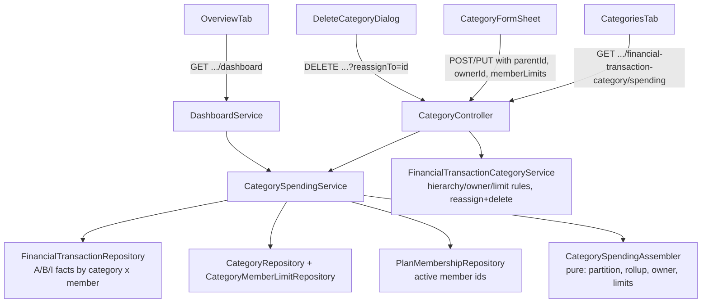

# Categories Revamp Design

**Spec**: `.specs/features/categories-revamp/spec.md`
**Context**: `.specs/features/categories-revamp/context.md`
**Status**: Approved (2026-10-12)

---

## Architecture Overview

Approach chosen (2026-10-12): **SQL facts + pure assembler**. It extends the AD-007 pattern.
- **Queries:** the three category queries (A, B, I) group by **category × member** instead of category alone. Item amounts are attributed to members in proportion to the transaction's participation shares.
- **Assembler:** one pure Java assembler turns those leaf facts into a two-level tree. It handles the parent rollup, ownership, per-member limits and dormant (former-member) entries.
- **Shared service:** the Overview breakdown and the new Categories tab both call one `CategorySpendingService`, so the two always show the same numbers.

Rejected alternatives:
- **In-memory computation:** departs from the existing query pattern and loads every transaction in the period.
- **Materialized spend table:** needs invalidation on every write, which is overkill for this app's volume.



### Spend math (leaf level)

For a transaction `T` with amount `amt`, category `C`, participants `p` with share `s_p`, and categorized items `i` (category `C_i`, amount `a_i`):

- **A[C, p] += s_p**: the whole share, as today.
- **B[C, p] += a_i · s_p / amt**: the item portion removed from the parent category.
- **I[C_i, p] += a_i · s_p / amt**: the item portion added to the item's category.
- **leaf[C, p] = A − B + I**: the AD-007 partition, applied per member.

The item terms are not divided in SQL. Each categorized item's amount is allocated to the transaction's participants **in integer cents by the largest remainder method**: floor each `a_i · s_p / amt`, then hand the leftover cents one by one to the largest fractional remainders, with ties broken by member id. This is the Fowler `Money.allocate` / Hamilton method, and it matches how `SplitResolver.java:36-40` already resolves EQUAL splits. Hence `Σ_p leaf[C, p]` equals the plan-level `spent[C]` **exactly**.

> **Revisit later (user, 2026-10-12):** the proportional rule for items is accepted for now but not settled. Per-item participants (Splitwise "by items") are the alternative. Tracked in `IDEAS.md`.

### From leaf facts to displayed rows (assembler)

1. **Rollup:** `rolled[P, p] = leaf[P, p] + Σ_children leaf[child, p]`. A child's row uses `leaf[child, p]` only.
2. **Row spend:**
   - unowned category: `Σ_p rolled[·, p]`
   - owned category: `rolled[·, owner]` only (CAT-16)
3. **Effective limit:**
   - with **active** per-member entries: their sum (CAT-11)
   - otherwise: `spendingLimit`
   - entries of users who are not active members are dormant: shown, but left out of the sum and of evaluation (CAT-14)
4. **Per-member rows:** each active entry compares `rolled[·, member]` with its own amount.
5. **Member filter** (Overview `memberId`): only that member's facts are kept. When the category has an active entry for that member, the row shows the member's limit; otherwise it shows the effective limit, as today.

Limits stay **monthly**. The frontend scales them by the number of months in the period, using the logic the Overview already has in `OverviewTab.tsx` (`scaledCategoryBreakdown`), now shared with the Categories tab.

---

## Code Reuse Analysis

### Existing Components to Leverage

| Component | Location | How to Use |
| --------- | -------- | ---------- |
| `CategoryBreakdownAssembler` | `backend/.../services/CategoryBreakdownAssembler.java` | Replaced by `CategorySpendingAssembler` (same pure style, row-array inputs); its tests are ported |
| A/B/I queries | `backend/.../repositories/FinancialTransactionRepository.java` (`findCategoryBreakdown`, `findCategorizedItemSums*`) | Rewritten to group by member and join participants for items |
| `PlanAuthorization.requireCanManageCategories` | `backend/.../security/PlanAuthorization.java` | Unchanged guard on create/update/delete |
| `PlanMembershipRepository.findAllByPlan` | `backend/.../repositories/PlanMembershipRepository.java:27` | Source of active member ids (membership rows are hard-deleted on removal, so a user with no row is a former member) |
| `CategoryBreakdownDto` limit math | `backend/.../dtos/response/CategoryBreakdownDto.java` | Same remaining / percent / overLimit rule reused for every row, including per-member rows |
| `FinancialTransactionCategorySpecification` / `FinancialTransactionSpecification.categoryEquals` | `backend/.../specifications/` | `categoryEquals` becomes `categoryInTree` (id or parent id) |
| Home tabs + URL/localStorage persistence | `frontend/src/features/home/filters/homeFilterParams.ts`, `hooks/useHomeFilters.ts` | Add `"categories"` to `HomeTab` and a `CategoriesFilters` slice (`period`, `customRange`) with its own param keys |
| Period picker + month scaling | `frontend/src/features/home/components/overview/OverviewTab.tsx` | Extract the month-count/limit-scaling helper into `features/home/utils/` and reuse it |
| `CategoryFormDialog` | `frontend/src/features/home/components/transactions/CategoryFormDialog.tsx` | Becomes `CategoryFormSheet` in `components/categories/`, with fields for parent, owner and per-member limits |
| `CategoryCombobox` | `frontend/src/features/home/components/transactions/CategoryCombobox.tsx` | Keeps select + quick create (with parent); edit/delete removed; options grouped by parent |
| Participant split UI | `TransactionFormDrawer.tsx` | Owner default applied only while participants are untouched (form dirty state) |

### Integration Points

| System | Integration Method |
| ------ | ------------------ |
| Dashboard summary | `DashboardService.buildCategoryBreakdown` delegates to `CategorySpendingService`; `CategoryBreakdownDto` gains `categoryId`, `parentId`, `children` (additive, so old fields keep working) |
| Transactions filter | `categoryId` filter matches the category and its children |
| Flyway | `V10__category_hierarchy_owner_member_limits.sql` |
| Plan membership | No hook on remove/leave: dormancy is derived at read time from active memberships, so rejoin restores everything with no code (CAT-14) |

---

## Components

### Backend

#### `FinancialTransactionCategory` (entity, extended)
- **Purpose**: Add hierarchy and ownership.
- **New fields**: `parent` (`@ManyToOne`, nullable, self FK), `owner` (`@ManyToOne User`, nullable), `memberLimits` (`@OneToMany(mappedBy, cascade = ALL, orphanRemoval = true)`).
- **Reuses**: the existing entity style (no Lombok).

#### `CategoryMemberLimit` (new entity)
- **Purpose**: One member's monthly limit inside a category.
- **Location**: `backend/.../models/CategoryMemberLimit.java`
- **Fields**: `id`, `category`, `member` (User), `amount`. Unique `(category_id, member_user_id)`.
- **Reuses**: the `TransactionParticipant` mapping style.

#### `FinancialTransactionCategoryRequestDto` (extended)
- `Long parentId` (nullable), `Long ownerId` (nullable), `List<MemberLimitDto> memberLimits` (nullable/empty = none).
- `MemberLimitDto { @NotNull Long memberId; @NotNull @PositiveOrZero BigDecimal amount; }`

#### `FinancialTransactionCategoryResponseDto` (extended)
- Adds `parentId`, `ownerId`, `ownerName`, `ownerActive`, `memberLimits[] {memberId, memberName, amount, active}`, `effectiveLimit`.

#### `FinancialTransactionCategoryService` (extended)
- **Interfaces**:
  - `create(dto, ctx)` / `update(id, dto, ctx)`: apply `CategoryRules` (below), then replace `memberLimits` as a set.
  - `delete(id, reassignToId, ctx)`:
    - category has children → 409 `CategoryHasChildrenException`
    - no reference counts → plain delete
    - references exist, no target → 409 `CategoryInUseException(counts)`
    - references exist, valid target → three bulk JPQL updates (transactions, items, recurrence definitions), then delete, all in one `@Transactional`
  - `findAllByPlan` (unchanged; the tree is built on the client from `parentId`)
- **Validation rules** (private helpers, each throwing a typed exception):

  | Rule | Status |
  | ---- | ------ |
  | Parent not in the plan | 404 |
  | Parent is itself a child | 400 |
  | Category has children and gets a parent | 400 |
  | Type differs from the parent | 400 |
  | Type change on a category with children | 400 |
  | Owner set on a child (children inherit it on read) | 400 |
  | Owner is not an active member | 400 |
  | Member limits on a CREDIT category | 400 |
  | Member limits on an owned category | 400 |
  | Member limit for a non-active member | 400 |
  | Duplicate member in the limits | 400 |
  | Delete target is the category itself, one of its children, or of another type | 400 |

  Dormant (former-member) entries already stored are kept on update when the request omits them. Only the OWNER's explicit "remove" deletes them. To remove one, the request sends the full list without that entry, and the response's `active` flag lets the UI tell entries apart.
- **Reuses**: `PlanAuthorization`, the `findById` not-found privacy rule.

#### `CategorySpendingService` (new)
- **Purpose**: The single source of category spend for the dashboard and the tab.
- **Location**: `backend/.../services/CategorySpendingService.java`
- **Interfaces**: `List<CategorySpendingNode> compute(Plan plan, LocalDate start, LocalDate end, Long memberId)`
- **Dependencies**: `FinancialTransactionRepository` (A/B/I facts), `FinancialTransactionCategoryRepository` (categories with `memberLimits`, fetch-joined), `PlanMembershipRepository`.

#### `CategorySpendingAssembler` (new, pure)
- **Purpose**: Turn facts + categories + active member ids into the tree (math above). It replaces `CategoryBreakdownAssembler`.
- **Interfaces**: `assemble(rowsA, rowsB, rowsI, categories, activeMemberIds, memberIdFilter): List<CategorySpendingNode>`
- **Output**: DEBIT and CREDIT roots, children nested, every category present (zero-spend rows included, so the tab lists all of them).
- The Overview keeps today's filter: DEBIT categories with spend or a limit.

#### `CategorySpendingNode` / `CategorySpendingDto` (new response)
- `categoryId, parentId, name, type, ownerId, ownerName, spent, limit, remaining, percentUsed, overLimit, members[] {memberId, name, spent, limit, remaining, percentUsed, overLimit, active}, children[]`

#### Controller endpoints (`FinancialTransactionCategoryController`)
- `GET {CATEGORY}/spending?startDate&endDate` → `List<CategorySpendingDto>` (tab, CAT-01..03)
- `DELETE {CATEGORY}/{id}?reassignTo={targetId}` (CAT-10)
- POST/PUT unchanged routes, extended bodies.

#### Repository queries (`FinancialTransactionRepository`)
- `findCategoryMemberFacts(plan, type, start, end, memberId)` → `[categoryId, memberId, sum(share)]`
- `findCategorizedItemParticipantRows(plan, type, start, end)` → `[itemId, itemCategoryId, parentCategoryId, itemAmount, transactionAmount, memberId, shareAmount]`: one row per categorized item × participant, no aggregation or division in SQL.
- `ItemShareAllocator` (new, pure): groups the rows by item and allocates each item amount across its participants in cents (largest remainder). It yields the B and I facts per category × member. The `memberId` filter is applied after allocation, so a member's portion is the same with or without the filter. This closes the gap noted at `DashboardService.java:73-76`.
- Reference counts: `countByCategory` on transactions, items and recurrence definitions; bulk `UPDATE ... SET category = :target WHERE category = :source`.

### Frontend

| Component | Location | Purpose |
| --------- | -------- | ------- |
| `CategoriesTab` | `features/home/components/categories/CategoriesTab.tsx` | Period picker + Expenses/Income sections; OWNER actions gated by role |
| `CategoryTreeRow` | `.../categories/CategoryTreeRow.tsx` | Name, owner badge, limit, spend, usage bar, over-limit mark; expands to children and per-member rows (former members greyed) |
| `CategoryFormSheet` | `.../categories/CategoryFormSheet.tsx` | react-hook-form + zod. Fields: type, name, parent (roots of the same type), owner (roots only), limit mode (single / per member) with a read-only % column |
| `DeleteCategoryDialog` | `.../categories/DeleteCategoryDialog.tsx` | When the category is in use, requires a target (same type, not itself or its children) before calling the delete |
| `useCategorySpending` | `api/services/useFinancialTransactionCategoryService.ts` | `["categorySpending", planId, range]`. Category mutations also invalidate `categorySpending` and `dashboard` |
| `CategorySpendingChart` | `features/home/components/overview/` | Roots with rolled-up spend; click to expand children (CAT-08) |
| `CategoryCombobox` | `features/home/components/transactions/` | Grouped options (parent, then indented children); quick create keeps a parent field; edit/delete removed |
| `TransactionsTab` | `features/home/components/transactions/` | "Manage categories" opens the Categories tab instead of the dialog (CAT-05) |
| `TransactionFormDrawer` | same | When an owned category is selected and the participants field is not dirty, sets the owner at 100% (CAT-17) |
| `homeFilterParams` / `useHomeFilters` | `features/home/filters`, `hooks` | `HomeTab` adds `"categories"`; `categoriesPeriod`, `categoriesPeriodFrom`, `categoriesPeriodTo` params, persisted like the others (CAT-03) |

`CategoriesManageDialog.tsx` and `CategoryFormDialog.tsx` are deleted.

---

## Data Models

### Migration `V10__category_hierarchy_owner_member_limits.sql`

```sql
ALTER TABLE public.financial_transaction_categories
    ADD COLUMN parent_id bigint,
    ADD COLUMN owner_user_id bigint,
    ADD CONSTRAINT fk_ftc_parent FOREIGN KEY (parent_id) REFERENCES public.financial_transaction_categories(id),
    ADD CONSTRAINT fk_ftc_owner FOREIGN KEY (owner_user_id) REFERENCES public.users(id);
CREATE INDEX idx_ftc_parent ON public.financial_transaction_categories USING btree (parent_id);

CREATE TABLE public.category_member_limits (
    id bigint GENERATED BY DEFAULT AS IDENTITY PRIMARY KEY,
    category_id bigint NOT NULL,
    member_user_id bigint NOT NULL,
    amount numeric(38,2) NOT NULL,
    CONSTRAINT fk_cml_category FOREIGN KEY (category_id) REFERENCES public.financial_transaction_categories(id) ON DELETE CASCADE,
    CONSTRAINT fk_cml_member FOREIGN KEY (member_user_id) REFERENCES public.users(id),
    CONSTRAINT uk_cml_category_member UNIQUE (category_id, member_user_id),
    CONSTRAINT ck_cml_amount_non_negative CHECK (amount >= 0)
);
```

The id and numeric column styles are copied from V6/V7 at implementation time. Existing rows become roots with no owner and no member limits, so behavior is unchanged on deploy.

### Wire types (frontend)

```typescript
type FinancialTransactionCategory = {
  id: number; type: FinancialTransactionType; description: string;
  spendingLimit?: number | null; effectiveLimit?: number | null;
  parentId: number | null; ownerId: number | null; ownerName: string | null; ownerActive: boolean | null;
  memberLimits: { memberId: number; memberName: string; amount: number; active: boolean }[];
};

type CategorySpending = {
  categoryId: number; parentId: number | null; name: string; type: FinancialTransactionType;
  ownerId: number | null; ownerName: string | null;
  spent: number; limit: number | null; remaining: number | null; percentUsed: number | null; overLimit: boolean | null;
  members: { memberId: number; name: string; spent: number; limit: number; remaining: number; percentUsed: number; overLimit: boolean; active: boolean }[];
  children: CategorySpending[];
};
```

---

## Error Handling Strategy

| Error Scenario | Handling | User Impact |
| -------------- | -------- | ----------- |
| Hierarchy / owner / member-limit rule broken | Typed `FinancialTransactionCategoryExceptions.*` → 400 via `GlobalExceptionHandler` (existing `ErrorResponseDto` body, as the other 400s) | Form shows the message; the form's zod schema prevents most cases up front |
| Parent or target not in the plan | `FinancialTransactionCategoryNotFoundException` → 404 | Toast "Category not found" |
| Delete parent with children | `CategoryHasChildrenException` → 409 | Dialog explains the children must be moved or deleted first |
| Delete in use without target | `CategoryInUseException` → 409, message includes counts | Dialog asks for a target (the UI always sends one when in use, so this is a guard) |
| Reassign + delete fails midway | Single `@Transactional`; rollback | Nothing changes; toast with the error |

---

## Risks & Concerns

| Concern | Location (file:line) | Impact | Mitigation |
| ------- | -------------------- | ------ | ---------- |
| Proportional item shares produce fractional cents | `ItemShareAllocator` | Naive rounding loses or adds cents | Largest remainder in integer cents; tests assert Σ members == item amount exactly (e.g. R$ 10 over 33.34/33.33/33.33) and deterministic tie-breaking by member id |
| Deleting a category today throws a raw FK violation (no handler) | `FinancialTransactionCategoryService.java` `delete` | 500 for the user | Replaced by the reference-count + reassign flow (CAT-10) |
| `CategoryCombobox` mixes selection with edit/delete/confirm logic (215 lines) | `CategoryCombobox.tsx:48-59` | Fragile when adding grouping | Remove edit/delete paths before adding grouping; keep the component to select + quick create |
| Owned category with non-owner shares: the row shows the owner's share only, so Σ category rows can be below total expenses | assembler | Overview categories don't add up to the total in that case | Rare by design (owner defaults to 100%); the tab shows the other members' shares in the per-member rows (greyed, no limit) so nothing is hidden |
| Member-filtered Overview semantics change: items now follow the member filter | `DashboardService.java:73-76` | Member-filtered category numbers change slightly when items exist | Intended fix of a documented gap; noted in the verification report |
| `findAllByPlan` + lazy `memberLimits`/`parent`/`owner` → N+1 | category repository | Extra queries per category on the tab | `@EntityGraph` / fetch join on the categories query used by the spending service and the list endpoint |
| Existing dashboard tests assert on `CategoryBreakdownAssembler` | `backend/src/test/...CategoryBreakdownAssemblerTest` | Lost coverage if deleted carelessly | Port each existing case to the new assembler before deleting the old class |

---

## Tech Decisions

| Decision | Choice | Rationale |
| -------- | ------ | --------- |
| Where the tree is built for the list/combobox | Client, from flat `parentId` (≈25 categories per plan) | Keeps the existing list endpoint; no recursive DTO for CRUD |
| Where spend is aggregated | Server, `CategorySpendingService` shared by dashboard and tab | One computation, the two views can't disagree |
| Dormant member data | Derived at read time from active memberships, never deleted on removal | Rejoin needs no code; matches how transactions are already kept |
| Effective limit storage | Computed (sum of active entries), not stored | No denormalized value to keep in sync |
| Item amount per member | Proportional to the transaction's participation shares, allocated in cents by largest remainder | Standard for unassigned shared costs (proportional tax/tip in Divvy, Splitty) and penny-exact allocation (Fowler, Betterment). Provisional: user wants to revisit |
| Delete with reassign | `DELETE ?reassignTo=` with bulk JPQL updates in one transaction | Benchmark pattern (YNAB/Actual merge); atomic |
| Limits period | Monthly, scaled by months on the client (existing Overview behavior) | No change to how limits are understood |

**Project-level decision to record on approval:** AD-008. Category spend is computed per category × member from participation shares, with items attributed proportionally to those shares; former members' category settings are kept dormant, not deleted. It extends AD-007 and does not supersede it.

---

## Amendment: UX polish round (2026-10-12)

Spec: UX-01..UX-05. Decisions: `context.md` → "Amendment: UX polish round".

### Data flow

- **Overview category list** reads `GET .../financial-transaction-category/spending` (the `CategorySpendingDto` tree, unfiltered), keeps the DEBIT roots, and applies the member filter **client-side**. Unfiltered data is required to draw the other members' dimmed segments (UX-04 AC 7). The dashboard `categoryBreakdown` stays in the API but the Overview stops reading it.
- **Summary** reads `GET .../dashboard` **without `memberId`**; totals per member come from `personBreakdown`, and with a member selected the summary shows that member's `income` / `expense` / net (client-side). One request serves both states.
- **Trend** reads a new `GET .../dashboard/trend?startDate&endDate&memberId` returning `List<MonthlyTrendDto>` (reuses `DashboardService.buildMonthlyTrend`, made package-visible or moved to a small method on the service). The frontend computes the 6-month window and fills missing months with zeros.

### Backend changes

- `CategorySpendingAssembler`: `members` lists, for every non-owned category, each member with spend facts in the row **or** with a limit entry (today: limit entries only), sorted by member id; `limit` is their own entry or null; `active` as today. Owned categories keep today's semantics (row spend = owner's) and list every member with spend, owner included, with `limit` null. Children report their own members; roots roll up per member as today (`rolledUp`).
- `DashboardController` + `DashboardService.getTrend(filter, ctx)`; `ApiRoutes.DASHBOARD + "/trend"`; same `DashboardFilterDto` (start, end, memberId), same `PlanContext` scoping, any member may read.

### Frontend components

| Unit | Kind | Notes |
| ---- | ---- | ----- |
| `utils/memberColors.ts` | pure + hook `useMemberColors()` | Palette of 6 CSS vars (`--chart-1..5` + one extra token); index = position in plan members sorted by `userId`, modulo palette. |
| `utils/periodNavigator.ts` | pure | `periodLabel(range)` ("October 2026" / "Aug – Oct 2026"), `shiftRange(range, ±1)` by the range's month length, `presetRange(preset, now)`. Months are calendar months; a custom range not aligned to months shifts by its month count anyway. |
| `components/PeriodNavigator.tsx` | presentational | ‹ label › + "Range ▾" dropdown (This month, Last 3 months, Last 6 months, This year, Custom → existing date-range picker). Writes the existing Overview `period` / `customRange` filter fields: arrows always produce a `customRange`; presets set `period`. |
| `overview/spendingRows.ts` | pure | From the `CategorySpending` DEBIT tree + months + selected member + colours → view rows: sorted, status (`ok`/`warning`/`over`/`none`), remaining/overBy, integer percent, segments (memberId, amount, colour, dimmed), member sub-rows, owner pill, default-expanded root ids. Limit scaling via existing `scaleTreeLimits`. |
| `overview/CategorySpendingList.tsx` | presentational | Replaces `CategorySpendingChart.tsx` (deleted). Whole root row is a button (`aria-expanded`), lucide `ChevronRight` rotating. Bar: HTML flex segments; over → tick at `limit/spent` and a red hatched overflow (CSS `repeating-linear-gradient`). |
| `overview/MemberFilterChips.tsx` | presentational | Chips for 2–4 members, else the existing `StandardCombobox` with dots. Uses `useOverviewMemberFilter`. |
| `overview/SummaryCards.tsx` | presentational (rewrite) | Desktop 3 cards; `< sm` single block. Per-member segments from `personBreakdown`. Pure helper `summaryView(data, memberId, colours)` (tested). `PersonBreakdownList.tsx` deleted. |
| `overview/MonthlyTrendChart.tsx` | rewrite | Recharts grouped `BarChart`; pure `trendWindow(range)` + `fillTrendMonths(data, window, selected)` (tested). Hook `useGetDashboardTrend` in `useDashboardService.ts`. |
| `categories/CategoriesTab.tsx`, `CategoryTreeRow.tsx` | rewrite | Data from `useGetFinancialTransactionCategories` for every role (no spending call, no period). Pure `buildCategoryTree(categories)` (sorted, roots then children; tested). Desktop grid columns; `< sm` stacked list, row tap → `openEdit` (OWNER). Hover icons ✎ 🗑 ＋ (＋ roots only). |
| `CategoryFormSheet.tsx` | extend | `openCreate({ parentId })` prefill; edit-mode footer gains Delete (opens the existing `DeleteCategoryDialog`) and, for roots, New subcategory, shown below `sm` only. |
| `transactions/TransactionMobileList.tsx` | new | Rendered `sm:hidden`; the table wrapper gets `hidden sm:block`. Pure `groupByDay(transactions)` (tested). Same page data and pagination as the table. Tap → existing edit flow. |
| `TransactionFormDrawer.tsx` | extend | Edit-mode footer gains Duplicate and Delete (below `sm` only), reusing the tab's existing handlers passed as props. |
| `filters/homeFilterParams.ts` | trim | Categories period (`categoriesPeriod`, `CategoriesFilters.period`/`customRange`) removed; unknown params ignored on parse so old URLs still load. |

Responsive switching is CSS-only (`sm:` breakpoint), no media-query hook: both layouts render, one is hidden.

### Testing

Pure helpers carry the logic and get vitest unit tests anchored to UX ACs; presentational components are build-gated (existing matrix). Backend: `CategorySpendingAssemblerTest` for the members rule, `CategorySpendingIT` for the endpoint shape, `DashboardTrendIT` (or a case in the existing dashboard IT) for the trend endpoint.

### Risks

- Client-side member filtering of the category list relies on `members` covering all spend; the assembler change makes Σ members.spent == row.spent for non-owned rows (asserted in tests).
- Rendering both mobile and desktop transaction layouts doubles DOM for one page (≤ 50 rows); acceptable.
