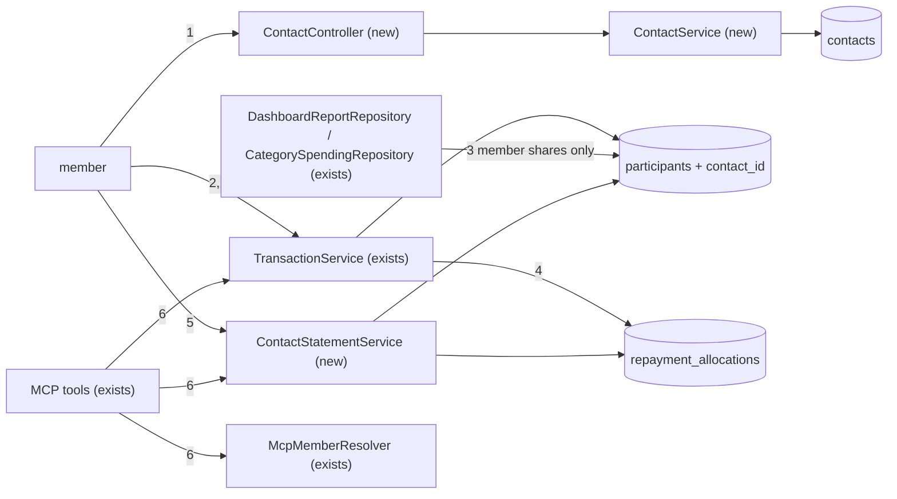
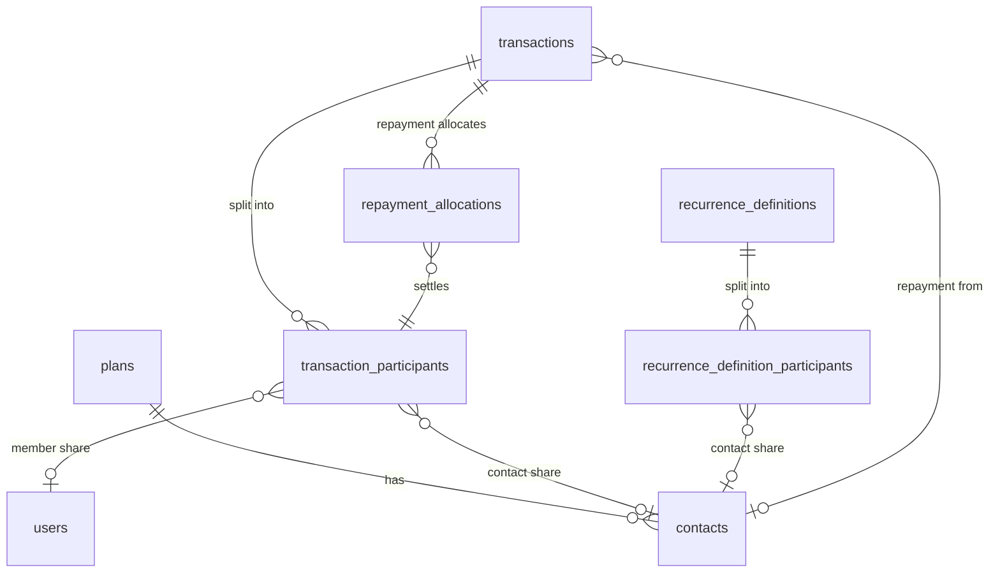
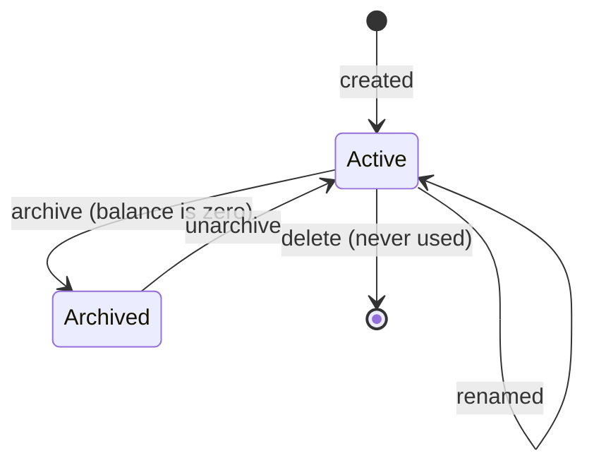

# Contacts and money to receive

**Approved**: 2026-11-25 - user: "Sim" (asked: "Aprova assim?", after the four unconfirmed defaults were named)

## Problem

A share of a transaction can go only to a plan member with an account. An external user asked for more on 2026-11-17 (DESIGN-PLAN R17). He shares a credit card with his parents, pays the bill and needs to know which purchases were theirs so he can charge them.

- Today he records his parents' purchases as his own spending, so his expenses, category totals and limits are inflated every month.
- When the parents pay him back by Pix, the Pix counts as income, so both sides of the month grow.
- He has no list of what each parent owes, so charging them means adding up the bill by hand.

The owner has the same need for smaller cases: a sister's gym plan, a friend's half of a pizza ("Reimbursements", folded into R17).

When this ships:

- A plan has contacts: people with a name and no login.
- A purchase, or one of its parts, can go to a contact.
- That part stays out of the plan's spending and adds to what the contact owes.
- A Pix from the contact is recorded as a payment that settles specific purchases.
- Each contact has a statement showing what is paid, partial, open and planned, and the balance owed.

## Shape

This reuses the existing split:
- `transaction_participants` and `recurrence_definition_participants` gain a contact as an alternative to a member, so equal and exact splits, series generation and edits work unchanged.
- A payment from a contact is a transaction with a new movement kind, `REPAYMENT`, which counts in no total, like the neutral kinds of AD-030.

The rules that change an outcome run in the backend `transaction`, `dashboard` and `category` services and repositories, which integration tests reach. They are:
- which shares count as spending;
- how a payment is allocated, by default oldest first;
- the balance;
- each share's status;
- when a contact may be archived or deleted.

The frontend reads these as data.

1. A member creates, renames, archives or deletes a contact. `ContactController` (new) → `ContactService` (new) persists `Contact` (door 1) in the `plan` feature.
2. A member saves a transaction or series whose split names a contact. `TransactionService` (exists) stores a participant with `contact_id` (door 2), through the same split resolver and series generator.
3. Every total query in `DashboardReportRepository` (exists) and `CategorySpendingRepository` (exists) sums member shares only. A contact's share counts in no income, expense, result, trend, person breakdown, category total or limit.
4. A member saves a `REPAYMENT` (door 3): a credit with one receiving member and a contact. `TransactionService` (exists) stores the allocations (door 4), which are either explicit or filled oldest first when omitted. Any excess is credit.
5. A member opens a contact's statement. `ContactStatementService` (new) reads the contact's shares, the payments and the allocations, and returns the rows grouped by month, each with its status, plus the balance.
6. The MCP. `McpMemberResolver` (exists) also resolves contact names in `attributedTo`. `create_transaction` takes `kind: REPAYMENT` with a contact name, applied oldest first. A new `list_contacts` tool returns each contact's balance.
7. Out: the Plans page gets a Contacts section and a statement page, and the transaction form gets contacts in the split and a payment form. The totals change with no new screen.

**Changes underneath**

| Front | What changes |
| --- | --- |
| domain | A participant meant "a plan member's part of the money"; it now means a member's part or a contact's part. It is read by every total query, `ItemShareAllocator`, the person breakdown, `Transaction.edit`, series regeneration, the import (one participant, the importer), the neutral rules (exactly one member participant) and the MCP responses (`attributedTo`). |
| domain | `TransactionKind` gains `REPAYMENT`. It is read by `isNeutral()`, the dashboard `neutralIn`, the neutral candidates review, the list filter `kind` and the frontend `movementKind` helpers. |
| stored data | Nothing to migrate. Existing participants keep `member_user_id`, `contact_id` is null, and the new tables start empty. |
| readers | Overview cards, trend and person breakdown, Categories totals and limits, transactions list (the contact's name shows in the attribution), transaction form, series form, Plans page, MCP `create_transaction`, `list_transactions`, `get_summary` and the new `list_contacts`. |

New: the `contacts` table, `contact_id` on both participant tables, `repayment_contact_id` on transactions, and `repayment_allocations`. One-way constraints:
- a participant has exactly one of member or contact (door 2);
- an allocation never exceeds the share it settles (door 4).

A contact share's status is derived, never stored:
- `planned` when its transaction is not actual (AD-025);
- otherwise `open` with no allocation, `partial` with allocations below the share, `paid` with allocations equal to the share.

## Surface

| Route | In | Out | Status | Who |
| --- | --- | --- | --- | --- |
| `GET /plan/{planId}/contacts` | `archived` (bool, default false) | `[{id, name, archived, owed, credit, version}]` | `200`, `404` outside the plan | any member |
| `POST /plan/{planId}/contacts` | `name` (1-60) | the contact | `201`, `422` `contact-name-taken`, `403` | OWNER, EDITOR |
| `PUT /plan/{planId}/contacts/{id}` | `name`, `version` | the contact | `200`, `422` `contact-name-taken`, `409` stale version, `404`, `403` | OWNER, EDITOR |
| `POST /plan/{planId}/contacts/{id}/archive` | - | the contact | `200`, `409` `contact-balance-not-zero`, `404`, `403` | OWNER, EDITOR |
| `POST /plan/{planId}/contacts/{id}/unarchive` | - | the contact | `200`, `404`, `403` | OWNER, EDITOR |
| `DELETE /plan/{planId}/contacts/{id}` | - | - | `204`, `409` `contact-in-use`, `404`, `403` | OWNER, EDITOR |
| `GET /plan/{planId}/contacts/{id}/statement` | - | `{contact, owed, credit, months[{month, shares[{participantId, transactionId, date, description, share, allocated, status}], repayments[{transactionId, date, amount, unallocated}]}]}` | `200`, `404` | any member |
| `POST`/`PUT /plan/{planId}/transactions` (exists), series (exists) | `participants[]` takes `contactId` as an alternative to `memberId`; `kind: REPAYMENT` with `contactId` and optional `allocations[{participantId, amount}]` | the transaction, whose participants carry `contactId` and `contactName`, plus `repayment {contactId, allocations[]}` | as today, plus `403` for a CONTRIBUTOR's contact share, `422` `contact-archived`, `contact-share-not-allowed`, `allocation-exceeds-open`, `allocation-exceeds-amount` | as today; a contact share needs OWNER or EDITOR (`canAttributeToOthers`) |

## Landing

| One-way door | Literal shape | Alternative rejected |
| --- | --- | --- |
| 1. Contact table | `contacts(id, plan_id → plans ON DELETE CASCADE, name varchar(60), archived_at timestamptz null, created_at, version)`, unique `uk_contacts_plan_name` on `(plan_id, lower(name))` where `archived_at IS NULL` | Contacts as `users` rows without a login: they would leak into auth, invitations and member lists, and need a fake email |
| 2. Participant is a member or a contact | `member_user_id` becomes nullable; `contact_id → contacts`; `ck_txn_participants_member_or_contact CHECK ((member_user_id IS NULL) <> (contact_id IS NULL))`; unique `(transaction_id, contact_id)`; the same on `recurrence_definition_participants` | A separate `contact_shares` table: every split, edit, series and allocator path would handle two lists, and Σ shares = amount would span two tables |
| 3. Repayment kind | `transactions.kind = 'REPAYMENT'`, `transactions.repayment_contact_id → contacts`, `CHECK ((kind = 'REPAYMENT') = (repayment_contact_id IS NOT NULL))`; type INCOME, exactly one member participant (who received it), no category or items | Payments as rows outside `transactions`: an imported Pix would be a second, unrelated row, and the trash, list and MCP would not see payments |
| 4. Stored allocations | `repayment_allocations(id, repayment_id → transactions ON DELETE CASCADE, participant_id → transaction_participants ON DELETE CASCADE, amount numeric(38,2) CHECK > 0)`, unique `(repayment_id, participant_id)`; a service rule holds Σ live allocations of a participant ≤ its share, under a lock on the contact row | Derived oldest-first allocation: rejected by the owner (decision 3, "Perguntar com sugestão"); the allocation is chosen and kept |
| 5. Repayment read shapes | `TransactionResponse.repayment` is `{contactId, contactName, allocations[{participantId, transactionId, amount}]}`, null on every other row, and lists the live allocations (a trashed purchase's stay stored and out of the answer); the statement's `months[].month` is `yyyy-MM` with each month's shares and payments oldest first; the MCP `create_transaction` answer for a REPAYMENT adds `repayment {contact, settled[], unallocated, owed, credit}` | `repayment {contactId, allocations[]}` only, as the Surface row says: the edit form would then need a second call for the contact's name, and the connector a third for what was settled |

- `REPAYMENT` and `contactId` are additions to the committed `backend/openapi.json` that the frontend and the MCP consume. Nothing is removed.
- Nothing else in this change is hard to reverse.

## Criteria

### S1: Contacts (P1)

A plan has contacts that members manage on the Plans page.

**Acceptance Criteria**

1. WHEN an OWNER or EDITOR uses "Novo contato" on the Plans page and saves a name THEN the system SHALL add the contact to the "Contatos" section below the members, with its balance "Em dia".
   - "Mãe" → listed; "  Mãe  " → saved as "Mãe"; an empty name → the field error, nothing saved.
2. IF the name equals, ignoring case, that of another active contact of the plan THEN the system SHALL reject it with 422 `contact-name-taken` and show "Já existe um contato com esse nome" on the field.
   - The same name as an archived contact → accepted.
   - The same name as a member → accepted; the MCP resolver refuses an ambiguous name (S6).
3. WHEN an OWNER or EDITOR renames a contact THEN the system SHALL show the new name on the contact, its statement and every transaction that has a share for it.
4. The Contacts section SHALL list the active contacts by name, each with its balance:
   - "Deve R$ X" when it owes;
   - "Crédito de R$ X" when payments exceed what it owes;
   - "Em dia" at zero.

   With no contacts it SHALL show "Nenhum contato ainda" and a line saying contacts are people outside the plan who share purchases. A CONTRIBUTOR or VIEWER SHALL see the section without the create, rename, archive or delete controls.
5. WHEN an OWNER or EDITOR archives a contact whose balance is zero THEN the system SHALL move it to "Arquivados" in the same section, remove it from the split and payment pickers, and keep its name on past transactions.
6. IF the contact's balance is not zero (owed or credit) THEN archiving SHALL be refused with 409 `contact-balance-not-zero`, and the page SHALL say "Quite o saldo antes de arquivar" with the amount.
   - Owes R$ 0.01 → refused; credit R$ 5 → refused; owes R$ 0 with planned shares only → archived.
7. WHEN an OWNER or EDITOR unarchives a contact THEN the system SHALL return it to the active list and the pickers.
   - IF another active contact has the same name THEN 422 `contact-name-taken`.
8. WHEN an OWNER or EDITOR deletes a contact that has no participant row, live or in the trash, and no repayment THEN the system SHALL remove it. IF it has any THEN 409 `contact-in-use`, and the page offers "Arquivar" instead.
9. IF a CONTRIBUTOR or VIEWER calls the create, rename, archive, unarchive or delete route THEN the system SHALL answer 403; a caller outside the plan SHALL get 404.

### S2: A contact's share is not plan spending (P1)

Splits accept contacts, and their shares leave every total.

**Acceptance Criteria**

10. WHEN an OWNER or EDITOR edits the split of an expense in the transaction form THEN the system SHALL offer the plan's active contacts after the members, in both equal and exact modes, and save the shares.
    - R$ 80 equal between "Eu" and "Mãe" → R$ 40 each.
    - R$ 100 exact, "Eu" 30 and "Mãe" 70 → as entered.
    - R$ 50 with only "Mãe" → one share of R$ 50.
    - R$ 100.01 equal between "Eu", "Livia" and "Mãe" → 33.34, 33.34 and 33.33, the existing cent rule.
11. The system SHALL count a contact's share in no income, expense, result, monthly trend, person breakdown, category total, item allocation or category limit.
    - An R$ 80 purchase in "Restaurante" split R$ 40 "Eu" and R$ 40 "Mãe" → expenses R$ 40, "Restaurante" R$ 40, its limit uses R$ 40, "Mãe" absent from the person breakdown.
    - The same purchase with R$ 20 of items in "Bebidas" → "Bebidas" R$ 10, "Restaurante" R$ 30.
12. IF a request puts a contact share on an income, on a neutral kind, on a refund or on a repayment THEN the system SHALL reject it with 422 `contact-share-not-allowed`.
13. IF a request names an archived contact or a contact of another plan THEN the system SHALL reject it with 422 `contact-archived` or 404 respectively.
14. IF a CONTRIBUTOR saves a split that includes a contact THEN the system SHALL reject it with 403, as it does today for another member. The form SHALL not offer contacts to a CONTRIBUTOR.
15. WHEN a series' split names a contact THEN each generated occurrence SHALL carry the contact's share. Changing the split SHALL follow the existing series edit scopes ("esta", "esta e as próximas", "todas"), and confirmed occurrences SHALL stay untouched (AD-025).
16. The transactions list (table and phone list) SHALL show the contact's name with the members in a row's attribution, and the transaction detail SHALL show each contact's share.

### S3: Payments from a contact (P1)

A repayment settles chosen purchases and is not income.

**Acceptance Criteria**

17. WHEN an OWNER or EDITOR uses "Registrar pagamento" on a contact's statement THEN the system SHALL open the transaction form as an income of kind "Pagamento de contato" with the contact chosen. The form asks for the amount, date and receiving member, and lists the contact's open and partial actual shares, oldest first.
18. WHEN the amount is typed THEN the form SHALL pre-select shares from the oldest, each up to its open amount, until the amount runs out. The last one may be partial. The user can tick, untick or change an amount before saving.
    - Owes R$ 200 (Oct) and R$ 300 (Nov), pays R$ 300 → Oct R$ 200, Nov R$ 100.
    - Pays R$ 600 → Oct R$ 200, Nov R$ 300, and "R$ 100 vira crédito" is shown.
    - Pays R$ 100 and ticks only Nov → Nov R$ 100, Oct untouched.
19. The same kind SHALL be choosable for any income in the form, an imported Pix included, with the same contact picker and allocation list.
20. The system SHALL count a repayment in no income, expense, result, trend or person breakdown. The dashboard SHALL report it in `neutralIn`, and the list SHALL show it with its kind badge and the contact's name.
21. IF an allocation exceeds the share's open amount THEN the system SHALL reject it with 422 `allocation-exceeds-open`. IF the allocations add up to more than the payment THEN 422 `allocation-exceeds-amount`. A payment larger than its allocations is accepted, and the rest is credit.
22. IF two payments for the same contact are saved at the same moment THEN the system SHALL never let a share's allocations exceed it: the second save is re-checked after the first commits, and rejected with 422 `allocation-exceeds-open` when it would.
23. WHEN a payment is edited THEN its allocations SHALL be replaced by the ones sent, with the same rules. WHEN it is moved to the trash THEN its allocations SHALL stop counting until it is restored.
24. WHEN a contact share is reduced below what is allocated to it, or the contact is removed from that split, or the purchase is moved to the trash THEN the allocations SHALL be cut back, newest payment first, to what still fits. The freed money becomes that contact's credit.
    - Share R$ 100 with R$ 60 from Pix A and R$ 40 from Pix B, reduced to R$ 70 → A R$ 60, B R$ 10, credit R$ 30.
    - The same share's purchase restored from the trash → allocations count again.
25. WHEN Claude records a payment through the MCP without choosing purchases THEN the system SHALL allocate it oldest first, as in criterion 18, and save it without asking.

### S4: The contact's statement (P1)

One screen answers "what does Mãe owe me, and for what".

**Acceptance Criteria**

26. WHEN a member taps a contact in the Contacts section THEN the system SHALL open its statement page, which has its own route under Plans. The page shows:
    - the balance first: "Deve R$ X", "Crédito de R$ X" or "Em dia";
    - then the months, newest first;
    - each month's shares by date, each with date, description, the contact's share and its status "Pago", "Parcial (R$ Y de R$ X)", "Em aberto" or "Previsto";
    - each month's payments, with date, amount and any unallocated part.
27. The balance SHALL equal Σ the contact's shares on actual transactions minus Σ the amounts of its live repayments. A positive balance is owed, a negative one is credit. Planned shares SHALL show in the statement and stay out of the balance and the section's figure.
    - Shares R$ 200 (actual) + R$ 120 (planned), a payment of R$ 150 → "Deve R$ 50"; the R$ 120 line is "Previsto".
    - A payment of R$ 250 → "Crédito de R$ 50".
28. WHILE a purchase or payment is in the trash it SHALL be left out of the statement and the balance until it is restored.
29. The statement SHALL be reachable by every member role. An OWNER or EDITOR also has "Registrar pagamento", "Renomear", "Arquivar" and "Excluir" there.
30. With no shares and no payments the statement SHALL say "Nada com este contato ainda". While loading it SHALL show the page skeleton, and on an error the standard error state with "Tentar de novo".
31. The Contacts section and the statement SHALL work at 390 px and 1280 px wide, with nothing clipped or overflowing, and a long month list scrolling with the page.

### S5: The MCP (P1)

Claude captures with contacts as it does with members.

**Acceptance Criteria**

32. WHEN Claude calls `create_transaction` with `attributedTo` naming a contact ("Mãe") THEN the system SHALL put that share on the contact, with the same equal-split rule used for members.
    - `["Mãe"]` → the whole amount to "Mãe".
    - `["Lucas", "Mãe"]` → split equally.
    - An unknown name → refused with the list of members and contacts.
    - A name that matches both a member and a contact → refused as ambiguous.
33. WHEN Claude calls `create_transaction` with `kind: REPAYMENT` and `contact: "Mãe"` THEN the system SHALL record a payment allocated oldest first (criterion 25). The response SHALL state what was settled and any credit.
34. The system SHALL offer a new `list_contacts` tool that returns each active contact with name, owed and credit. `list_transactions` and the transaction responses SHALL name contacts in `attributedTo`, as members are named.

## Out of scope

| Excluded | Why |
| --- | --- |
| A ready-to-send charge text or a public statement link | owner decision 4: "Só a tela" |
| A dependant contact (child, pet) whose share is plan spending | owner decision 2: "Só \"a cobrar\"" |
| Linking a contact to a member who signs up later | not asked; the sketch's "later" |
| Forgiving a debt (writing an open balance off as spending) | not chosen in decision 9; archiving requires a zero balance |
| Repayments proposed by the neutral-candidates review or by the importer | belongs to C10 import review with attribution memory (phase 3, next) |
| A contact filter on the transactions list | the statement answers "what is Mãe's"; can come with C10 |
| Money to receive on the Overview | phase 5 Overview redesign, with R7 |
| A contact share on a refund | rare; the user edits the original purchase instead |

## Assumptions

| Assumption | Chosen default | Rationale | Confirmed? |
| --- | --- | --- | --- |
| A contact's share | out of spending, adds to money to receive | owner, 2026-11-24: "Fora dos gastos (Recomendado)" | y |
| Contact kinds | only "to charge" | owner, 2026-11-24: "Só \"a cobrar\"" | y |
| Payment and purchases | the form pre-selects the oldest up to the amount, editable; stored; excess is credit; Claude applies oldest first | owner, 2026-11-24: "Quero ambos os casos", then "Perguntar com sugestão (Recomendado)" | y |
| Charging | the statement screen only | owner, 2026-11-24: "Só a tela" | y |
| Split | contacts in the existing equal or exact split | owner, 2026-11-24: "Sim, na mesma divisão (Recomendado)" | y |
| Series | splits accept contacts | owner, 2026-11-24: "Sim, como as compras (Recomendado)" | y |
| Where | a Contacts section on Plans, below members; the statement on its own page | owner, 2026-11-24: "Junto dos membros (Recomendado)" | y |
| Planned shares | outside the balance, shown as planned | owner, 2026-11-24: "Só quando realizada (Recomendado)" | y |
| Removing | archive with a zero balance only; delete when never used | owner, 2026-11-24: "Arquivar só com saldo zero (Recomendado)"; delete-when-unused approved with the plan, 2026-11-25 | y |
| Who manages and uses contacts | OWNER and EDITOR create, rename, archive, use in splits and record payments; every member sees the section and statements | follows `canAttributeToOthers`: a contact share moves money out of the plan's spending, as attributing to another member does | y - approved with the plan, 2026-11-25 |
| Credit | stays on the contact until a payment is edited to use it; there is no separate "use credit" action | editing a payment's allocation already covers it, with no new concept | y - approved with the plan, 2026-11-25 |
| Contact names | 1-60 characters, unique among active contacts, ignoring case | matches category names; uniqueness keeps pickers and the MCP unambiguous | y - approved with the plan, 2026-11-25 |
| Statement grouping | by calendar month of the transaction date | card-bill grouping needs R5, which comes later | y - approved with the plan, 2026-11-25 |

**Open questions:** none - all resolved or logged above.

## Differences from the source

None - the product matches the source

## Sources

- `.specs/project/DESIGN-PLAN.md` R17 row, design sketch and "R17 owner decisions" 1-9 (2026-11-24) - binding - the rules above
- AD-025 (actual vs forecast), AD-028 (trash), AD-029 (MCP attribution), AD-030 (movement kinds) - binding - the existing rules this extends
- [Splitwise: payments go against the balance](https://splitwise.uservoice.com/forums/162446-general/suggestions/5207736-payment-to-person-not-currently-owed-money), [QuickBooks: receive payment auto-applies to the oldest invoice](https://quickbooks.intuit.com/learn-support/en-us/help-article/accounting-bookkeeping/resolve-common-issues-applying-payment-towards/L2UMXN8tt_US_en_US), [Splitwise: no removal with a non-zero balance](https://splitwise.uservoice.com/knowledgebase/articles/386282-why-can-t-i-remove-a-group-member-with-a-non-zero) - non-binding - prior art shown to the owner for decisions 3 and 9
