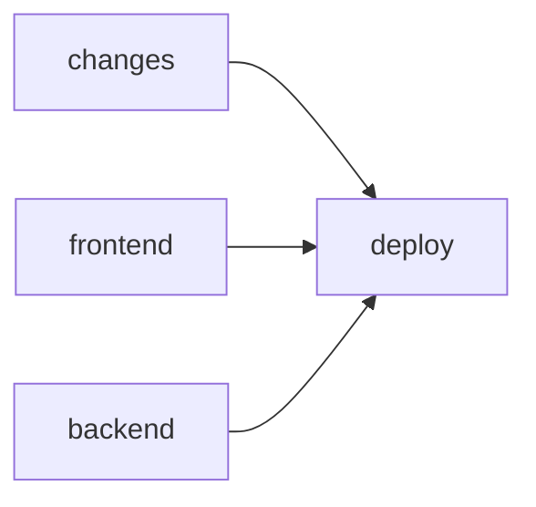

# Frontend Standards Design

**Spec**: `.specs/features/frontend-standards/spec.md`
**Context**: `.specs/features/frontend-standards/context.md` (locked decisions)
**Status**: Draft (decisions recorded one at a time with the user)

---

## Architecture Overview

`context.md` already fixes the architecture: where code lives, what gets extracted, which gates exist. This design settles the open "how" decisions, in slice order:

1. `eslint.config.js` composition (STD-02; base for STD-05/06/08/09/12) — **decided**
2. CI and deploy layout, husky hooks (STD-03) — **decided**
3. MSW setup and the session-refresh test (STD-04) — **decided**
4. Where the home filter state lands when `features/home` is removed (STD-05) — **decided**
5. `CurrencyInput` contract and the form binding standard (STD-06, STD-07) — **decided**
6. Locale/currency source of `formatMoney` (STD-06) — **decided**
7. `Heading`/`Text` variant set (STD-08) — **decided**
8. Story and test gate scripts (STD-10/11) — **decided**
9. Local lint rule shape: logic cap + IIFE ban (STD-12)
10. OpenAPI generator (STD-13)

---

## Design Decisions

### 1. `eslint.config.js` composes layered restrictions from named fragments, guarded by a config test

**Problem.** The folder layers overlap (`components/**/base/**` ⊂ `components/**` ⊂ outside `app/`) and all use the same two built-in rules, `no-restricted-imports` and `no-restricted-syntax`. In flat config, when two blocks match a file and set the same rule, the later block's options **replace** the earlier ones. Verified on ESLint 9.39.5: a palette ban on `components/**` followed by a typography ban on `base/**` leaves `base/` files with no palette ban, and lint stays green.

**Decision.**

- The top of `eslint.config.js` declares named fragments: `paletteSelectors`, `typographySelectors`, `rawTextTagSelectors` (for `no-restricted-syntax`) and `appInternalsImports`, `crossFeatureImports`, `appAnyImports`, `apiImports` (for `no-restricted-imports`).
- Each layer block spreads the **complete** list for its layer, so the layer table below reads directly in the code:

| Glob | `no-restricted-imports` | `no-restricted-syntax` |
| --- | --- | --- |
| `src/**` except `src/app/**` | all of `@/app/*` except `providers/*` and `routing/paths` (C6 wording; covers `app/home`, see decision 4) | palette + typography + raw `<p>`/`<hN>` |
| `src/app/**` | — | palette + typography + raw `<p>`/`<hN>` |
| `src/features/**` | the above + `@/features/*` | same |
| `src/components/**` | the above + `@/features/*` | same |
| `src/components/**/base/**` | the above + `@/api/*`, all of `@/app/*` | **palette only** |

- A config test calls `ESLint#calculateConfigForFile` on one representative path per layer and asserts every expected fragment is active. A forgotten fragment becomes a red test instead of a silent gap.
- `tseslint.config()` (deprecated in typescript-eslint 8.65) is replaced by ESLint's `defineConfig()`.

**Rejected.**

- One local rule per concern (`local/token-colors`, …): unique names cannot collide, but it adds ~3 owned rules and reopens the "built-in rules, no plugin" decision (E4a, E4b, `base/`) for a problem a test already solves.
- `import/no-restricted-paths` (`eslint-plugin-import`, installed but unused): one block avoids collisions for imports, but resolving `@/` needs `eslint-import-resolver-typescript` (a new dependency), and it does nothing for `no-restricted-syntax`.

**Residual cost.** A new layer must spread its parents' fragments; the test catches the omission only if the layer gets a test case (rule written in the skill). Relative cross-feature imports (`../../plans/x`) escape `no-restricted-imports`, which sees the string, not the resolved path; review and the Verifier cover them, and cross-folder imports use `@/` by convention.

**Reversibility.** Full: one config file, no application code involved.

### 2. One `ci.yml` workflow; deploy gated by CI, a change filter and a head guard

**Problem.** The spec needs CI on every push (STD-03 AC 1), deploy only after both CI jobs pass (AC 2/3), and no deploy for docs-only pushes to `main` (AC 4). The Portainer `git/redeploy` call builds whatever `refs/heads/main` is **when called**, not the tested commit: if B is pushed while A's CI runs, A's deploy ships B before B's CI ends.

**Decision.** `.github/workflows/ci.yml` replaces `deploy.yml`, triggered on `push` (all branches) and `workflow_dispatch`, with four jobs:



- `changes`: a ~10-line shell step runs `git diff --name-only <before>..<sha>` and outputs `deployable=true` when any path falls outside `.specs/`, `.claude/` and `*.md`. `workflow_dispatch`, a zeroed `before` (first push) or a `before` that is not an ancestor (force push) count as deployable: CI has passed, so deploying is the safe default.
- `frontend`: pnpm via corepack (the root `package.json` gains `"packageManager": "pnpm@11.1.2"`, the same version as `frontend/Dockerfile`), Playwright browser cache, then lint, build (`tsc`), the Vitest projects and the gate scripts configured at the time.
- `backend`: Temurin Java 17, `./mvnw test` (surefire; `*IT` stay in failsafe until the Docker DB exists).
- `deploy`: `needs: [changes, frontend, backend]`, runs only on a push to `main` with `deployable == 'true'`, under a `concurrency` group (one deploy at a time). A **head guard** first checks with `git ls-remote` that `github.sha` is still the tip of `main`; if not, it exits without deploying and the newer commit's pipeline decides. The Portainer call is unchanged.
- The filter moves from `paths-ignore` into `changes` because GitHub path filters apply per workflow, not per job; at workflow level they would skip CI on docs-only pushes, against AC 1.

Local hooks live in `frontend/.husky/` (where `prepare` points): `pre-commit` runs `lint-staged` (ESLint on staged frontend files), `commit-msg` runs `python3 .claude/skills/tlc-spec-driven/scripts/check_commit.py`.

**Rejected.**

- Separate deploy workflow on `workflow_run`: no path filters on `workflow_run`, runs in the default-branch context, and every push shows as two runs.
- Reusable workflow (`deploy.yml` calling `ci.yml` via `workflow_call`): a docs-only push to `main` runs nothing (against AC 1) unless triggers are juggled across two files.
- `dorny/paths-filter`: a third-party action with repository access to replace ~10 lines of shell.

**Residual cost.**

- A seconds-wide race remains between the head guard and Portainer pulling `main`. Closing it requires Portainer to build a specific SHA; whether `RepositoryReferenceName` accepts one is **unverified** (no documentation found).
- If A passes but is skipped because B is the tip, and B fails, production stays on the previous release until a fix lands (fix forward). Intended; written in the skill.
- The `changes` script is code we own.

**Reversibility.** High: workflow files only.

---

### 3. MSW responses are always explicit, built from typed handler factories

**Problem.** Integration tests render real screens that fire several requests (`/users/me`, plans, categories, transactions). Where those responses come from decides whether a test shows what it depends on, and whether a mutant that changes a request fails loudly. Today the service-hook tests `vi.mock` `findracoApi` and assert call arguments; `findracoApi.test.ts` crosses the interceptors through a hand-written axios adapter that skips XHR, `withCredentials` and serialisation.

**Decision.**

- **No global handlers.** Each test calls `server.use(...)` with what it needs.
- **Handler factories per endpoint**, next to the service hook they mirror (`src/api/services/dashboard.handlers.ts` exporting e.g. `dashboardHandlers.trend(trend)`), typed with the DTOs (with the generated types after STD-13).
- **Named scenarios** group factories for screens (`signedInMember({ role: "VIEWER" })`). A scenario groups, it never hides: its parameters name what the test relies on (rule written in `frontend-testing`).
- **An unhandled request fails the test.** MSW's `onUnhandledRequest: "error"` only logs and fails the request, so code that swallows the error still passes. The `unit` setup records every unhandled request in the callback and throws in `afterEach` (STD-04 AC 3).
- **Context without `vi.mock`.** After C3 the context object is exported from `useXxx.ts`, so `renderWithProviders` renders `<PlanContext.Provider value={…}>` with explicit values instead of mocking the provider module.
- **`findracoApi.test.ts` migrates to MSW** (one mechanism, real XHR); the held-refresh concurrency cases use a deferred promise inside the handler. It carries the 401 → refresh → retry test (STD-04 AC 4).
- **Location.** `src/test/` holds the infrastructure (`server.ts`, the `unit` setup file, `renderWithProviders`, scenarios). `*.handlers.ts` sit beside their service and are exempt from the sibling-test gate (decision 8): no logic, exercised by every test that uses them.

**Rejected.** A global "happy path" handler set overridden per test: shorter tests, but a test can pass on a default it does not know about (a VIEWER test passing on an OWNER fixture), fixture edits ripple into unrelated tests, and the unhandled-request rule loses its value.

**Residual cost.** Screen tests start more verbose; scenarios absorb most of it. Handler files are code to maintain.

**Reversibility.** Medium: switching models later rewrites every flow test's setup, hence deciding before the first one.

---

### 4. Home filter state is split by owner; the page, gate and storage move to `src/app/home/`

**Problem.** STD-05 AC 1 removes `features/home`, and STD-05 runs before mobile-navigation, so the filter state needs its final home now (C4 and C9 had deferred it to mobile-navigation's Design). Today one module, `homeFilterParams.ts`, and one hook, `useHomeFilters`, hold the tab and plan params, the Overview params (`period`, `periodFrom/To`, `overviewMember`, `Period`, `resolvePeriodDates`) and the Transactions params (`type`, `category`, `q`, `sort`, `size`, …). Overview and Transactions share no filter; Categories reads none.

**Decision.**

| Piece | Destination |
| --- | --- |
| Overview params + `useOverviewFilters` | `features/overview/filters/` |
| Transactions params + `useTransactionFilters` | `features/transactions/filters/` |
| `HomePage` (tab composition), `HomeFiltersGate`, tab and plan params + `useHomeTab`, `filterStorage` | `src/app/home/` (they know all three features; only `app/` may import features; storage lives with the state it persists, C9) |
| `withParams` and the "update this key group" mechanics | `src/hooks/useSearchParamGroup.ts` (generic, used by two features) |

- Behaviour is unchanged: tab switches push history, filter updates replace, the gate saves and restores the whole query string per (user, plan). The gate builds its key list from the lists each feature exports.
- Mobile-navigation later moves only the tab row from `app/home/` to `app/layout/`; the filter state is already final.
- Decision 1's import rule for code outside `app/` becomes C6's literal wording ("all of `@/app/*` except `providers/*` and `routing/paths`"), which covers `app/home` and any future `app/` folder. It tightens STD-05 AC 8, which names only `layout` and `routing`.

**Rejected.**

- Keep it together at the root (`src/hooks/useHomeFilters.ts`, `src/utils/homeFilterParams.ts`): smallest move, but a root module would know two features' private filters, couple them through a file that represents nothing shared, and leave `filterStorage` without an obvious home.
- Interim location now, final in mobile-navigation: two moves; its spec keeps the URL model and persistence (NAV-01 AC 5), so nothing would change the destination.

**Residual cost.** Three hooks instead of one. The gate depends on each feature's exported key list; a param missing from its list would not count as a home param, so `HomeFiltersGate.test.tsx` gains a case built from the exported lists.

**Reversibility.** High: file moves with no behaviour change.

---

### 5. `CurrencyInput` is controlled and numeric; every form field binds through `Controller` via `FormField`

**Problem.** `maskCurrency` is used in 7 places: five inside react-hook-form (amount, items, participant shares, category limit, member limits) and two on plain `useState` (filter min/max, inline table edit). The masked string sits in form state and is undone by hand more than 10 times (`replace(/\D/g, "")` + `parseInt / 100`). With `register`, the DOM is the source of truth: `reset({ amount: 12.34 })` writes `"12.34"` into the input, so defaults must already be masked strings, and the mask leaks into mappers and state. That rules out `register` for any input whose displayed value differs from the form value. Forms also use a third pattern, `watch()` + `setValue()` (50 calls in `TransactionFormDrawer`, taught by `form-creation`), which re-renders the whole form on every change, never fires blur/touched, cannot receive focus-on-error (no `ref`) and validates only when `{ shouldValidate: true }` is remembered.

**Decision.**

- **`CurrencyInput`** (`src/components/input/CurrencyInput.tsx`, a composition over `Input`): `value: number | null`, `onValueChange(value: number | null)`, other props passed to `Input`. Empty is `null`, never `0` ("no limit" ≠ "limit R$ 0,00"; empty filter min = no filter). Required/minimum rules live in the zod schema. Display is always `formatMoney(cents / 100)`. Input is handled in `onChange` (strip non-digits, reformat), not `keydown` (Android virtual keyboards send `keyCode 229`); pasting "R$ 12,34" yields 12.34; caret stays at the end; `inputMode="numeric"`; at most 15 digits so cents stay a safe integer.
- **Money arithmetic goes through cents** (`toCents(value)` in the money module, tested). Forms hold reais as `number`; a float comparison such as "items ≤ total" can be off by 0.00000001.
- **Every form field binds through `Controller`**, written via a thin **`FormField`** (`src/components/form/FormField.tsx`, with a story) that wraps `Controller` + `Field` + `FieldLabel` + `FieldDescription` + `FieldError`, and hands a render prop a `field` already carrying `id`, `ref`, `onBlur` and `aria-invalid`:

```tsx
<FormField control={control} name="amount" label="Amount">
  {(field) => <CurrencyInput {...field} onValueChange={field.onChange} />}
</FormField>
```

- `FormField` keeps to `label`, `description` and the render prop. Special layouts (horizontal, hidden label) use a raw `Controller`, which stays allowed. Label/`id` wiring, `aria-invalid` and `FieldError errors={[…]}` (E3) hold by construction.
- **Reading another field** inside a form uses `useWatch({ control, name })` in the section that needs it, never `watch()` at the form root.
- **Mappers stay at the boundary** (`toFormValues` from the API, `toPayload` to the API, in `transactionForm.ts` / `categoryForm.ts`) and convert shape and type only (nested → flat, ISO date → `Date`, `undefined` → `null`), never display formatting.
- The 20 current `register` calls migrate in the slices that already touch those files (auth in STD-05/06, plans in STD-06, forms in STD-07). `FormField` is a design addition within STD-07 and the `form-creation` rewrite (STD-01); it changes no behaviour. The user wants to iterate on the form field components later.

**Rejected.**

- Integer cents in form state: removes float error at the root, but contradicts STD-06 AC 4 and adds a third representation next to the API's and the display's reais.
- `CurrencyInput` bound to react-hook-form (`control` + `name`): the filter and inline edit do not use a form.
- Hybrid binding (`register` for native text inputs, `Controller` for the rest): one line per text field and no re-render while typing, but two patterns and a per-field judgement call in a repo where agents write most commits. The per-keystroke re-render is limited to the one `Controller` and is imperceptible at 10–20 fields. `register` is not legacy (react-hook-form still recommends it for native inputs); `Controller` is the norm with controlled component libraries such as Base UI, and the current shadcn form docs use it for every field.

**Residual cost.** `FormField` is one more owned component and may attract per-case props (same watch as `FormSheet`). `onValueChange={field.onChange}` stays visible for Base UI-style inputs rather than renaming our props against Base UI's convention.

**Reversibility.** `CurrencyInput` contract: medium (7 consumers, mechanical, guarded by form and mapper tests). Binding style: high, per field; both styles coexist in one form.

---

### 6. Money formatting reads one static module

**Problem.** B6 asks for one locale/currency source. Today there are 21 formatting sites: `formatCurrency(value, "BRL")` repeated, three local `money` shortcuts, a hand-built compact `Intl.NumberFormat("pt-BR")` in the trend chart, a locale-less `toLocaleString()` in `Chart`, and the 11-entry currency → locale table in `maskCurrency`. The backend has no currency field.

**Decision.** `src/utils/money.ts` holds `MONEY_LOCALE = "pt-BR"` and `MONEY_CURRENCY = "BRL"` and exports `formatMoney(value)`, `formatMoney(value, { compact: true })` (chart axis) and `toCents(value)`. `Amount` and `CurrencyInput` use it; the currency table and the `money` shortcuts go away. Screens call `Amount`, `CurrencyInput` or `formatMoney`, never `Intl`, a locale or a currency.

**Rejected.**

- Locale context + `useMoneyFormat()` now: invents a mechanism the i18n library (M5-10) will replace for dates, copy and plurals too, and would make `Amount` a container under F1 unless an "ambient provider" category is defined, which belongs to the i18n design.
- Currency as a parameter at every call: repeats `"BRL"` at every site (today's problem) for data the backend does not have yet.

**Residual cost.** The source is static. `toCents` assumes 2 fraction digits. Multi-currency (the user foresees transactions in more than one currency, e.g. a foreign account) will make currency per-value data and give `formatMoney` a currency argument; deliberately not designed now (user, 2026-10-17).

**Reversibility.** High: one module plus the few direct call sites.

---

### 7. `Heading` and `Text` share one seven-step type scale; variants carry the role's tone

**Problem.** Outside `base/`, 236 size/weight/colour class uses form 14 distinct looks. Many roles share a look (page titles, the wordmark and metric figures are all 2xl–3xl bold; group and column headers are identical), and the three figure sizes exist only in the mobile summary layout (desktop cards are all `text-2xl`). `SectionHeader` uses `text-md`, which Tailwind does not define, so it renders inherited 16px.

**Decision.**

- One `cva` scale, `typographyVariants`, in `typography/base/`, shared by `Heading` (tag from `level`) and `Text` (tag from `as`, default `span`, since a `p` default breaks HTML inside buttons, labels and other paragraphs). The names are hierarchy levels in the style of the Material 3 type scale, not screens.
- Variants carry the tone their role implies (`secondary`, `caption` are muted); colour stays overridable through token classes (E4a).
- `tabular-nums` is neither size nor weight, so it stays allowed in `className` (and `Amount` embeds it); figures need no variant of their own.

| # | Variant | Classes | Used for |
| --- | --- | --- | --- |
| 1 | `display` | the decorative 404 numeral (`text-[10rem]`, responsive) | 404 |
| 2 | `headline` | `text-2xl font-bold` | page titles (auth, 404, `PageHeader`), wordmark, metric figures |
| 3 | `title` | `text-base font-semibold` | section titles (`SectionHeader`), compact figures, `PeriodNavigator` label |
| 4 | `label` | `text-sm font-medium` | row titles, option labels |
| 5 | `body` | `text-sm` | default text |
| 6 | `secondary` | `text-sm text-muted-foreground` | descriptions, metric labels |
| 7 | `caption` | `text-xs text-muted-foreground` | metadata, subtitles, group and column headers |

- `typographyVariants` is exported for non-HTML targets: the trend chart's SVG `<text>` tick uses `className={typographyVariants({ variant: "label" })}`, which passes the literal-string lint legitimately.
- The E4b regex also catches arbitrary sizes (`text-[10rem]`) and undefined size classes (`text-md`); `display` lives in `base/`, so the 404 numeral's arbitrary size stays inside the system.
- `Sheet`/`Dialog` titles keep their own styles as `base/` primitives (E4b).

**Accepted visual changes** (spec amended 2026-10-17: STD-08 AC 1, the behaviour-preservation assumption, the STD-08 independent test):

| Where | Before | After |
| --- | --- | --- |
| 404 title | 30px bold | 24px bold |
| Auth wordmark | 30px bold, `tracking-tight` | 24px bold, normal tracking |
| Mobile Balance | 30px bold | 24px bold (still above Income/Expenses) |
| Mobile Income/Expenses | 18px bold | 16px semibold |
| `PeriodNavigator` label, mobile | 14px semibold | 16px semibold (desktop unchanged) |
| Metric labels | muted, `font-medium` | muted, normal weight |
| Mobile day header, category column header | xs muted, `font-medium` | xs muted, normal weight |

The user judges typography by seeing it and will adjust after the slice if needed (2026-10-17); a case that fits no step gets a new role variant, never an exception.

**Rejected.**

- 14 variants reproducing every current look: no visual change, but three one-off variants and several duplicate looks under different names.
- Size/weight-only variants with tone in `className`: the ~40 muted uses would keep repeating the colour by hand.

**Residual cost.** The visual changes above; the mobile Balance and compact figures are the most noticeable.

**Reversibility.** High: one `cva` holds the scale, and the lint keeps every use inside it.

---

### 8. Gate scripts classify by content: a module needs a test when it holds a decision point

**Problem.** STD-11 requires a sibling test for every logic `.ts` module and every hook with logic, exempting DTO, type-only and constant-only modules; STD-10 requires a sibling story for every `.tsx` that does not directly import `@/api/services`, `@/app/providers` or `react-router-dom`. The story side is mechanical (read the imports). The test side needs a definition of "logic". Today 22 `.ts` modules lack a test: nine DTO/type modules, two constant modules (`paths.ts`, `planLabels.ts`) and executable ones (`useDebounce`, `buildPagedQuery`, `resolveErrorMessage`, `resolveSuccessMessage`, `cols.ts`, `masks.ts`, `mergeClasses`, `SessionExpiredError`).

**Decision.**

- `frontend/scripts/check-siblings.ts` reads each module's AST with the installed `typescript` compiler and prints two reports (missing tests, missing stories), each naming the files; any entry fails the run.
- **A `.ts` module is logic, and needs a sibling `.test.ts`, when it contains at least one of:** a decision point (`if`, ternary, `switch`, `&&`/`||`/`??` used as a value, a loop, `try`/`catch`); arithmetic on non-literal operands; an iteration callback (`map`, `filter`, `reduce`, `forEach`, …). This operationalises the C1 triggers, the project's own definition of logic, and matches the spec's "logic module" / "hook with logic" wording. Classification is by content, never by name, so no rename escapes it.
- Applied today: `buildPagedQuery`, `cols.ts`, `masks.ts`, `resolveErrorMessage`, `resolveSuccessMessage` need tests; `cn`, `SessionExpiredError`, DTOs, types, constants and `useDebounce` are exempt.
- **`*.handlers.ts` (decision 3) are test support,** exempt by suffix. To keep the suffix from becoming a hiding place, `no-restricted-imports` forbids non-test files from importing `*.handlers` or `@/test/*` (a fragment in decision 1's composition).
- **Story gate scope:** every `.tsx` under `src/` except `src/index.tsx`, `src/test/**`, tests and stories.
- **Scripts are TypeScript**, run natively by Node 24 (type stripping; local, `Dockerfile` and CI all run Node 24) and covered by lint and `tsc` (`tsconfig.node.json` includes `scripts/`). `npm test` becomes `node scripts/check-siblings.ts && vitest run --coverage`.
- **Coverage is independent of this classification:** Vitest covers `src/**/*.ts` excluding tests, `*.handlers.ts`, `src/test/**` and `.d.ts`, with a 90% branch threshold. Type-only files emit no code and constant files have no branches, so neither distorts the number.

**Rejected.**

- "Any function, class or call is logic": classifies by content too, but forces tests on code with no decision (`cn` tests `tailwind-merge`, `SessionExpiredError` tests the language). Such tests cannot fail on our defects and turn testing into a ritual (over-testing).
- Exemption by path or name (`api/dtos/**`, `*.constants.ts`): a constants file that grows a function stays exempt; a bypass through naming.
- An explicit exemption list: the per-file exception D4 forbids.

**Residual cost.** A branchless function that matters (a pure mapper alone in a module) escapes the gate; form mappers have tests required by STD-07 AC 1, and integration tests plus the Verifier's mutants cover the rest. `useDebounce` (time semantics, no branch) is exempt and exercised through `useTransactionSearch` (D3). A `const` initialised by a call is classified by its content like anything else. The script (~60 lines) is code we own, with its own test per decision-point kind.

**Reversibility.** High: the criterion lives in one script.

---

## Risks & Concerns

| Concern | Location (file:line) | Impact | Mitigation |
| ------- | -------------------- | ------ | ---------- |
| Same-rule options replace across flat-config blocks | `frontend/eslint.config.js` | A layer silently loses a restriction; lint stays green | Decision 1: named fragments + `calculateConfigForFile` test |
| Unused lint devDependencies: `eslint-plugin-import`, `eslint-plugin-check-file`, `eslint-plugin-prettier`, `eslint-config-prettier` | `frontend/package.json` | Dead dependencies suggest rules that do not run | Remove in STD-02 |
| Portainer redeploys `refs/heads/main` at call time, not the tested SHA | `.github/workflows/deploy.yml` | An untested newer commit can ship after an older commit's CI passes | Decision 2: `concurrency` + head guard; seconds-wide residual window |
