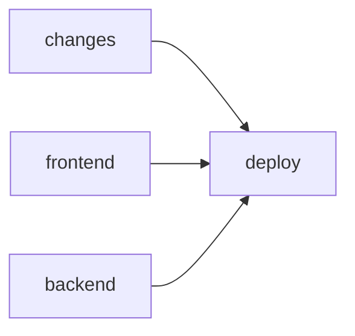

# Frontend Standards Design

**Spec**: `.specs/features/frontend-standards/spec.md`
**Context**: `.specs/features/frontend-standards/context.md` (locked decisions)
**Status**: Draft (decisions recorded one at a time with the user)

---

## Architecture Overview

`context.md` already fixes the architecture: where code lives, what gets extracted, which gates exist. This design settles the open "how" decisions, in slice order:

1. `eslint.config.js` composition (STD-02; base for STD-05/06/08/09/12) — **decided**
2. CI and deploy layout, husky hooks (STD-03) — **decided**
3. MSW setup and the session-refresh test (STD-04) — **decided**
4. Where the home filter state lands when `features/home` is removed (STD-05) — **decided**
5. `CurrencyInput` API and the locale/currency source of `formatMoney` (STD-06)
6. `Heading`/`Text` variant set (STD-08)
7. Story and test gate scripts (STD-10/11)
8. Local lint rule shape: logic cap + IIFE ban (STD-12)
9. OpenAPI generator (STD-13)

---

## Design Decisions

### 1. `eslint.config.js` composes layered restrictions from named fragments, guarded by a config test

**Problem.** The folder layers overlap (`components/**/base/**` ⊂ `components/**` ⊂ outside `app/`) and all use the same two built-in rules, `no-restricted-imports` and `no-restricted-syntax`. In flat config, when two blocks match a file and set the same rule, the later block's options **replace** the earlier ones. Verified on ESLint 9.39.5: a palette ban on `components/**` followed by a typography ban on `base/**` leaves `base/` files with no palette ban, and lint stays green.

**Decision.**

- The top of `eslint.config.js` declares named fragments: `paletteSelectors`, `typographySelectors`, `rawTextTagSelectors` (for `no-restricted-syntax`) and `appInternalsImports`, `crossFeatureImports`, `appAnyImports`, `apiImports` (for `no-restricted-imports`).
- Each layer block spreads the **complete** list for its layer, so the layer table below reads directly in the code:

| Glob | `no-restricted-imports` | `no-restricted-syntax` |
| --- | --- | --- |
| `src/**` except `src/app/**` | all of `@/app/*` except `providers/*` and `routing/paths` (C6 wording; covers `app/home`, see decision 4) | palette + typography + raw `
`/`<hN>` |
| `src/app/**` | — | palette + typography + raw `
`/`<hN>` |
| `src/features/**` | the above + `@/features/*` | same |
| `src/components/**` | the above + `@/features/*` | same |
| `src/components/**/base/**` | the above + `@/api/*`, all of `@/app/*` | **palette only** |

- A config test calls `ESLint#calculateConfigForFile` on one representative path per layer and asserts every expected fragment is active. A forgotten fragment becomes a red test instead of a silent gap.
- `tseslint.config()` (deprecated in typescript-eslint 8.65) is replaced by ESLint's `defineConfig()`.

**Rejected.**

- One local rule per concern (`local/token-colors`, …): unique names cannot collide, but it adds ~3 owned rules and reopens the "built-in rules, no plugin" decision (E4a, E4b, `base/`) for a problem a test already solves.
- `import/no-restricted-paths` (`eslint-plugin-import`, installed but unused): one block avoids collisions for imports, but resolving `@/` needs `eslint-import-resolver-typescript` (a new dependency), and it does nothing for `no-restricted-syntax`.

**Residual cost.** A new layer must spread its parents' fragments; the test catches the omission only if the layer gets a test case (rule written in the skill). Relative cross-feature imports (`../../plans/x`) escape `no-restricted-imports`, which sees the string, not the resolved path; review and the Verifier cover them, and cross-folder imports use `@/` by convention.

**Reversibility.** Full: one config file, no application code involved.

### 2. One `ci.yml` workflow; deploy gated by CI, a change filter and a head guard

**Problem.** The spec needs CI on every push (STD-03 AC 1), deploy only after both CI jobs pass (AC 2/3), and no deploy for docs-only pushes to `main` (AC 4). The Portainer `git/redeploy` call builds whatever `refs/heads/main` is **when called**, not the tested commit: if B is pushed while A's CI runs, A's deploy ships B before B's CI ends.

**Decision.** `.github/workflows/ci.yml` replaces `deploy.yml`, triggered on `push` (all branches) and `workflow_dispatch`, with four jobs:

- `changes`: a ~10-line shell step runs `git diff --name-only <before>..<sha>` and outputs `deployable=true` when any path falls outside `.specs/`, `.claude/` and `*.md`. `workflow_dispatch`, a zeroed `before` (first push) or a `before` that is not an ancestor (force push) count as deployable: CI has passed, so deploying is the safe default.
- `frontend`: pnpm via corepack (the root `package.json` gains `"packageManager": "pnpm@11.1.2"`, the same version as `frontend/Dockerfile`), Playwright browser cache, then lint, build (`tsc`), the Vitest projects and the gate scripts configured at the time.
- `backend`: Temurin Java 17, `./mvnw test` (surefire; `*IT` stay in failsafe until the Docker DB exists).
- `deploy`: `needs: [changes, frontend, backend]`, runs only on a push to `main` with `deployable == 'true'`, under a `concurrency` group (one deploy at a time). A **head guard** first checks with `git ls-remote` that `github.sha` is still the tip of `main`; if not, it exits without deploying and the newer commit's pipeline decides. The Portainer call is unchanged.
- The filter moves from `paths-ignore` into `changes` because GitHub path filters apply per workflow, not per job; at workflow level they would skip CI on docs-only pushes, against AC 1.

Local hooks live in `frontend/.husky/` (where `prepare` points): `pre-commit` runs `lint-staged` (ESLint on staged frontend files), `commit-msg` runs `python3 .claude/skills/tlc-spec-driven/scripts/check_commit.py`.

**Rejected.**

- Separate deploy workflow on `workflow_run`: no path filters on `workflow_run`, runs in the default-branch context, and every push shows as two runs.
- Reusable workflow (`deploy.yml` calling `ci.yml` via `workflow_call`): a docs-only push to `main` runs nothing (against AC 1) unless triggers are juggled across two files.
- `dorny/paths-filter`: a third-party action with repository access to replace ~10 lines of shell.

**Residual cost.**

- A seconds-wide race remains between the head guard and Portainer pulling `main`. Closing it requires Portainer to build a specific SHA; whether `RepositoryReferenceName` accepts one is **unverified** (no documentation found).
- If A passes but is skipped because B is the tip, and B fails, production stays on the previous release until a fix lands (fix forward). Intended; written in the skill.
- The `changes` script is code we own.

**Reversibility.** High: workflow files only.

---

### 3. MSW responses are always explicit, built from typed handler factories

**Problem.** Integration tests render real screens that fire several requests (`/users/me`, plans, categories, transactions). Where those responses come from decides whether a test shows what it depends on, and whether a mutant that changes a request fails loudly. Today the service-hook tests `vi.mock` `findracoApi` and assert call arguments; `findracoApi.test.ts` crosses the interceptors through a hand-written axios adapter that skips XHR, `withCredentials` and serialisation.

**Decision.**

- **No global handlers.** Each test calls `server.use(...)` with what it needs.
- **Handler factories per endpoint**, next to the service hook they mirror (`src/api/services/dashboard.handlers.ts` exporting e.g. `dashboardHandlers.trend(trend)`), typed with the DTOs (with the generated types after STD-13).
- **Named scenarios** group factories for screens (`signedInMember({ role: "VIEWER" })`). A scenario groups, it never hides: its parameters name what the test relies on (rule written in `frontend-testing`).
- **An unhandled request fails the test.** MSW's `onUnhandledRequest: "error"` only logs and fails the request, so code that swallows the error still passes. The `unit` setup records every unhandled request in the callback and throws in `afterEach` (STD-04 AC 3).
- **Context without `vi.mock`.** After C3 the context object is exported from `useXxx.ts`, so `renderWithProviders` renders `<PlanContext.Provider value={…}>` with explicit values instead of mocking the provider module.
- **`findracoApi.test.ts` migrates to MSW** (one mechanism, real XHR); the held-refresh concurrency cases use a deferred promise inside the handler. It carries the 401 → refresh → retry test (STD-04 AC 4).
- **Location.** `src/test/` holds the infrastructure (`server.ts`, the `unit` setup file, `renderWithProviders`, scenarios). `*.handlers.ts` sit beside their service and are exempt from the sibling-test gate (decision 7): no logic, exercised by every test that uses them.

**Rejected.** A global "happy path" handler set overridden per test: shorter tests, but a test can pass on a default it does not know about (a VIEWER test passing on an OWNER fixture), fixture edits ripple into unrelated tests, and the unhandled-request rule loses its value.

**Residual cost.** Screen tests start more verbose; scenarios absorb most of it. Handler files are code to maintain.

**Reversibility.** Medium: switching models later rewrites every flow test's setup, hence deciding before the first one.

---

### 4. Home filter state is split by owner; the page, gate and storage move to `src/app/home/`

**Problem.** STD-05 AC 1 removes `features/home`, and STD-05 runs before mobile-navigation, so the filter state needs its final home now (C4 and C9 had deferred it to mobile-navigation's Design). Today one module, `homeFilterParams.ts`, and one hook, `useHomeFilters`, hold the tab and plan params, the Overview params (`period`, `periodFrom/To`, `overviewMember`, `Period`, `resolvePeriodDates`) and the Transactions params (`type`, `category`, `q`, `sort`, `size`, …). Overview and Transactions share no filter; Categories reads none.

**Decision.**

| Piece | Destination |
| --- | --- |
| Overview params + `useOverviewFilters` | `features/overview/filters/` |
| Transactions params + `useTransactionFilters` | `features/transactions/filters/` |
| `HomePage` (tab composition), `HomeFiltersGate`, tab and plan params + `useHomeTab`, `filterStorage` | `src/app/home/` (they know all three features; only `app/` may import features; storage lives with the state it persists, C9) |
| `withParams` and the "update this key group" mechanics | `src/hooks/useSearchParamGroup.ts` (generic, used by two features) |

- Behaviour is unchanged: tab switches push history, filter updates replace, the gate saves and restores the whole query string per (user, plan). The gate builds its key list from the lists each feature exports.
- Mobile-navigation later moves only the tab row from `app/home/` to `app/layout/`; the filter state is already final.
- Decision 1's import rule for code outside `app/` becomes C6's literal wording ("all of `@/app/*` except `providers/*` and `routing/paths`"), which covers `app/home` and any future `app/` folder. It tightens STD-05 AC 8, which names only `layout` and `routing`.

**Rejected.**

- Keep it together at the root (`src/hooks/useHomeFilters.ts`, `src/utils/homeFilterParams.ts`): smallest move, but a root module would know two features' private filters, couple them through a file that represents nothing shared, and leave `filterStorage` without an obvious home.
- Interim location now, final in mobile-navigation: two moves; its spec keeps the URL model and persistence (NAV-01 AC 5), so nothing would change the destination.

**Residual cost.** Three hooks instead of one. The gate depends on each feature's exported key list; a param missing from its list would not count as a home param, so `HomeFiltersGate.test.tsx` gains a case built from the exported lists.

**Reversibility.** High: file moves with no behaviour change.

---

## Risks & Concerns

| Concern | Location (file:line) | Impact | Mitigation |
| ------- | -------------------- | ------ | ---------- |
| Same-rule options replace across flat-config blocks | `frontend/eslint.config.js` | A layer silently loses a restriction; lint stays green | Decision 1: named fragments + `calculateConfigForFile` test |
| Unused lint devDependencies: `eslint-plugin-import`, `eslint-plugin-check-file`, `eslint-plugin-prettier`, `eslint-config-prettier` | `frontend/package.json` | Dead dependencies suggest rules that do not run | Remove in STD-02 |
| Portainer redeploys `refs/heads/main` at call time, not the tested SHA | `.github/workflows/deploy.yml` | An untested newer commit can ship after an older commit's CI passes | Decision 2: `concurrency` + head guard; seconds-wide residual window |
