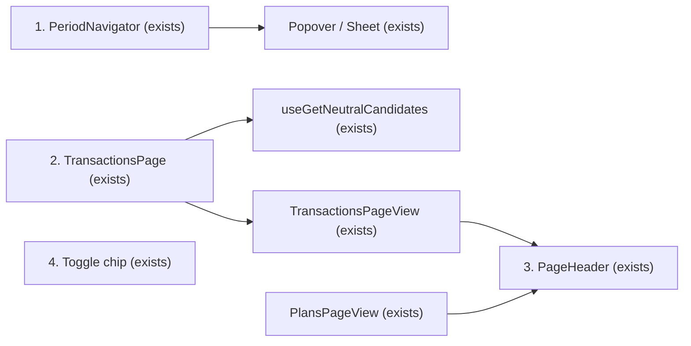

# Header polish

**Approved**: 2026-11-24 - user: "Sim" (asked: "Aprova assim?", after the two assumptions were named)

## Problem

The owner reported four issues using production 1.0.0-beta.39 on an iPhone, 2026-11-24, with screenshots:

1. **Period picker.** "Select de intervalo + periodo de data ao clicar entre as duas setas é redundante." Two controls open the same calendar. The "novembro 2026" label opens it directly, and the "Intervalo" menu opens it through "Personalizado…". The menu also holds the presets.
2. **Transactions header.** "Parte de transações mega poluída e totalmente desalinhada no header."
   - Two unlabeled square icon buttons ("Importar CSV" and "Revisar movimentos") sit beside the title.
   - The period row and the search row end at different right edges: "Intervalo" ends 46 px before "Filtros".
   - The period arrows sit inside the list's left edge.
3. **Page headers.** "Botão de adicionar categoria ao lado, mas botão de adicionar plano embaixo. Só a tela de planos tem subtítulo." The Plans subtitle takes the width, so "Novo plano" wraps below the title.
4. **Chips.** "Badge de pessoa ta gordo na vertical." The member chips ("Todos", "Lucas", "Livia") grew to 44 px visible height with the phase 2 touch tier.

When this ships, each page header has its title and its one action on the same row. The period is one control. Transactions has one tidy header whose rows share the list's edges, and chips look like chips again while staying easy to tap.

## Shape

This reuses `PeriodNavigator`, `PageHeader`, the `Toggle` chip variant, the `Dropdown` and `Sheet`/`Popover` primitives, and the existing `useGetNeutralCandidates` query, which is read with a page size of 1 for its total. No new endpoint is needed. The rules that decide what a user sees (the preset list, when the review notice shows, the chip hit area) run in components that stories reach.

1. `PeriodNavigator` (exists) - drops the "Intervalo" menu; its label opens one panel with the presets and the range calendar, a `Popover` from `sm` and a bottom `Sheet` below it
2. `TransactionsPageView` (exists) - the header keeps the title and one "⋯" `Dropdown` with "Importar CSV" and "Revisar movimentos"; `TransactionsPage` (exists) reads the candidates total through `useGetNeutralCandidates` (exists) for the dot and the review notice
3. `PageHeader` (exists) - keeps its actions on the title row at every width; `PlansPageView` (exists) drops its description
4. `Toggle` chip variant (exists) and the removable filter chips - 32 px visible below `sm`, with a 44 px hit area

**Changes underneath**

| Front | What changes |
| --- | --- |
| domain | nothing |
| stored data | nothing to migrate |
| readers | Overview and Transactions (period); Transactions (header, review notice); Plans and every `PageHeader` user (actions row); Overview member chips and Transactions filter chips (chip size) |
| docs | the `component-creation` skill: page header rule (no description, actions on the title row), chip hit area |

Data: none - presentation only.

## Surface

None - the candidates query already exists; it is read with `size=1`.

## Landing

| One-way door | Literal shape | Alternative rejected |
| --- | --- | --- |
| None | - | - |

- None - presentation only. Every change is a component edit that a later commit can reverse.

## Criteria

### S1: One period control (P1)

**Acceptance Criteria**

1. The period control SHALL show only the previous arrow, the period label and the next arrow, with no "Intervalo" button
2. WHEN a user taps the period label THEN the system SHALL open one panel holding the presets "Este mês", "Últimos 3 meses", "Últimos 6 meses" and "Este ano" above a range calendar. On a phone the panel is a bottom sheet; from 640 px it is a popover. The current preset is marked
3. WHEN the user picks a preset in the panel THEN the system SHALL apply it and close the panel; WHEN the user picks a range of two different days THEN the system SHALL apply it and close the panel
4. WHEN the user taps an arrow THEN the system SHALL step the period by its own length, as today
5. WHILE the window is narrower than 640 px the period control SHALL span the content width: the previous arrow's left edge on the content's left edge, the next arrow's right edge on its right edge, and the label centred between them

### S2: Transactions header (P1)

**Acceptance Criteria**

6. The Transactions header SHALL show the title and one "⋯" button named "Mais ações". The button opens a menu with "Importar CSV" ("Importando…" and disabled while an import runs) and, for those who may create transactions, "Revisar movimentos"
7. WHEN the plan has one or more movements to review and the user may create transactions THEN the system SHALL show a dot on "⋯" and a notice above the list with a "Revisar" button that opens the review
   - 1 → "1 movimento para revisar"; 4 → "4 movimentos para revisar"; 0 → no dot, no notice; a viewer → no dot, no notice
8. WHILE the window is 414 px or 1280 px wide the period control, the search and filters row, and the transaction list SHALL share the same left and right edges, within 1 px

### S3: Page headers (P1)

**Acceptance Criteria**

9. The Plans page SHALL show no description under its title
10. WHILE the window is 414 px wide the Categories, Plans and Transactions pages SHALL show their header action ("Nova categoria", "Novo plano", "⋯") on the title row: its top within the title row's box, not below the title

### S4: Chips (P1)

**Acceptance Criteria**

11. WHILE the window is narrower than 640 px a chip (the Overview member chips and the Transactions removable filter chips) SHALL be 32 px tall visibly, while a tap 6 px above or below its visible edge still lands on it (a 44 px hit area)
12. WHILE the window is 640 px or wider a chip SHALL keep its desktop height of 28 px

## Out of scope

| Excluded | Why |
| --- | --- |
| Other phone-size controls (buttons, fields) | they stay 44 px visible (phase 2 decision); only chips changed |
| The Overview cards ("Realizado" / "Previsto" lines) | not reported; phase 5 redesigns the Overview |
| New presets ("Últimos 12 meses", "Ano passado") | not asked; the panel keeps today's four |

## Assumptions

| Assumption | Chosen default | Rationale | Confirmed? |
| --- | --- | --- | --- |
| Period control | label opens one panel with presets and calendar; arrows stay; "Intervalo" goes | user, 2026-11-24: "Rótulo abre tudo (Recomendado)" | y |
| Transactions actions | one "⋯" menu; a dot and a notice when there are movements to review | user, 2026-11-24: "Menu '⋯' no título (Recomendado)" | y |
| Page subtitles | none on any page; the action sits on the title row | user, 2026-11-24: "Sem subtítulo (Recomendado)" | y |
| Chips | 32 px visible, 44 px hit area, for every chip | user, 2026-11-24: "Visual menor, toque 44 (Recomendado)" | y |
| Review notice copy | "N movimento(s) para revisar" with a "Revisar" button | plain status plus the action; en "N movement(s) to review" / "Review" | y - approved with the plan, 2026-11-24 |
| Desktop period control | stays inline, sized to its content | the full-width rule is for the phone, where the row is otherwise ragged | y - approved with the plan, 2026-11-24 |

**Open questions:** none - all resolved or logged above.

## Sources

- The owner's four screenshots of production at 390 px, dark theme, 2026-11-24 - non-binding - the user reported problems; they are not a design to match
- `.specs/features/phase2-foundations/plan.md` - the touch tier and page shell this adjusts
