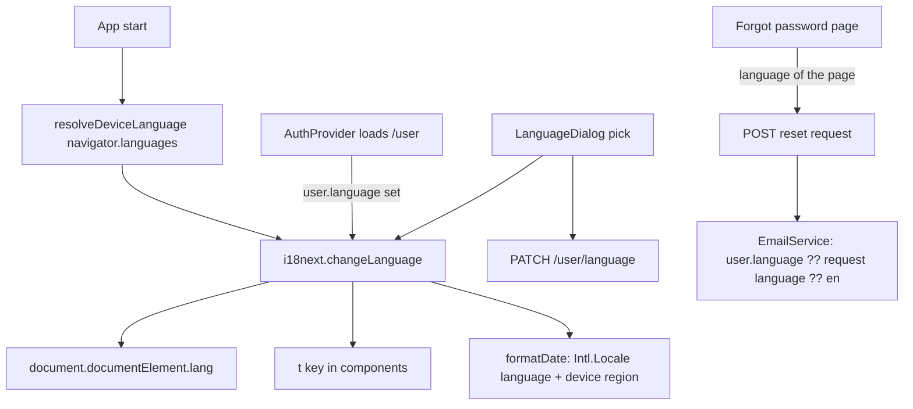

# Internationalisation (M5-10) Design

**Spec**: `.specs/features/i18n/spec.md`
**Status**: Draft

---

## Architecture Overview

i18next holds the language and the two bundled resource files; React reads them through react-i18next. A one-off codemod moves the literal texts out of the components; the lint rule and the type of `t` then keep them out. The backend stores the language on the user, as it stores the time zone, and picks the reset e-mail's language.



---

## Code Reuse Analysis

### Existing Components to Leverage

| Component | Location | How to Use |
| --------- | -------- | ---------- |
| Time-zone preference (field, request, endpoint, dialog, `TimeZoneInterceptor`) | `backend/.../user/`, `frontend/src/features/profile/components/TimeZoneDialog*` | Copy the shape for the language: `UpdateLanguageRequest`, `PATCH`, `LanguageDialog` + view + story + flow test |
| Problem copy map | `frontend/src/api/utils/problems.ts` | `PROBLEM_COPY` values become keys `problems.<slug>`; the `Record<ProblemType, …>` keeps a new slug failing the build |
| `formatMoney` | `frontend/src/utils/money.ts` | Unchanged (`R$ 1.234,56` in both languages) |
| `Calendar` `locale` prop | `frontend/src/components/calendar/base/Calendar.tsx:14` | Receives the date-fns locale of the language in use |
| `FormField` | `frontend/src/components/form/` | Translates the field error: zod messages become keys |
| Custom lint plugin (`local/*`) | `frontend/eslint.config.js:156` | `i18next/no-literal-string` joins it; tests and stories excluded |
| `testTable.ts` / `check-siblings.ts` | `frontend/scripts/` | New `utils/` modules get unit tests by the existing rows |

### Integration Points

| System | Integration Method |
| ------ | ------------------ |
| Database | Flyway `V22`: `users.language VARCHAR(5) NULL`, named check `ck_users_language` (`'en'`, `'pt-BR'`) |
| API contract | `UserResponse.language` (nullable), `PATCH /user/language`, optional `language` on the password-reset request; `openapi.json` regenerated in the same commit (AD-019) |
| Frontend types | Regenerated from `openapi.json` |

---

## Components

### i18n module

- **Purpose**: Initialise i18next with both resource files, typed from `en.json`.
- **Location**: `frontend/src/i18n/` (`i18n.ts`, `en.json`, `pt-BR.json`, `i18next.d.ts`)
- **Interfaces**: `i18n` instance; `CustomTypeOptions.resources` typed from `en.json`, so `t("missing.key")` is a type error and the build fails.
- **Dependencies**: `i18next`, `react-i18next`
- **Reuses**: nothing; new. No language-detector package: the device rule is ours (`pt*` → `pt-BR`).

### resolveDeviceLanguage

- **Purpose**: Map `navigator.languages` to `en` or `pt-BR` (I18N-02 AC 1).
- **Location**: `frontend/src/i18n/utils/resolveDeviceLanguage.ts` + unit test.

### formatDate / date locale

- **Purpose**: One date formatter: `Intl.DateTimeFormat(new Intl.Locale(language, { region }))`, region from the device locale (I18N-03); the date-fns locale (`enUS` / `ptBR`) for the calendar and month names.
- **Location**: `frontend/src/utils/dates.ts` + unit test; replaces the 24 `format(...)` display calls in 12 files. The CSV parser's `dd/mm/yyyy` reading stays.

### Language preference (frontend)

- **Purpose**: "Language / Idioma" in the profile menu; apply the saved language when `/user` loads; save the pick.
- **Location**: `frontend/src/features/profile/components/LanguageDialog*`, service hook in `src/api/services/useUserService.ts` (raw function + hook + MSW handler factory), applied in `AuthProvider`.
- **Reuses**: `TimeZoneDialog` pattern, `buildMutationOptions`.

### Language preference (backend)

- **Purpose**: Store and validate the language; choose the reset e-mail's.
- **Location**: `user.model.User.language`, `user.request.UpdateLanguageRequest` (`@Pattern("en|pt-BR")` → 422 validation-failed), `UserController` `PATCH`, `auth.service.EmailService` (subject and body per language), `PasswordResetService` (`user.language ?? request.language ?? en`).
- **Reuses**: time-zone update path, in-memory mail fake in ITs.

### Codemod (one-off, not committed)

- **Purpose**: Replace literal JSX text and the `placeholder`, `title`, `aria-label`, `alt`, `label`, `description` string props in `src/**/*.tsx` (not tests, not stories) with `t("…")`, and write `en.json`.
- **Location**: the session scratchpad (`codemods/extractStrings.ts`), run once with `ts-morph`.
- **Rules**: converts only nodes that are 100% literal; JSX text is normalised as React renders it (collapsed whitespace, HTML entities decoded); a text mixed with expressions, a template literal, or a string in a `.ts` module is left for the lint list. Keys: `<area>.<componentCamel>.<slug>` (area = feature name, or `components`/`app`); a text found in 3+ components goes to `common.<slug>`. Adds `useTranslation()` to each touched component.
- **Verification**: the full test suite stays green in English after the run; a sample of the diff is read.

---

## Data Models

```sql
-- V22__add_user_language.sql
ALTER TABLE users ADD COLUMN language VARCHAR(5);
ALTER TABLE users ADD CONSTRAINT ck_users_language CHECK (language IN ('en', 'pt-BR'));
```

```typescript
type Language = "en" | "pt-BR";
type UserResponse = { /* … */ language: Language | null };
type UpdateLanguageRequest = { language: Language };
```

---

## Error Handling Strategy

| Error Scenario | Handling | User Impact |
| -------------- | -------- | ----------- |
| Saving the language fails | Mutation error → problem copy toast; i18next keeps the picked language for the session | Screen stays in the picked language; a toast in that language |
| `PATCH` with an unknown language | `@Pattern` → 422 `validation-failed` | Not reachable from the UI |
| A key missing in `pt-BR.json` | Build/tooling test fails (parity check) | Never ships |
| A literal text added to a component | Lint fails | Never ships |

---

## Risks & Concerns

| Concern | Location (file:line) | Impact | Mitigation |
| ------- | -------------------- | ------ | ---------- |
| ~1000 tests assert English copy | `frontend/src/**/*.test.tsx` | A wrong key breaks screens silently if tests run in another language | Unit and story setup initialise i18n in `en`; the codemod keeps every rendered string identical, so the suite is the regression net |
| Zod messages are English strings in `*Form.ts` | `transactionForm.ts:90,109,120` and others | Validation stays English | Messages become keys; `FormField` translates; covered by the form unit tests |
| `problems.ts` copy is resolved outside React | `frontend/src/api/utils/problems.ts:7` | Toasts fired from hooks could miss the current language | Resolve with `i18n.t` at call time, never at module load |
| Codemod misses or garbles text | all `.tsx` | Wrong text on screen | Only pure literals converted; lint lists the rest; suite green before commit |
| Generated keys change if a component moves | keys embed the component name | A rename leaves an odd key | Acceptable: keys are never shown; renaming a key is a find-and-replace the type check guards |
| Storybook catalog stories assert English | `*.stories.tsx` | None if Storybook initialises `en` | `.storybook/preview.tsx` initialises i18n in `en` |

---

## Tech Decisions (only non-obvious ones)

| Decision | Choice | Rationale |
| -------- | ------ | --------- |
| Library | i18next 26 + react-i18next 17 | The React default; plurals via `Intl.PluralRules` (`_one` / `_other`); typed keys through `CustomTypeOptions` |
| Resources | Bundled JSON, one file per language, no lazy loading | Two small files; no network step before the first paint |
| Extraction | One-off `ts-morph` codemod, leftovers from the lint list | User, 2026-11-05: chosen over workers reading every component (consistency, tokens) |
| Lint | `eslint-plugin-i18next` `no-literal-string` (JSX text + user-facing attributes) | I18N-01 AC 6; no inline bypass, as AD-010 requires |
| Parity | A tooling test comparing key sets, interpolation variables and plural forms of both files | I18N-01 AC 7 |
| CLAUDE.md rule | "English only" covers code, specs and keys; UI copy lives in `src/i18n/*.json` | Supersedes the UI part of the rule; recorded as AD-024 |
