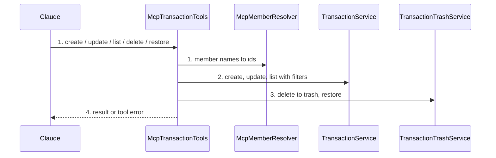

# MCP Capture Hub

**Approved**: 2026-11-18 - user: "Em seguida, escolher adequadamente entre lean e sdd e continuar com a fase 1. Sozinho, sem me chamar pra nada, até 9 da manhã"

> Unattended run: the user delegated the product decisions of phase 1 and reviews the result afterwards. Every
> decision taken on their behalf is an `Assumptions` row marked `user delegated`.

## Problem

Claude is the owners' main way of entering card purchases (owner answer, 2026-11-17), but the connector stops short of
the daily loop. `update_transaction` copies the stored category, so a purchase saved uncategorized can only be
categorized in the app (`mcp/service/McpUpdateCopy.java`). `create_transaction` always attributes the whole amount to
the caller, so "a farmácia foi da Marina" or "dividimos o mercado" is typed by hand afterwards (`McpTransactionTools.java:126-127`).
`list_transactions` cannot ask for what is uncategorized or what waits for confirmation, so Claude cannot run a
clean-up pass. And nothing can delete: a duplicate Claude created stays until someone opens the app.

When this ships, Claude can create a purchase for the right person, fix its category, find what is uncategorized or
waiting for confirmation, and delete a mistake - which lands in the trash and can be restored.

## Shape

This reuses the services the app calls - `TransactionService` for create, update and list, `TransactionTrashService`
(from `transaction-trash`) for delete and restore - so the MCP adds no rule of its own beyond resolving names. The
rules that decide outcomes (status and uncategorized filters, attribution, scope of a series delete) run in the
transaction service and its specification, reached by `*IT` tests.

1. Claude calls a tool -> `McpTransactionTools` (exists) - resolves the plan (`McpPlanResolver`, exists), names of categories (`McpCategoryResolver`, exists) and members (`McpMemberResolver`, new)
2. `TransactionService` (exists) - create with participants; update with a category; list with `status` and `uncategorized` filters (door 1)
3. `TransactionService` / `TransactionTrashService` (exists after `transaction-trash`) - delete to the trash, restore
4. out: `CallToolResult` with the stored transaction, the page, or `{ deletionId }`; errors as tool errors (`McpToolRunner`, exists)

**Changes underneath**

| Front | What changes |
| --- | --- |
| domain | `create_transaction` meant "paid in full by the caller"; it now means "attributed to the caller unless people are named" |
| contract | `TransactionFilter` gains `status` (ACTUAL, FORECAST, PENDING) and `uncategorized`; `GET …/transaction` accepts them (`backend/openapi.json` regenerated). The SPA does not send them yet |
| contract | `McpTransactionResponse` gains `attributedTo` (names) and `series` (`"3/6"` or `"monthly"`, null outside a series) |
| stored data | nothing |
| readers | the transactions list endpoint (new optional params); every MCP tool's schema (Claude re-reads it on connect) |

Data: none - no stored shape changes.

## Surface

| Route | In | Out | Status | Who |
| --- | --- | --- | --- | --- |
| `GET /plan/{planId}/transaction` | adds `status`, `uncategorized` | as today | `200`, `400` invalid status, `404` | as today |
| MCP `create_transaction` | adds `attributedTo: string[]?` | as today, with `attributedTo` | `200` result, `200` with `isError` for a tool error (role denial included), `401` without a token | OWNER, EDITOR, CONTRIBUTOR |
| MCP `update_transaction` | adds `category: string?`, `removeCategory: boolean?` | as today | `200` result, `200` with `isError` for a tool error (role denial included), `401` without a token | as today |
| MCP `list_transactions` | adds `status`, `uncategorized: boolean?` | rows with `attributedTo`, `series` | `200` result, `200` with `isError` for a tool error (role denial included), `401` without a token | every member |
| MCP `delete_transaction` | `id`, `scope?` (THIS_ONE default, THIS_AND_FOLLOWING, ALL), `plan?` | `{ deletionId, description, count }` | `200` result, `200` with `isError` for a tool error (role denial included), `401` without a token | as the app's delete |
| MCP `restore_deletion` | `deletionId`, `plan?` | `{ restored }` | `200` result, `200` with `isError` for a tool error (role denial included), `401` without a token | as the app's restore |

## Landing

| One-way door | Literal shape | Alternative rejected |
| --- | --- | --- |
| 1. list filters in the REST contract | `status=ACTUAL\|FORECAST\|PENDING` (derived against the reader's today, as the dashboard does) and `uncategorized=true` on `GET …/transaction`; `uncategorized` with `categoryId` → `400` | MCP-only filters: the app's "A confirmar" and "Sem categoria" views (DESIGN-PLAN C6, C9) need the same rule, and two copies drift |
| 2. tool names and parameters Claude learns | `delete_transaction`, `restore_deletion`, `attributedTo`, `removeCategory`, `status`, `uncategorized` | a generic `edit_transaction` with a patch object: harder for the model to call correctly and to validate per field |

- Nothing else in this change is hard to reverse

## Criteria

### S1: Create for the right people (P1)

**Acceptance Criteria**

1. WHEN Claude creates a transaction without `attributedTo` THEN the system SHALL attribute it to the caller (unchanged).
2. WHEN Claude creates a transaction with `attributedTo: ["Marina"]` THEN the system SHALL attribute the whole amount to Marina.
   - name matched case- and accent-insensitively, by first name or full name ("marina", "Marína Souza")
3. WHEN Claude creates a transaction with two or more names THEN the system SHALL split it equally between them.
   - R$ 100,00 between three → 33,34 · 33,33 · 33,33, as the app's equal split allocates cents
4. IF a name matches no member, or more than one THEN the tool SHALL answer a tool error listing the plan's members and create nothing.
5. IF `attributedTo` is given in a single-member plan with any name other than the caller THEN the tool SHALL answer the same error.

### S2: Fix and find (P1)

**Acceptance Criteria**

6. WHEN Claude updates a transaction with `category` THEN the system SHALL set that category (by name, as create does) and keep amount, date, description, split and items.
7. WHEN Claude updates a transaction with `removeCategory: true` THEN the system SHALL leave it uncategorized.
8. IF both `category` and `removeCategory: true` are given THEN the tool SHALL answer a tool error and change nothing.
9. IF the new category's type does not match the transaction's THEN the tool SHALL answer the existing `transaction-category-type-mismatch` message and change nothing.
10. WHEN the list is filtered with `uncategorized: true` (tool or REST) THEN the system SHALL return only transactions with no category.
11. WHEN the list is filtered with `status: PENDING` THEN the system SHALL return only forecasts that require confirmation and whose date is on or before the reader's today; `FORECAST` the other forecasts; `ACTUAL` confirmed or past automatic rows - the same derivation as `Transaction.status(today)`.
    - reader in São Paulo at 2026-11-18 01:00 local (04:00 UTC): a bill due 2026-11-18 requiring confirmation → PENDING
12. IF `uncategorized: true` is combined with a category THEN the REST endpoint SHALL answer `400` and the tool a tool error.
13. WHEN Claude lists transactions THEN each row SHALL carry `attributedTo` (member first names) and `series` (`"k/N"` for installments, `"monthly"` for an open series, null otherwise).

### S3: Delete a mistake, safely (P1)

**Acceptance Criteria**

14. WHEN Claude deletes a transaction that is not part of a series THEN the system SHALL move it to the trash and answer its `deletionId`.
15. WHEN Claude deletes a series occurrence without `scope` THEN the system SHALL trash only that occurrence (THIS_ONE); with `scope` it SHALL apply that scope, as the app's series delete.
16. WHEN Claude restores a `deletionId` THEN the system SHALL restore it as the app does and answer `restored`; a 404 or 409 from the service becomes a tool error with its message.
17. The `delete_transaction` tool SHALL carry `destructiveHint = true` and its description SHALL say that the deletion can be restored for 30 days with `restore_deletion`.
18. IF the caller may not delete the transaction THEN the tool SHALL answer a tool error and trash nothing (role matrix as the app's delete).

## Out of scope

| Excluded | Why |
| --- | --- |
| Exact or custom splits through the MCP | Equal split and one person cover the spoken cases; exact amounts need arithmetic the model gets wrong |
| Items on create | DESIGN-PLAN R9 later step; receipts are read by Claude and can be entered as separate transactions meanwhile |
| Creating series or installments through the MCP | Kept out by the mcp-connector spec; a wrong series is many wrong rows |
| Listing the trash through the MCP | The app shows it; Claude gets the `deletionId` at delete time |
| Contacts outside the plan | R17 |

## Assumptions

| Assumption | Chosen default | Rationale | Confirmed? |
| --- | --- | --- | --- |
| Split through the MCP | Allowed, equal only; reverses the mcp-connector rule "no splits from here" (AD-029) | Pooled money and spoken capture ("dividimos") make the equal split the common case | y - user delegated |
| Name matching | Case- and accent-insensitive, first or full name, using `McpNames.matches` | Same matcher as plans and categories | y - user delegated |
| Default series scope for delete | THIS_ONE | The least destructive choice when the model is unsure | y - user delegated |
| Status vocabulary | ACTUAL, FORECAST, PENDING, as `TransactionStatus` | Already the API's words | y - user delegated |

**Open questions:** none - all resolved or logged above.

## Differences from the source

None - no binding source.

## Sources

- `.specs/project/DESIGN-PLAN.md` R9; owner answers 2026-11-17 (capture through Claude, pooled money).
- `.specs/features/mcp-connector/spec.md` - the connector's current rules; AD-026.
- `.specs/features/transaction-trash/plan.md` - delete and restore semantics.
- User, 2026-11-18 - delegated phase 1 decisions.
