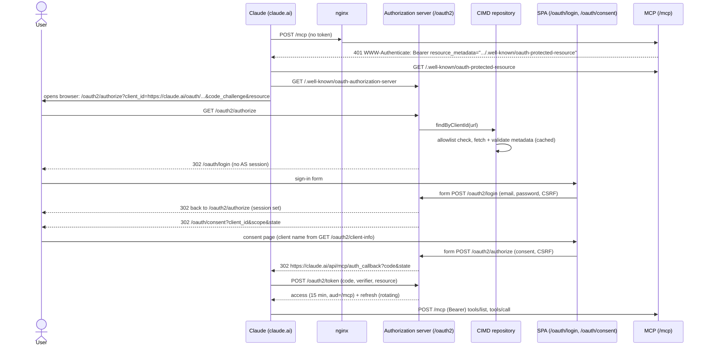

# Claude MCP Connector Design

**Spec**: `.specs/features/mcp-connector/spec.md`
**Status**: Approved (2026-11-08, user: "Sim")

Conforms to AD-004/005 (plan membership, `PlanContext`), AD-009 (app sessions untouched), AD-016/017
(package by feature, ArchUnit), AD-018 (problem+json on `/api` only), AD-020 (ITs on Testcontainers),
AD-021 (`app.*` properties), AD-024 (copy in `i18n/*.json`), AD-025 (reader's today = saved time zone),
AD-026 (authorization server in the backend, CIMD allowlist, no DCR).

---

## Architecture Overview

Three pieces inside the existing backend, one in the SPA, one in nginx:

1. **Authorization server** (Spring Security 7 OAuth2 Authorization Server) on its own filter chain at
   `/oauth2/**` and `/.well-known/oauth-authorization-server`, with a form-login session of its own
   (`JSESSIONID`, path `/oauth2`). Clients come only from our **CIMD client repository**.
2. **MCP resource server** on a second filter chain at `/mcp` and
   `/.well-known/oauth-protected-resource`: validates the authorization server's JWTs (signature, issuer,
   audience = canonical `/mcp` URL, scope `findraco.mcp`) and serves Spring AI 2.0's Streamable HTTP MCP
   endpoint.
3. **MCP tools** (`mcp` package): thin adapters that resolve the plan, call the existing services and
   shape the answers.
4. **SPA pages** `/oauth/login` and `/oauth/consent`: the sign-in and consent screens, built with the
   design system and i18n; they submit real HTML forms (top-level navigation) to the authorization
   server, never `fetch`.
5. **nginx** routes `/oauth2/`, `/mcp` and `/.well-known/` to the API; the service worker never answers
   those navigations.

The existing `/api/**` chain (bearer JWT from `jjwt`, HMAC) stays as is. An MCP token is RSA-signed by
another issuer, so the app's `JwtAuthenticationFilter` rejects it with `401` (spec Connect 14) without
new code.

### Connecting (first time)



### A tool call

```mermaid
sequenceDiagram
    participant C as Claude
    participant F as MCP chain (JWT validation, rate limit)
    participant T as McpTransactionTools
    participant P as McpPlanResolver
    participant S as TransactionService (existing)

    C->>F: tools/call create_transaction {plan:"Casa", amount:42, ...}
    F->>F: verify JWT, aud, scope; bucket per user
    F->>T: userId from token subject
    T->>P: resolve("Casa", userId)
    P->>P: PlanService.listPlans → match → PlanService.resolveContext (membership, role)
    P-->>T: PlanContext
    T->>S: create(CreateTransactionRequest, ctx)
    S-->>T: TransactionResponse
    T-->>C: result {id, ..., plan:"Casa"} or isError + message
```

---

## Code Reuse Analysis

### Existing Components to Leverage

| Component | Location | How to Use |
| --------- | -------- | ---------- |
| `PlanService.listPlans`, `resolveContext` | `plan/service/PlanService.java:81,89` | Plan list, default flag, membership + role → `PlanContext` |
| `TransactionService.findAllByPlanPaged`, `create`, `confirm`, `update`, `editSeries` | `transaction/service/TransactionService.java:141,183,226,202,432` | Every transaction tool; an occurrence edit goes through `editSeries` with `THIS_ONE` and the occurrence as pivot, as the app does |
| `CategoryService.findAllByPlanPaged` | `category/service/CategoryService.java:92` | `list_categories`, category-name resolution |
| `CategorySpendingService` | `category/service/CategorySpendingService.java` | `get_category_spending` |
| `DashboardService.getSummary` | `dashboard/service/DashboardService.java:48` | `get_month_summary` |
| `UserService.today(userId)` | `user/service/UserService.java` | Default dates, current month (AD-025) |
| `DaoAuthenticationProvider` + `CustomUserDetailsService` | `auth/config/SecurityConfig.java` | Authorization-server form login checks the same credentials |
| `RateLimiter` + `RateLimitProperties` | `shared/ratelimit/` | Login limits on `/oauth2/login`; new `MCP_USER` rule for tool calls |
| `PasswordResetService` → `SessionService.revokeAll` | `auth/service/PasswordResetService.java:90` | Same spot also revokes MCP grants |
| `PublicEndpoints` beans | `shared/security/PublicEndpoints.java` | Not used: the two new chains own their own matchers |
| `LoginView`, `AuthCard`, `PasswordInput`, `authForms` | `frontend/src/features/auth/` | `/oauth/login` reuses the login view; consent uses `AuthCard` |

### Integration Points

| System | Integration Method |
| ------ | ------------------ |
| Database | Flyway `V25`: Spring's `oauth2_authorization` and `oauth2_authorization_consent` tables (JDBC services), named constraints and indexes per our standards; no client table (clients live in the CIMD cache) |
| App auth | Untouched; separate chain, separate session cookie path, separate token issuer |
| nginx | New `location`s for `/oauth2/`, `/mcp` (buffering off, long read timeout), `/.well-known/` |
| Service worker | `navigateFallbackDenylist` gains `/oauth2/`, `/mcp`, `/.well-known/` |

---

## Components

### `AuthorizationServerConfig` (auth/config)

- **Purpose**: The authorization-server filter chain (`@Order(1)`, matcher `/oauth2/**`, `/.well-known/oauth-authorization-server`).
- **Interfaces**: beans `SecurityFilterChain authorizationServerChain`, `AuthorizationServerSettings` (issuer = `app.oauth.issuer`), `JWKSource` (RSA key from `app.oauth.signing-key`), `OAuth2TokenCustomizer` (sets `aud` from the `resource` parameter after checking it equals the canonical MCP URL), `TokenSettings` (access 15 min, refresh 30 days, `reuseRefreshTokens(false)`).
- **Behaviour**: authorization code + PKCE only (`S256` required); public clients (`none`) only, so metadata advertises `token_endpoint_auth_methods_supported: ["none"]` (issue #1043); metadata adds `client_id_metadata_document_supported: true`; no registration endpoint; consent page `/oauth/consent`; form login page `/oauth/login`, processing `/oauth2/login`; CSRF on with `CookieCsrfTokenRepository` (cookie path `/oauth2`, readable by the SPA).
- **Dependencies**: `CimdRegisteredClientRepository`, JDBC `OAuth2AuthorizationService` and consent service, `AuthenticationProvider`.
- **Reuses**: existing `AuthenticationProvider`, `RateLimiter` (login rules applied in a filter before the login processing).

### `CimdRegisteredClientRepository` (auth/service)

- **Purpose**: Turns an allowlisted `client_id` URL into a Spring `RegisteredClient`.
- **Interfaces**:
  - `findByClientId(String clientId): RegisteredClient` — `null` unless the URL is exactly one of `app.oauth.cimd.allowed-clients` and its document is valid.
  - `findById(String id): RegisteredClient` — same as by client id (id = client id URL), so stored grants keep resolving on refresh.
  - `save(...)` — unsupported.
- **Behaviour**: GET with 5 s timeout, 64 KB cap, no redirects; document must be JSON with `client_id` equal to the URL, `redirect_uris` (each `https` or loopback), `token_endpoint_auth_method: none`, grant types containing `authorization_code` (others, such as claude.ai's `jwt-bearer`, ignored: the client gets only `authorization_code` + `refresh_token`); loopback redirects match any port (RFC 8252). Cached in Caffeine for `app.oauth.cimd.cache-ttl` (24 h); a fetch failure keeps the cached entry, and with none falls back to the pinned copy shipped in `resources/oauth/cimd/` (claude.ai's edge has answered server-side fetches from cloud IPs with 403, claude-code#84263).
- **Dependencies**: `RestClient` (JDK client), Caffeine (already a dependency).

### `OAuthClientInfoController` (auth/controller)

- **Purpose**: `GET /oauth2/client-info?client_id=` → `{ name, redirectHost }` for the consent page; `404` when the repository refuses the id. Public inside the AS chain.

### `McpGrantService` (auth/service)

- **Purpose**: `revokeAll(userId)` deletes the user's rows in `oauth2_authorization`; called from `PasswordResetService` next to `SessionService.revokeAll` (spec Connect 13).
- **Refresh reuse** (Connect 12): an `OAuth2AuthorizationService` decorator keeps the hash of each rotated-out refresh token on the authorization row (`metadata`); a refresh with a rotated-out token removes the whole authorization. Verified 2026-11-08 in Spring Security 7.1.2 source: `OAuth2RefreshTokenAuthenticationProvider` answers a rotated-out token with `invalid_grant` and revokes nothing.

### Public-client refresh (auth/config)

Verified 2026-11-08 in Spring Security 7.1.2 source: `OAuth2RefreshTokenGenerator` returns `null` for a public client on the code grant ("Do not issue refresh token to public client"), and `PublicClientAuthenticationConverter` only matches code-grant requests with a `code_verifier`, so a public client cannot authenticate a `refresh_token` request either. Three small pieces close it:

- `PublicClientRefreshTokenGenerator`: issues an opaque refresh token for an allowlisted CIMD client (same key generator and TTL as Spring's).
- `PublicClientRefreshAuthenticationConverter` + `PublicClientRefreshAuthenticationProvider`: on `grant_type=refresh_token` with a `client_id` and no secret, authenticate a `none` client whose id is in the CIMD repository.
- Wired through `tokenEndpoint` and `clientAuthentication` customizers; ITs: code → refresh issued; refresh rotates; old refresh rejected and grant removed.

### `McpSecurityConfig` (mcp/config)

- **Purpose**: Resource-server chain (`@Order(2)`, `/mcp`, `/.well-known/oauth-protected-resource`): `oauth2ResourceServer().jwt()` with validators for issuer, audience (canonical `app.oauth.mcp-resource`), scope `findraco.mcp`; stateless; the `401` entry point writes `WWW-Authenticate: Bearer resource_metadata="<base>/.well-known/oauth-protected-resource"`; `MCP_USER` rate-limit filter after authentication.
- **Protected-resource metadata**: `resource` = `app.oauth.mcp-resource`, `authorization_servers` = [issuer], `scopes_supported` = [`findraco.mcp`].

### `McpPlanResolver` (mcp/service)

- **Purpose**: `resolve(String plan, long userId): ResolvedPlan(PlanContext ctx, String name)`.
- **Behaviour**: `null` → default plan; numeric → id among `listPlans`; otherwise normalised name (NFD, strip marks, casefold) exact match; zero → `McpToolException` listing names; two+ → listing names with ids. Then `PlanService.resolveContext` (membership, role).

### Tools (mcp/tool) — one class per area, Spring AI `@McpTool`

| Class | Tools | Calls |
| ----- | ----- | ----- |
| `McpPlanTools` | `list_plans` | `PlanService.listPlans` |
| `McpCategoryTools` | `list_categories`, `get_category_spending` | `CategoryService`, `CategorySpendingService` |
| `McpTransactionTools` | `list_transactions`, `create_transaction`, `confirm_transaction`, `update_transaction` | `TransactionService` |
| `McpSummaryTools` | `get_month_summary` | `DashboardService.getSummary` |

- Every tool: read `userId` from the JWT subject (`AuthenticatedUser` built from the token, not from `CustomUserDetails`), resolve the plan, build the existing request record, call the service, map to an `McpXxxResult` record. Annotations set `readOnlyHint`, `destructiveHint`, `idempotentHint` per spec.
- `update_transaction`: `getById` → copy every stored field into `UpdateTransactionRequest` (items, participants, split, `version`), override amount/date/description; refuse `EXACT` when the amount changes; for an occurrence with `seriesId`, build `UpdateSeriesRequest` with `THIS_ONE` and the occurrence as pivot. Split `EQUAL` recompute and item-sum check come from the existing entity rules.
- Category by name: `McpCategoryResolver` over `CategoryService.findAllByPlanPaged` (same normalisation).
- Errors: domain exceptions and `McpToolException` map to an MCP result with `isError: true` and the exception's message; anything else to "Something went wrong (ref <requestId>)" and an `ERROR` log.

### `McpCallLogger` (mcp/config)

- **Purpose**: One `INFO` line per tool call: user id, plan id, tool, outcome, duration; never arguments (Edge 6).

### Frontend

- **`features/oauth/OAuthLoginPage` + view**: reuses `LoginView` fields; renders a plain `<form method="post" action="/oauth2/login">` with the CSRF token read from the cookie; shows the error state when the AS redirects back with `?error`. Time zone: none needed (the app sends it on every request already).
- **`features/oauth/OAuthConsentPage` + view**: reads `client_id`, `scope`, `state` from the URL, loads `GET /oauth2/client-info` through a service hook, shows name, redirect host, the capability list, "Allow"/"Deny" as a form POST to `/oauth2/authorize` with `consent_action`, `client_id`, `state`, `scope`, CSRF. States: loading, unknown client (error, no buttons), ready.
- Routes in `AppRouter` outside `PrivateRoute`; copy keys in `en.json` and `pt-BR.json`.

---

## Data Models

```sql
-- V25: Spring Authorization Server JDBC schema, adapted to our naming rules
CREATE TABLE oauth2_authorization (
  id varchar(100) PRIMARY KEY,
  registered_client_id varchar(500) NOT NULL,   -- the CIMD URL
  principal_name varchar(200) NOT NULL,         -- user id
  authorization_grant_type varchar(100) NOT NULL,
  authorized_scopes varchar(1000),
  attributes text, state varchar(500),
  authorization_code_value text, authorization_code_issued_at timestamptz,
  authorization_code_expires_at timestamptz, authorization_code_metadata text,
  access_token_value text, access_token_issued_at timestamptz, access_token_expires_at timestamptz,
  access_token_metadata text, access_token_type varchar(100), access_token_scopes varchar(1000),
  refresh_token_value text, refresh_token_issued_at timestamptz, refresh_token_expires_at timestamptz,
  refresh_token_metadata text
  -- OIDC / device / user-code columns as the Spring schema requires
);
CREATE INDEX ix_oauth2_authorization_principal ON oauth2_authorization (principal_name);

CREATE TABLE oauth2_authorization_consent (
  registered_client_id varchar(500) NOT NULL,
  principal_name varchar(200) NOT NULL,
  authorities varchar(1000) NOT NULL,
  CONSTRAINT pk_oauth2_authorization_consent PRIMARY KEY (registered_client_id, principal_name)
);
```

Token values are stored as Spring stores them; a periodic purge of rows whose refresh token expired
joins the existing daily job.

New configuration (`app.oauth`, validated record):

```
app.oauth.issuer=https://<domain>/oauth2
app.oauth.mcp-resource=https://<domain>/mcp
app.oauth.signing-key=<path to PEM, mounted secret>
app.oauth.cimd.allowed-clients=https://claude.ai/oauth/mcp-oauth-client-metadata,https://claude.ai/oauth/claude-code-client-metadata
app.oauth.cimd.cache-ttl=24h
app.rate-limit.mcp-user=60/1m
```

---

## Error Handling Strategy

| Error Scenario | Handling | User Impact |
| -------------- | -------- | ----------- |
| No / expired MCP token | `401` + `WWW-Authenticate` resource metadata | Claude refreshes or reconnects silently |
| Refresh token expired, revoked or reused | `invalid_grant`; reuse also deletes the grant | Claude asks to reconnect |
| `client_id` outside allowlist / bad document | `invalid_client` on `/oauth2/authorize`; consent page shows "unknown app" | Connection fails before any sign-in |
| Wrong password on `/oauth/login` | AS redirects to `/oauth/login?error`; login rate limits apply | Same message as the app's login |
| Plan or category not matched | Tool `isError` with the names to choose from | Claude asks which one |
| Domain rule (not awaiting confirmation, stale version, item sum, role) | Tool `isError` with the exception's message | Claude explains and proposes the fix |
| Rate limit | Tool `isError` "retry in a moment" | Rare pause |
| Unexpected exception | Generic tool error with request id; `ERROR` log | Claude says it failed; log has the cause |

---

## Risks & Concerns

| Concern | Location (file:line) | Impact | Mitigation |
| ------- | -------------------- | ------ | ---------- |
| Spring's authorization server issues no refresh token to public clients and cannot authenticate them on refresh (verified in 7.1.2 source) | `OAuth2RefreshTokenGenerator:55`, `PublicClientAuthenticationConverter` | Without the fix, Claude reconnects every 15 min | "Public-client refresh" component, covered by ITs |
| Refresh-token reuse detection (Connect 12) is not built in (verified) | `OAuth2RefreshTokenAuthenticationProvider:115-120` | A stolen rotated token is refused but the grant stays alive | Decorator described in `McpGrantService`; IT replays an old token |
| claude.ai's CIMD document lists a grant type we do not support (`jwt-bearer`) | `https://claude.ai/oauth/mcp-oauth-client-metadata` (fetched 2026-11-08) | A strict subset check would refuse claude.ai | Require `authorization_code`, ignore extra grant types |
| claude.ai's edge may 403 server-side fetches from cloud IPs | claude-code#84263 | The VPS cannot fetch the document; the connection fails | Pinned copy fallback; test a fetch from the VPS before release |
| SSRF through the CIMD fetch | `CimdRegisteredClientRepository` | Server fetches attacker URLs | Only the exact allowlisted URLs are ever fetched; no redirects; size and time caps |
| Recent CVEs in Spring's AS (DCR endpoints, 7.0.0–7.0.4) | `pom.xml` | Known vulnerabilities | Boot 4.1.2 pins Spring Security 7.1.x; DCR stays off; Dependabot already watches |
| Service worker serves `index.html` for `/oauth2/authorize` | `frontend/vite.config.ts:137` | The authorization flow never reaches the backend on an installed PWA | Add `/oauth2/`, `/mcp`, `/.well-known/` to `navigateFallbackDenylist` |
| Signing key regenerated per start would kill tokens on every deploy | `JWKSource` | Every deploy invalidates live access tokens (Claude refreshes, but any key mix-up breaks every connection) | Key from a mounted PEM (`app.oauth.signing-key`), startup fails without it (AD-021) |
| `update_transaction` copies the whole stored transaction into a full-replace request | `UpdateTransactionRequest` | A field left out of the copy is wiped (items, participants) | Unit test per copied field; IT edits a transaction with items and participants and asserts both survive |
| Two security chains + the existing one | `SecurityConfig` | A matcher overlap opens or closes the wrong paths | Explicit `securityMatcher` per chain with `@Order`; IT matrix: app JWT on `/mcp` → 401, MCP token on `/api` → 401, anonymous on each |
| Spring AI MCP falls back to SSE without the protocol property | `application.properties` | `/mcp` 404 | `spring.ai.mcp.server.protocol=STREAMABLE`; IT calls `tools/list` |

---

## Tech Decisions

| Decision | Choice | Rationale |
| -------- | ------ | --------- |
| AS sign-in | Separate form-login session on `/oauth2` (user signs in once per connection, even if signed in to the app) | Standard Spring AS flow with custom pages; reusing the SPA's bearer would mean rewriting the authorization endpoint's responses as JSON. Connecting happens about once a month |
| SPA ↔ AS | Real form POSTs, not `fetch` | The AS answers with redirects to Claude; a navigation follows them, `fetch` cannot |
| Client storage | No table; CIMD documents cached in memory, id = URL | Clients are documents Anthropic owns; a restart refetches |
| Token format | JWT (RSA) for access, opaque refresh in DB | The resource server validates locally; refresh needs revocation |
| MCP library | Spring AI 2.0 MCP server (WebMVC, Streamable HTTP), `@McpTool` | Official Spring line for Boot 4.1; no pre-1.0 security add-on (AD-026) |
| Audience | `aud` = canonical `/mcp` URL from RFC 8707 `resource` | Claude sends it; prevents token reuse on other resources |
