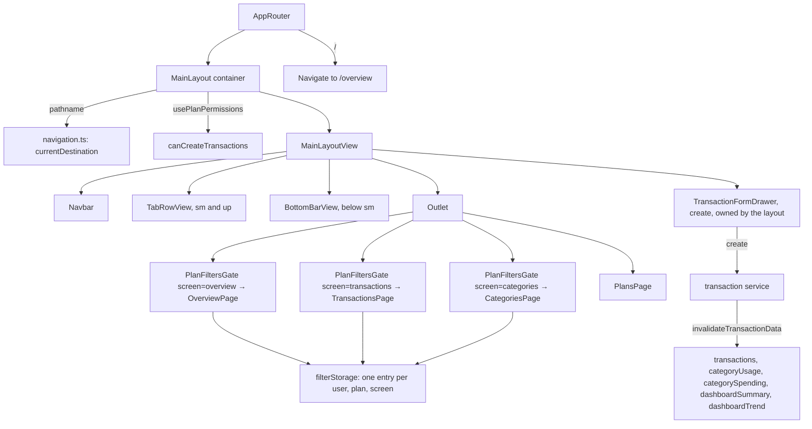

# Mobile Navigation Design

**Spec**: `.specs/features/mobile-navigation/spec.md`
**Context**: `.specs/features/mobile-navigation/context.md`
**Status**: Approved (user, 2026-10-19)

---

## Architecture Overview

Each destination becomes its own route, and the navigation moves into the layout. `MainLayout`
already wraps every private screen, so it is the one place that knows the current route, shows the
destinations on the four screens that have them, and owns the one global New Transaction form.
Screens keep only their content; a per-screen filters gate keeps each screen's URL and saved filters
in step with the active plan.

- **Routes (NAV-06):** `/overview`, `/transactions`, `/categories`, `/plans`. `/` redirects
  (replace) to `/overview`; old `/?tab=` links are not mapped and land there too. Accept-invitation stays under the
  layout without navigation (NAV-03 edge).
- **Current destination:** derived from the pathname, never stored. The bar and tab row are plain
  links to the four paths; the gate restores the target screen's filters, so links carry no query.
- **Global add:** one `TransactionFormDrawer` in create mode, opened by the bar's "+" or the tab
  row's "New Transaction"; its open state is local to the layout container. The Transactions screen
  keeps its own drawer for edit and duplicate only.
- **Narrow vs wide:** both views render; CSS hides one (`sm:hidden` / `hidden sm:flex`), the same
  breakpoint the transactions list already swaps on. No JS media query, so no flash and no state.

### Approaches considered

| Approach | Summary | Verdict |
| -------- | ------- | ------- |
| **A. Navigation in the layout** (chosen, user 2026-10-19) | `MainLayout` renders the tab row, the bottom bar and the global drawer; screens render content only | One nav, one drawer, one place to test. Accept-invitation is excluded by route match |
| B. Navigation per page + `GlobalAddProvider` | Each screen renders the tab row and bar; a context opens one drawer mounted in the layout | Copies of the nav to keep in sync, and a provider whose only job is a boolean |
| C. URL-driven add (`?add=1`) | The form opens from a query param; Back closes it | Nice on Android, but it ties the form to history; a candidate for M5-07 PWA instead |

---

## Code Reuse Analysis

### Existing Components to Leverage

| Component | Location | How to Use |
| --------- | -------- | ---------- |
| `HomeFiltersGate` | `src/app/home/HomeFiltersGate.tsx` | Becomes `PlanFiltersGate` with a `screen` and its param keys; its plan-sync rules (plan switch, link to another plan, unknown plan) stay as they are, per screen |
| `filterStorage` | `src/app/home/filterStorage.ts` | Key gains the screen: `filters:<screen>:<user>:<plan>`. Old `homeFilters:` entries are ignored (one-time reset, user 2026-10-19) |
| `OVERVIEW_PARAM_KEYS`, `TRANSACTION_PARAM_KEYS` | features' `filters/` | Each screen's gate saves and restores only its own keys |
| `TransactionFormDrawer` | `src/features/transactions/components/TransactionFormDrawer.tsx` | Rendered by the layout in `create` mode; `app/` may import features. Type defaults to DEBIT (unchanged) |
| `usePlanPermissions().canCreateTransactions` | `src/hooks/usePlanPermissions.ts` | Gates the "+" and "New Transaction". Already false until the plan and role load, which covers the role-loading edge |
| `Button`, lucide icons, `Text` | `src/components/` | Bar items and the tab row; labels through `Text` per the typography rule |
| `SeriesScopeDialogProvider` | mounted in `AppProvider` | Already above the layout, so the layout's drawer can create series |
| `buildMutationOptions` | `src/api/utils/` | Success toast message per service |

### Integration Points

| System | Integration Method |
| ------ | ------------------ |
| Router | Four routes under `MainLayout`; destinations are `<Link>`s, so a switch pushes a history entry; redirects use `replace` |
| Local storage | One saved query string per (user, plan, screen) |
| TanStack Query | Every transaction mutation calls `invalidateTransactionData` (see Tech Decisions) |
| Sonner | Every service success message moves to the short style of the message table (NAV-05) |

---

## Components

### `navigation.ts` (logic, sibling test)

- **Purpose**: The destination list and the pure mappings between URLs and destinations.
- **Location**: `src/app/layout/navigation.ts`
- **Interfaces**:
  - `type Destination = "overview" | "transactions" | "categories" | "plans"`
  - `DESTINATION_PATHS: Record<Destination, string>`
  - `currentDestination(pathname: string): Destination | null` - `null` off the four paths (accept-invitation)
- **Dependencies**: `PATHS`

### `PlanFiltersGate` (container, from `HomeFiltersGate`)

- **Purpose**: Keeps one screen's URL filters and its saved filters in step with the active plan.
- **Location**: `src/app/routing/PlanFiltersGate.tsx` (with `filterStorage.ts` and its test moved alongside)
- **Interfaces**: `screen: "overview" | "transactions" | "categories"`, `paramKeys: readonly string[]`, `children`
- **Behaviour**: the current rules, scoped to the screen: matching plan → render and save; plan switch → redirect to that plan's saved filters for this screen; link for another plan the user belongs to → make it active; no params or unknown plan → saved filters or defaults
- **Reuses**: the existing gate logic and its tests, parameterised

### `MainLayout` (container, changed)

- **Purpose**: Decides whether navigation shows, which destination is current, whether add is allowed, and owns the global drawer's open state.
- **Location**: `src/app/layout/MainLayout.tsx`
- **Dependencies**: `useLocation`, `usePlanPermissions`
- **Reuses**: `TransactionFormDrawer`

### `MainLayoutView` (view, changed)

- **Purpose**: Page frame with slots for navbar, tab row, bottom bar and drawer; reserves bottom space below `sm` when the bar shows.
- **Location**: `src/app/layout/MainLayoutView.tsx`
- **Interfaces**: `navbar`, `navigation?: { tabRow: ReactNode; bottomBar: ReactNode }`, `overlay?: ReactNode`, `children`
- **Reuses**: existing frame classes; bottom padding `calc(4rem + env(safe-area-inset-bottom))` below `sm`

### `TabRowView` (view, new)

- **Purpose**: Wide-screen destinations (Overview · Transactions · Categories · Plans) with the active one underlined, plus "New Transaction" at the end when allowed.
- **Location**: `src/app/layout/TabRowView.tsx`
- **Interfaces**: `current: Destination`, `onAdd: (() => void) | null`
- **Reuses**: the tab styling now in `HomeTabsView` (moved, not duplicated); `aria-current="page"` on the active link

### `BottomBarView` (view, new)

- **Purpose**: Narrow-screen fixed bar: Overview · Transactions · (+) · Categories · Plans; four evenly spaced items when `onAdd` is null.
- **Location**: `src/app/layout/BottomBarView.tsx`
- **Interfaces**: same as `TabRowView`
- **Reuses**: lucide icons (`LayoutDashboard`, `ArrowLeftRight`, `Plus`, `Tags`, `Users`), `Text` for labels, `primary` token for the active item, `pb-[env(safe-area-inset-bottom)]`

### Removals, renames and small changes

| Where | Change | Spec |
| ----- | ------ | ---- |
| `src/app/home/` | Removed: `HomePage`, `HomeTabsView` (+ story), `useHomeTab`, `homeParams` (`PLAN_PARAM` moves to the gate). The folder goes | NAV-06 |
| `OverviewTab`, `TransactionsTab`, `CategoriesTab` (+ views, stories, tests) | Renamed `OverviewPage`, `TransactionsPage`, `CategoriesPage`: they are routes now, like `PlansPage` | NAV-06 |
| `PATHS` | `home` → `overview`, `transactions`, `categories`; `/` kept only for the redirect. `/` is a `<Navigate replace>` route to `/overview`. Login, accept-invitation and not-found go to `/overview` | NAV-06 AC 6 |
| `TransactionsPage` / view | Drop `onManageCategories` and `onCreate` with their buttons; `useTransactionActions.openCreate` goes if unused | NAV-02 AC 8, NAV-04 |
| `PlansPage` / view | Drop `onBack` and the Back button | NAV-03 AC 4 |
| `PlanSwitcher` / view | Drop `onManagePlans` and "Manage plans" | NAV-03 AC 5 |
| `useFinancialTransactionService` | `invalidateTransactionData` in every transaction mutation | NAV-02 AC 4 |
| Every service in `src/api/services/` | Success messages per the message table | NAV-02 AC 3, NAV-05 |
| `/api-integration` skill | One line: a success toast is a short past-tense sentence, no "successfully" | NAV-05 |
| `/feature-structure` skill, `STRUCTURE.md` | One route per destination; screens are `XxxPage` | NAV-06 |

---

## Error Handling Strategy

| Error Scenario | Handling | User Impact |
| -------------- | -------- | ----------- |
| Create fails (4xx/5xx) | Unchanged: the drawer closes only on success; the service shows the error toast | Form stays open with the values; no success toast (NAV-02 AC 7) |
| Role changes to VIEWER while the form is open | The add buttons hide; an open form stays until closed, and the backend rejects a save | Error toast on save; needs a plan switch with the form open, which the sheet's overlay prevents |
| Plans not loaded yet | `canCreateTransactions` is false; the gate renders nothing until the plan is known (as today) | No "+" flash for a VIEWER |
| Storage unavailable (private mode) | `filterStorage` never throws (as today) | Filters live only in the URL |
| Saved filters from before the change | Old keys are not read | Each screen starts from its defaults once |

---

## Risks & Concerns

| Concern | Location (file:line) | Impact | Mitigation |
| ------- | -------------------- | ------ | ---------- |
| Transaction mutations do not invalidate the dashboard keys | `src/api/services/useFinancialTransactionService.ts:78` | Saving from the "+" on the Overview would leave totals and the chart stale (they refresh today only because the Overview remounts on a tab switch) | `invalidateTransactionData` in every transaction mutation; integration test of NAV-02 AC 4 |
| The gate holds subtle plan-sync rules (plan switch vs link to another plan) | `src/app/home/HomeFiltersGate.tsx:33` | A regression could mix one plan's filters with another's queries | Parameterise, don't rewrite: the existing `HomeFiltersGate.test.tsx` cases run per screen; new cases for screen isolation (NAV-06 AC 3) |
| Old bookmarks point at `/` or `/?tab=` | users' browsers | They land on `/overview` instead of the old tab | Accepted (user, 2026-10-19); the root redirect is covered by a routing test (NAV-06 AC 6) |
| Success messages are asserted in tests | service and flow tests | Message change breaks them | Updated in the same task; assertions follow the message table |
| The fixed bar could cover the last rows | every screen under the layout | Hidden content | `MainLayoutView` reserves the bar height plus the safe area below `sm` (NAV-01 AC 7); story at mobile viewport |

---

## Tech Decisions (only non-obvious ones)

| Decision | Choice | Rationale |
| -------- | ------ | --------- |
| Responsive switch | CSS (`sm:hidden` / `hidden sm:flex`), both views rendered | No resize listener or hydration flash; same breakpoint as the transactions list |
| Refresh after a transaction write (user 2026-10-19) | One `invalidateTransactionData(queryClient)` in `useFinancialTransactionService.ts`, called by every transaction mutation (create, update, delete, series create/update/delete, CSV import): `invalidateQueries` by key-name prefix for `financialTransactions`, `categoryUsage`, `categorySpending`, `dashboardSummary`, `dashboardTrend`; not awaited | Fixes the cause (per-mutation key lists that drifted), not only create. Active queries refetch at once; inactive ones are only marked stale. Not narrowed to the active plan: with `staleTime` 0 it would save nothing |
| One route per destination (user 2026-10-19) | `/overview`, `/transactions`, `/categories`, `/plans` replace `/?tab=`; each URL carries only its screen's filters; the plan stays a `?plan=` query param; `/` redirects to `/overview`, old `/?tab=` links are not mapped | The tab param mixed "where you are" with "how the screen is filtered", which made a link from Plans to a tab lose its filters. A path per screen matches the bar, gives PWA shortcuts (M5-07) and nested screens (`/transactions/42`) a home, and removes the "Home" concept. Plan in the path (`/plans/5/transactions`) was weighed and deferred: every URL would change for no visible gain today. Supersedes context.md's "history works as today"; tab switches still push history entries |
| Saved filters per screen (user 2026-10-19) | One local-storage entry per (user, plan, screen), restored when a screen opens without filter params; old per-page entries are not converted | Each screen keeps its own state; converting the old format is code for one day, at the cost of a one-time reset |
| Destinations as links | `<Link>` / `<a href>` rather than buttons with `onClick` | Real navigation semantics: middle-click, `aria-current`, history entries for free |
| Toast wording (user 2026-10-19) | Every success toast, app-wide, in a short past-tense style (table below); edit, duplicate and delete keep a toast | Context.md's "edit and duplicate stay without a toast" misdescribed today's behaviour (both toasted); the user wants a toast on every case and one style everywhere |

### Success messages (NAV-05)

| Service mutation | Today | New |
| ---------------- | ----- | --- |
| Create transaction (also duplicate) | Transaction created successfully. | Transaction added. |
| Create series | Series created successfully. | Series created. |
| Update transaction | Transaction updated successfully. | Transaction updated. |
| Update series | Series updated successfully. | Series updated. |
| Delete transaction | Transaction deleted successfully. | Transaction deleted. |
| Delete series | Series deleted successfully. | Series deleted. |
| Import CSV | Transactions imported successfully. | Transactions imported. |
| Create category | Category created successfully. | Category created. |
| Update category | Category updated successfully. | Category updated. |
| Delete category | Category deleted successfully. | Category deleted. |
| Create plan | Plan created successfully. | Plan created. |
| Rename plan | Plan renamed successfully. | Plan renamed. |
| Archive plan | Plan archived successfully. | Plan archived. |
| Transfer ownership | Plan ownership transferred successfully. | Ownership transferred. |
| Leave plan | You left the plan successfully. | You left the plan. |
| Update member role | Member role updated successfully. | Role updated. |
| Remove member | Member removed successfully. | Member removed. |
| Create invitation | Invitation created successfully. | Invitation created. |
| Revoke invitation | Invitation revoked successfully. | Invitation revoked. |
| Accept invitation | Invitation accepted successfully. | You joined the plan. |
| Register user | User registered successfully. | Account created. |
| Reset password | Password updated. Sign in with your new password. | unchanged |

Out of this table: "Link copied to clipboard." (not a service message, already short) and every error message.
