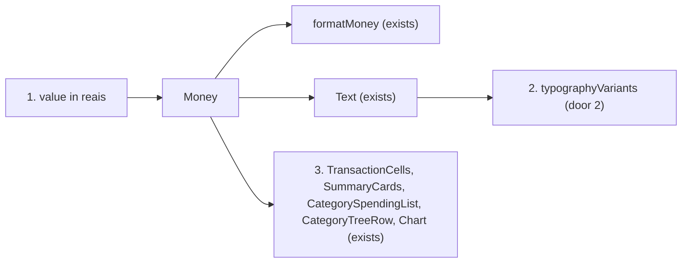

# Money display

**Approved**: 2026-11-23 - user: "Ok" (asked: "Aprova o plano assim, incluindo as duas suposições?")

## Problem

Money has four looks. Transaction lists use `components/amount/Amount.tsx`: JetBrains Mono, a hyphen and a space ("- R$ 1.234,50"), and left-aligned in the table, so the digits do not line up in a column. The Overview and the Categories tab call `formatMoney` by hand, each with its own classes. A second component, also called `Amount`, lives inside `CategorySpendingList.tsx:102`. The chart tooltip uses mono again. Many figures sit in 12 px captions: the per-member amounts, the "Previsto" line, "R$ X de R$ Y", the limit status and the split percentage. On the phone, the Income and Expense figures are 16 px, the same size as a label, because the type scale jumps from 16 to 24 px. Evidence: DESIGN-PLAN.md Track 3, S1 and S11 (survey 2026-11-17).

When this ships, every amount uses the app typeface with figures of equal width, a real minus sign and the same colour rules as today. Columns of amounts line up. No money figure or percentage reads smaller than 14 px.

## Shape

`Money` reuses `formatMoney` (the one locale and currency source) and the `Text` primitive, and it replaces both `Amount` components. Sign, tone and format rules run in `Money` and `typographyVariants`, which stories and unit tests reach.

1. a value in reais (signed) -> `Money` (new) - formats it with `formatMoney` (exists), which now writes a negative with U+2212 and no space and a value that rounds to zero as "R$ 0,00" (so sentences, inputs and axis ticks get the same minus), picks the colour from `tone`, and renders through `Text` (exists) with `numeric`
2. `typographyVariants` (exists) - gains the 20 px `figure` step and the `numeric` flag (door 2)
3. the screens that show money (exist) - transaction lists, Overview cards, category spending, Categories tab, chart tooltip - render `Money` for each standalone figure, and put sentences that carry an amount in a 14 px step with `numeric`
4. out: the same screens, with JetBrains Mono and both `Amount` components gone

**Changes underneath**

| Front | What changes |
| --- | --- |
| domain | nothing - presentation only |
| stored data | nothing to migrate |
| readers | `TransactionCells` (table, inline edit), `TransactionMobileList`, `NeutralReviewListView`, `PlanTrashListView`, `SummaryCards`, `CategorySpendingList`, `CategoryTreeRow`, `CategoryLimitFields`, `Chart` tooltip, `ItemsField` remainder |
| dependencies | `@fontsource-variable/jetbrains-mono` and the `--font-mono` token are removed |
| docs | `CLAUDE.md` ("money through `Money`, `formatMoney` and `CurrencyInput`") and the `component-creation` skill: money display (`Money`, not `Amount`) and the scale (eight steps) |

Data: none - presentation only.

## Surface

None - nothing consumed outside the frontend.

## Landing

| One-way door | Literal shape | Alternative rejected |
| --- | --- | --- |
| 1. The money pattern every screen copies | `<Money value={-1234.5} tone="bySign" variant="headline" />`, where `value` is signed, `tone` is `"default" \| "income" \| "expense" \| "bySign"` and `variant` is a typography step; lists pass `type === "DEBIT" ? -amount : amount` | keep `formatMoney` with classes at each call site: that is how four looks happened |
| 2. The scale step and flag | `typographyVariants({ variant: "figure", numeric: true })`, with `figure` = `text-xl font-bold` (20 px) and `numeric` = `tabular-nums` | a one-off `text-xl` at the Overview call site: the next screen would improvise again |

- Nothing else in this change is hard to reverse

## Criteria

### S1: One money component (P1)

Every amount comes out of one component with one format.

**Acceptance Criteria**

1. WHEN `Money` renders a value THEN the system SHALL show it in the pt-BR currency format, with U+2212 and no space before "R$" for a negative value
   - 1234.5 → "R$ 1.234,50"; -1234.5 → "−R$ 1.234,50"; 0 → "R$ 0,00"; -0.004 → "R$ 0,00" (strong case: rounds to zero, no minus)
2. The `Money` component SHALL render in the app typeface with tabular figures (`tabular-nums`) and never in a monospace face
3. WHEN `Money` has `tone` set THEN the system SHALL colour it: `income` → `text-success`; `expense` → `text-destructive`; `bySign` → `text-success` for a value ≥ 0 and `text-destructive` below 0; `default` → the inherited colour
   - bySign 0 → `text-success`; bySign -0.004 → `text-success` (strong case: shown as zero)
4. IF the value is 9999999999999.99 THEN `Money` SHALL keep it on one line ("R$ 9.999.999.999.999,99", no wrap)

### S2: Transaction lists (P1)

The four lists show amounts in the new format, aligned.

**Acceptance Criteria**

5. WHEN the transactions table, the phone list, the neutral review list or the trash list shows a debit of 1234.50 THEN the system SHALL show "−R$ 1.234,50" in `text-destructive`, and a credit of 1234.50 as "R$ 1.234,50" in `text-success`
6. WHEN the transactions table renders THEN the system SHALL right-align the amount column, both header and cells
7. WHEN an editor clicks an amount in the transactions table THEN the system SHALL show the inline amount input in the app typeface with tabular figures, not monospace

### S3: Overview (P1)

The Overview figures get their sizes and stop reading as captions.

**Acceptance Criteria**

8. WHILE the window is narrower than `sm` (640 px) the Overview SHALL show the Income and Expense figures in the `figure` step (20 px), and the result ("Saldo") in `headline` (24 px)
9. The Overview SHALL show the per-member amounts, the "Previsto" line and the neutral movements line of the summary cards at 14 px or larger
10. The Overview's category spending list SHALL show the spent amount, "de R$ Y", the limit status with its percentage, the member line, the focus line and the subcategory amounts at 14 px or larger
11. WHEN a user hovers or taps a month in the monthly trend chart THEN the tooltip SHALL show each value through `Money` at 14 px

### S4: Categories tab (P2)

**Acceptance Criteria**

12. The Categories tab SHALL show each category limit and each member limit amount through `Money` at 14 px or larger
13. WHEN an editor edits a category's per-member limits THEN the system SHALL show each member's share percentage at 14 px

### S5: Scale and guard (P1)

**Acceptance Criteria**

14. The type scale SHALL have eight steps: `display`, `headline` (24 px), `figure` (20 px), `title` (16 px), `label`, `body`, `secondary` (14 px) and `caption` (12 px), plus a `numeric` flag that adds `tabular-nums`
15. IF a production `.tsx` file outside `components/money/` renders `formatMoney(...)` directly as a JSX child THEN the frontend check SHALL fail; `formatMoney` stays allowed inside a translated sentence, an input's text and a chart axis formatter
16. The frontend SHALL contain no component named `Amount`, no `font-mono` class and no JetBrains Mono import

## Out of scope

| Excluded | Why |
| --- | --- |
| Colour roles (O13: expense totals in the foreground colour, red only for over-limit and negative) | user, 2026-11-23: "Cores como hoje": colours change once, in phase 5 with the Overview redesign |
| Dates and counters below 14 px ("12/11", "3/6") | user, 2026-11-23: "Só dinheiro e %"; they are supporting information |
| Filter chip labels ("Valor ≥ R$ 100") | the chip primitive is resized by S2, the touch tier |
| Chart axis ticks | a scale reference, not a figure; the chart is redrawn in O6 |
| New tokens (S10), badges (S4) | the next topics of phase 2 |

## Assumptions

| Assumption | Chosen default | Rationale | Confirmed? |
| --- | --- | --- | --- |
| A credit's sign | no "+": "R$ 50,00" in green | user, 2026-11-23: "Entrada sem sinal" | y |
| Which numbers the 14 px rule covers | money amounts and percentages only | user, 2026-11-23: "Só dinheiro e %" | y |
| Colours | as today: debit and expense red, credit and income green, the result by its sign | user, 2026-11-23: "Cores como hoje" | y |
| Sentences that carry an amount ("Previsto: R$ X", "restam R$ X") | stay one translated string with `formatMoney` inside, rendered in a 14 px step with `numeric` | splitting translated sentences around a component breaks word order across languages; user approved with the plan, 2026-11-23 | y |
| Where the minus goes | U+2212 attached to "R$" ("−R$ 1.234,50"), the position pt-BR `Intl` uses | follows the locale; only the glyph changes; user approved with the plan, 2026-11-23 | y |
| Space Grotesk has tabular figures and a U+2212 glyph | yes | measured 2026-11-23: "1111" and "0000" are equally wide with `tabular-nums`, and the minus renders in the font | y |

**Open questions:** none - all resolved or logged above.

## Sources

- `.specs/project/DESIGN-PLAN.md` Track 3, S1 and S11 - the request (a written survey item, no design): one `Money` component and the scale step
- No capture or design comes with the request: screens get outcomes, not layout
