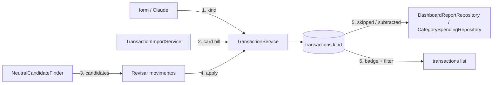
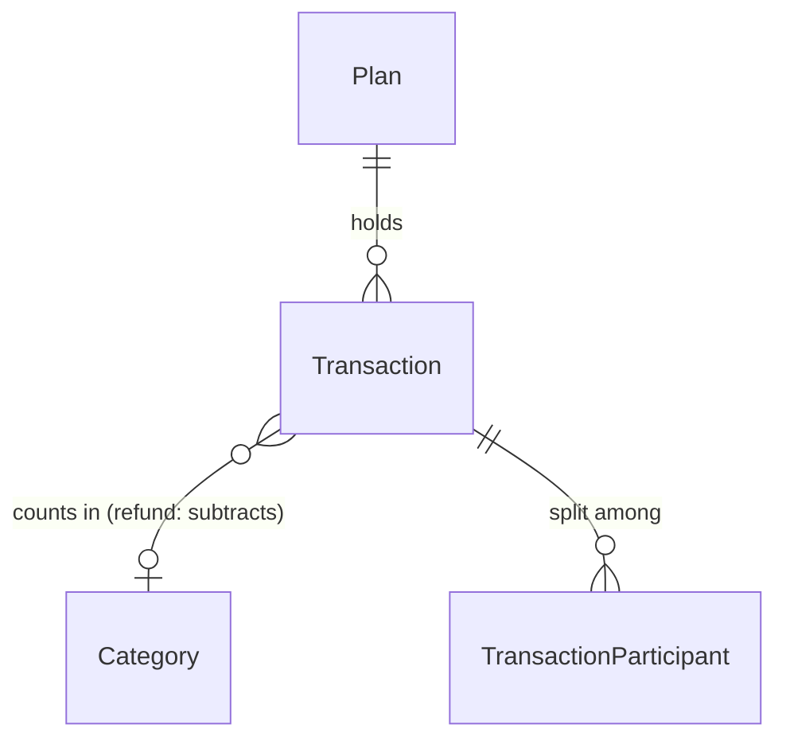

# Neutral Movements

**Approved**: 2026-11-19 - user: "Sim"

## Problem

findraco has two movement types, CREDIT and DEBIT, and every row counts as income or expense. The owners send card
purchases through Claude and both import their Nubank account statements into the shared plan (owner answers,
2026-11-17), so today:

- each card purchase counts twice: once as the purchase typed through Claude, once inside the "Pagamento de fatura"
  debit in the account statement;
- each Pix between the two owners counts twice: as an expense in the sender's statement and as an income in the
  receiver's, inflating both totals;
- money moved to savings or an investment counts as spending;
- a friend paying back half of a shared R$ 100 pizza counts as R$ 50 of income while Food keeps R$ 100, so both
  income and spending are inflated (owner, 2026-11-19).

The Overview's income, expenses, result, category totals and limits are all off by these amounts, and nothing on
screen says so.

When this ships, a transfer between the owners, a card bill payment and a savings move stay visible in the list but
count in no total, and a refund lowers the spending of the category it pays back.

## Shape

This reuses the transaction row and its type (the direction of the money) and adds one optional kind; the aggregates
already filter rows explicitly (AD-006), so the rule lands in the same repositories the trash filter touched, which the
backend ITs reach. The matching rules for imports and the review list run in the backend.

1. a row enters (form, Claude) -> `TransactionService` (exists) - stores `kind` (door 1) under the kind rules: a
   neutral kind has no category, split or items; a refund is a CREDIT with an expense category
2. a statement enters -> `TransactionImportService` (exists) - stores "Pagamento de fatura" rows as card bill
   payments; everything else as today
3. `NeutralCandidateFinder` (new) - lists rows with no kind whose bank text matches a rule: a Pix to or from a plan
   member → transfer; "Pagamento de fatura" → card bill payment (rows imported before this change)
4. a member applies a candidate -> `TransactionService` (exists) - sets the kind on that row
5. `DashboardReportRepository`, `CategorySpendingRepository` (exist) - leave neutral rows out of every sum, and
   subtract refunds from expenses, from their category and from the member they are attributed to
6. out: the list shows a badge per kind and a "Neutros" filter; the Overview shows "Neutros" under the result; the MCP
   tools take and return `kind`

**Changes underneath**

| Front | What changes |
| --- | --- |
| domain | "expense" meant every DEBIT row; now a DEBIT row with no kind, minus refunds. "income" meant every CREDIT row; now a CREDIT row with no kind - read by the dashboard summary, monthly trend, person breakdown, category spending and limits, the MCP summary and category tools |
| domain | a category had the transaction's type; a refund (CREDIT) now carries an expense (DEBIT) category - `Transaction` and `RecurrenceDefinition` check the match today |
| stored data | nothing migrated: existing rows have no kind and count as before until a member applies a candidate |
| readers | Overview cards, trend chart, person breakdown, category list and limits; transactions list (badge, filter); MCP list, create, update, summary |

New: `transactions.kind`. One-way constraints: `kind` in a closed set, null for a normal row (door 1).

## Surface

| Route | In | Out | Status | Who |
| --- | --- | --- | --- | --- |
| `POST`, `PUT /plan/{planId}/transaction` | `kind` (optional: `TRANSFER`, `CARD_BILL_PAYMENT`, `SAVINGS`, `REFUND`) | `kind` on the row | `200`, `422` `neutral-kind-invalid`, `404` outside the plan | members who may create or edit the row today |
| `GET /plan/{planId}/transaction` | `kind` filter (`NEUTRAL` = any kind) | rows with `kind` | `200`, `404` | any member |
| `GET /plan/{planId}/transaction/neutral-candidates` | page | rows with `proposedKind` | `200`, `404` | any member; a contributor sees only rows they created |
| `POST /plan/{planId}/transaction/{id}/kind` | `kind`, `version` | the row | `200`, `409` stale version, `422`, `404` | members who may edit the row |
| `GET /plan/{planId}/dashboard` | - | `neutralOut`, `neutralIn` | `200`, `404` | any member |

## Landing

| One-way door | Literal shape | Alternative rejected |
| --- | --- | --- |
| 1. a kind on the row | `V29`: `alter table transactions add column kind varchar(32) null constraint ck_transactions_kind check (kind in ('TRANSFER','CARD_BILL_PAYMENT','SAVINGS','REFUND'))`; null is a normal income or expense | a third `TransactionType`: loses the direction of the money, and every `switch` over the type would need a branch; full accounts first (R7): blocks the fix behind the largest item |
| 2. the API field | `kind` on transaction requests and responses, `kind` filter on the list, `kind` on the MCP `create_transaction` / `update_transaction` / `list_transactions` | a boolean `neutral` plus a separate refund flag: two fields that can contradict |

- Nothing else in this change is hard to reverse

## Criteria

### S1: neutral rows leave the totals (P1)

A transfer, a card bill payment and a savings move count in nothing.

**Acceptance Criteria**

1. WHILE a row has kind TRANSFER, CARD_BILL_PAYMENT or SAVINGS the system SHALL count it in no income, expense, result, monthly trend, person breakdown, category total or limit
   - November: R$ 3,000 salary, R$ 200 market, R$ 1,500 card bill payment, R$ 500 Pix to the partner → income 3,000.00, expenses 200.00, result 2,800.00
2. IF a request gives a neutral kind together with a category, a split with someone else or items THEN the system SHALL answer 422 `neutral-kind-invalid` and store nothing
3. WHEN the Overview shows a period with neutral rows THEN it SHALL show a "Neutros" line under the result with the money out and the money in, outside the totals
   - R$ 1,500 bill + R$ 500 Pix sent + R$ 500 Pix received → "Neutros" out 2,000.00, in 500.00

### S2: refunds lower spending (P1)

**Acceptance Criteria**

4. WHILE a CREDIT row has kind REFUND the system SHALL subtract it from its category's spending, from the period's expenses and from the spending of the member it is attributed to, and SHALL count it in no income
   - R$ 100 pizza in Food + R$ 50 refund in Food → Food 50.00, expenses 50.00 lower, income unchanged
5. IF a refund has no category, a category of type CREDIT, or the row is a DEBIT THEN the system SHALL answer 422 `neutral-kind-invalid`
6. WHILE a category has a limit the limit SHALL be measured against its spending net of refunds
   - limit 80.00, pizza 100.00, refund 50.00 → 50.00 of 80.00, not over

### S3: imports and review (P1)

**Acceptance Criteria**

7. WHEN a Nubank statement row's text starts with "Pagamento de fatura" THEN the import SHALL store it with kind CARD_BILL_PAYMENT
8. WHEN a member opens "Revisar movimentos" THEN the system SHALL list rows with no kind that match a rule - a Pix whose counterpart name contains a plan member's first and last name (accents and case ignored) → TRANSFER; text starting with "Pagamento de fatura" → CARD_BILL_PAYMENT - newest first, each with its proposed kind
   - "Transferência enviada pelo Pix - MARINA SOUZA LIMA - ..." with member "Marina Lima" → TRANSFER; "... - MARINA COSTA - ..." → not listed
9. WHEN a member applies a candidate THEN the system SHALL set its kind (200), the row SHALL leave the review list and the totals SHALL change at once; a candidate not applied SHALL change nothing
10. WHILE no row matches THEN "Revisar movimentos" SHALL show its empty state

### S4: seeing and choosing the kind (P1)

**Acceptance Criteria**

11. WHEN a member picks a kind in the transaction form THEN the form SHALL hide category and split for a neutral kind, keep category for a refund, and save the kind; reopening the row SHALL show the kind chosen
12. WHILE a row has a kind the list SHALL show a badge naming it ("Entre membros", "Fatura", "Guardar", "Reembolso") on desktop and phone
13. WHEN the list is filtered by "Neutros" THEN it SHALL show only rows with a kind
14. WHEN Claude creates or updates a transaction with `kind` THEN the system SHALL apply the same rules as criteria 2 and 5, and `list_transactions` SHALL return each row's kind

## Out of scope

| Excluded | Why |
| --- | --- |
| A kind on a series | occurrences of a recurring savings move are marked one by one until R7 accounts make it a transfer |
| Linking the two sides of a Pix between members | comes with accounts (R7) as one transfer |
| Charging people outside the plan | R17; a refund records the money that came back, not the debt |
| Account balances | R7 |
| Detecting savings moves in imports | no statement sample of the bank's text; marked by hand or by Claude |
| Undoing an applied candidate from the review list | the kind is changed back in the row's form |

## Assumptions

| Assumption | Chosen default | Rationale | Confirmed? |
| --- | --- | --- | --- |
| Kinds | TRANSFER, CARD_BILL_PAYMENT, SAVINGS, REFUND | owner answers 2026-11-19 | y |
| Import applies card bills, only proposes Pix | as chosen | owner: "Fatura sim, Pix só sugere" | y |
| Old rows | review list, no backfill | owner: "Lista para revisar" | y |
| Overview | "Neutros" line, out of the totals | owner: "Linha 'Neutros R$ X'" | y |
| Category on neutral rows | none; refund keeps the purchase's category | owner: "Sem categoria agora" | y |
| Claude | `kind` on create, update and list | recommended, accepted with the plan | y |
| Refund attribution | like any row: the creator by default, or a split among members | owner 2026-11-19: "De quem lançou" | y |
| "Neutros" line content | money out and money in, separately | owner 2026-11-19: "Saiu e entrou" | y |
| A kind on a series | later, with accounts (R7) | owner 2026-11-19: "Depois, com as contas" | y |

**Open questions:** none - all resolved or logged above.

## Sources

- `.specs/project/DESIGN-PLAN.md` R3, R7, R17; owner answers 2026-11-17 and 2026-11-19.
