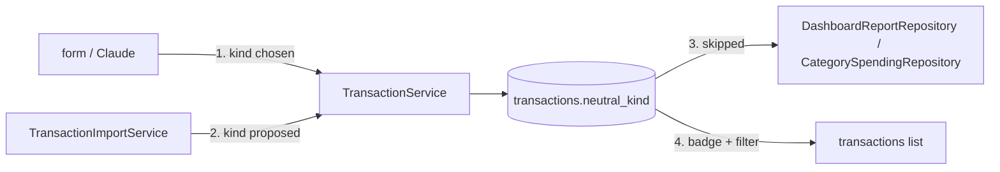

# Neutral Movements

**Approved**: not yet - draft for the owner's review (unattended run, 2026-11-18). Nothing here is built.

> Why this was not built overnight: it changes what every total counts and adds a stored column every aggregate reads.
> A wrong default here rewrites months of figures, so the product decisions below wait for the owner.

## Problem

findraco has two movement types, CREDIT and DEBIT, and every one counts as income or expense. The owners send card
purchases through Claude and both import their Nubank account statements into the shared plan (owner answers,
2026-11-17), so today:

- each card purchase counts twice: once as the purchase typed through Claude, once inside the "Pagamento de fatura"
  debit in the account statement;
- each Pix between the two owners counts twice: as an expense in the sender's statement and as an income in the
  receiver's, inflating both totals;
- money moved to savings or an investment counts as spending.

The Overview's income, expenses, result, category totals and limits are all off by these amounts, and nothing on
screen says so.

When this ships, a movement that is not income or spending - a transfer between the owners, a card bill payment, a
savings move - stays visible in the list but counts in no total.

## Shape (proposal)

This reuses the transaction row and its type (the direction of the money) and adds one optional kind that takes it out
of the totals; the aggregates already filter rows explicitly (AD-006), so the rule lands in the same repositories the
trash filter touched.

1. a row enters (form, import, Claude) -> `TransactionService` (exists) - stores `neutral_kind` when given (door 1)
2. `TransactionImportService` (exists) - proposes a kind per row from its bank text: "Pagamento de fatura" → card bill payment; a Pix whose counterpart name matches a plan member → transfer between members
3. `DashboardReportRepository`, `CategorySpendingRepository` (exist) - skip rows with a kind
4. out: the list shows the row with a "Neutro" badge and a filter; the Overview totals leave it out

## Landing (proposal)

| One-way door | Literal shape | Alternative rejected |
| --- | --- | --- |
| 1. a kind on the row | `transactions.neutral_kind varchar(32) null check (neutral_kind in ('TRANSFER','CARD_BILL_PAYMENT','SAVINGS'))`; null means a normal income or expense | a third `TransactionType` (TRANSFER): loses the direction, and every `switch` over the type today would need a branch; full accounts first (R7): blocks the fix behind the largest item |

## Decisions for the owner

| # | Question | Recommendation | Why |
| --- | --- | --- | --- |
| 1 | Which kinds exist? | Transfer between members, card bill payment, savings/investment move | The three cases the owners described; "other" invites misuse |
| 2 | Does the importer apply the kind it proposes, or only suggest it? | Apply it for card bill payments (the bank text is fixed); suggest it for Pix between members until the import review step (C10) exists | A false transfer hides a real expense; bill payments are unambiguous |
| 3 | What about rows already imported? | A one-off "Revisar movimentos" list of existing rows that match the rules, applied by the owner, no automatic backfill | A silent backfill would change past months without anyone seeing why |
| 4 | Are neutral rows shown on the Overview at all? | Not in totals; a small "Movimentos neutros R$ X" line under the result so the money is not invisible | Keeps the figures honest without hiding that money moved |
| 5 | Can a split or a category apply to a neutral row? | No category, no split | It is not spending; a category would count it in limits again |
| 6 | Does Claude get a `neutral` parameter? | Yes, on create and update | Claude is the capture channel |

## Criteria (to be finalised after the decisions)

1. WHILE a row has a neutral kind the system SHALL count it in no income, expense, result, category total or limit.
2. WHEN a statement row's text starts with "Pagamento de fatura" THEN the import SHALL store it as a card bill payment.
3. WHEN a member marks a row as neutral THEN the list SHALL show it with the "Neutro" badge and its kind.
4. WHEN the list is filtered by "Neutros" THEN it SHALL show only neutral rows.

## Out of scope

| Excluded | Why |
| --- | --- |
| Linking the two sides of a Pix between members | Comes free with accounts (R7) as one transfer |
| Repayments from people outside the plan | R17 |
| Account balances | R7 |

## Sources

- `.specs/project/DESIGN-PLAN.md` R3, R7, R17; owner answers 2026-11-17.
