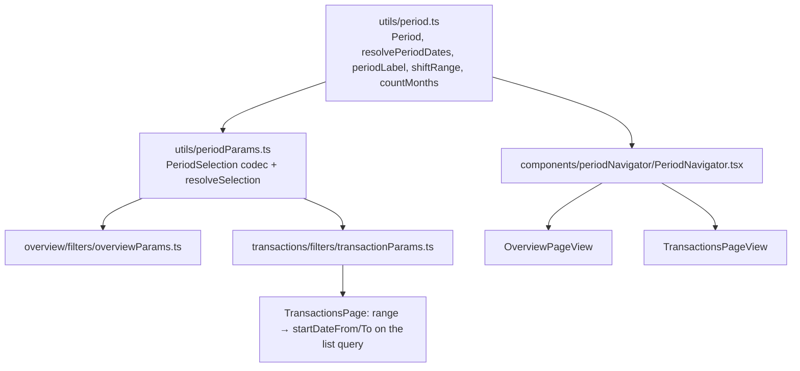

# Period Navigator Design

**Spec**: `.specs/features/period-navigator/spec.md`
**Status**: Approved

---

## Architecture Overview

The period model and the navigator leave `features/overview/` because Transactions becomes their second consumer (CLAUDE.md: features never import each other; code lifts one rung when a second consumer appears). Both screens then hold the same `PeriodSelection` in their own URL (AD-013: each screen's URL carries only its own filters), encoded by one codec with the same keys (`period`, `periodFrom`, `periodTo`). Sharing one selection across screens later (deferred option 2) becomes a storage change, not a format change.

---

## Code Reuse Analysis

### Existing Components to Leverage

| Component | Location | How to Use |
| --------- | -------- | ---------- |
| `periodLabel`, `shiftRange`, `PeriodRange` | `frontend/src/features/overview/utils/periodNavigator.ts` | Move to `utils/period.ts` unchanged |
| `countMonths` | `frontend/src/features/overview/utils/periodMonths.ts` | Move to `utils/period.ts` unchanged (also used by `trendMonths.ts`) |
| `Period`, `resolvePeriodDates`, `DEFAULT_PERIOD`, preset parse/serialize | `frontend/src/features/overview/filters/overviewParams.ts` | Period part moves to `utils/period.ts` / `utils/periodParams.ts`; Overview keeps only `overviewMember` |
| `PeriodNavigator` | `frontend/src/features/overview/components/PeriodNavigator.tsx` | Move to `components/periodNavigator/`; the label becomes a button |
| Page reset on filter change | `frontend/src/features/transactions/useTransactionsPage.ts` | Already keys the page on the serialized filters: once the period is in `TransactionFilters`, PNAV-01 AC 6 holds with no change |
| Saved state per (user, plan, screen) | `frontend/src/app/routing/PlanFiltersGate.tsx` | Keeps every key in `TRANSACTION_PARAM_KEYS`; adding the period keys there gives PNAV-03 |
| List filter | `PagedTransactionsFilter.startDateFrom/To` | Filled from the resolved range at query time, never from the URL |

### Integration Points

| System | Integration Method |
| ------ | ------------------ |
| Transactions list API | Unchanged; `startDateFrom` / `startDateTo` now always set |
| URL / saved filters | `TRANSACTION_PARAM_KEYS` gains `period`, `periodFrom`, `periodTo` and drops `from`, `to` |

---

## Components

### `utils/period.ts`

- **Purpose**: The period vocabulary shared by both screens.
- **Location**: `frontend/src/utils/period.ts` (+ `period.test.ts`, the moved cases of `periodNavigator.test.ts`, `periodMonths.test.ts` and the `resolvePeriodDates` cases of `overviewParams.test.ts`)
- **Interfaces**: `type Period`, `PERIODS`, `DEFAULT_PERIOD`, `type PeriodRange`, `resolvePeriodDates(period, now): PeriodRange`, `periodLabel(range)`, `shiftRange(range, ±1)`, `countMonths(start, end)`
- **Reuses**: the three existing modules, moved; `presetRange` (an alias of `resolvePeriodDates`) is dropped

### `utils/periodParams.ts`

- **Purpose**: One codec for a screen's period in its URL.
- **Location**: `frontend/src/utils/periodParams.ts` (+ `periodParams.test.ts`)
- **Interfaces**:
  - `type PeriodSelection = { period: Period; customRange: { from: string; to: string } | null }`
  - `PERIOD_PARAM_KEYS = ["period", "periodFrom", "periodTo"]`
  - `parsePeriodParams(params): PeriodSelection` - today's Overview rules: `period=custom` with valid `periodFrom ≤ periodTo` → custom; any other custom → `DEFAULT_PERIOD`; unknown or missing token → `DEFAULT_PERIOD`
  - `serializePeriodParams(selection): Record<string, string>` - default preset emits nothing
  - `resolveSelection(selection, now): PeriodRange`
- **Reuses**: `parseDate` from `utils/searchParams.ts`

### `PeriodNavigator`

- **Purpose**: "‹ label ›" + Range menu + range calendar, on both screens.
- **Location**: `frontend/src/components/periodNavigator/PeriodNavigator.tsx` (+ story)
- **Interfaces**: props unchanged: `range`, `period`, `isCustom`, `onPresetChange`, `onRangeChange`
- **Change**: the label is a ghost `Button` that calls the same `openCalendar` as Custom…; accessible name `Choose period, <label>`; the label text keeps `aria-live="polite"`.
- **Reuses**: the existing component, moved.

### Transactions wiring

- `transactionParams.ts`: `TransactionFilters` gains `period: PeriodSelection`; `from`/`to` are no longer parsed or serialized (old links with them fall to This month, spec PNAV-05).
- `useTransactionFilters.ts`: the clearable keys also exclude `PERIOD_PARAM_KEYS`.
- `TransactionsPage.tsx`: `range = resolveSelection(transactions.period, new Date())` (memoized like `OverviewPage`), passed into the list query as `startDateFrom`/`startDateTo` and to the view as `navigator` props.
- `TransactionsPageView.tsx`: a `navigator` prop rendered on its own row above the search row.
- Date removed from `transactionFilterDraft.ts`, `TransactionFilterPopoverView.tsx`, `useTransactionFilterChips.ts`, `activeFilterCount.ts`.

---

## Error Handling Strategy

| Error Scenario | Handling | User Impact |
| -------------- | -------- | ----------- |
| Invalid / partial / reversed custom range in the URL | `parsePeriodParams` returns `DEFAULT_PERIOD` | Lands on the current month |
| Old `from`/`to` params | Not in the keys; the gate drops them | Lands on the current month |
| Month with no rows | Existing empty state | "No transactions found." |

---

## Risks & Concerns

| Concern | Location (file:line) | Impact | Mitigation |
| ------- | -------------------- | ------ | ---------- |
| Overview tests import from the moved modules | `overviewParams.test.ts`, `periodNavigator.test.ts`, `periodMonths.test.ts`, `PlanFiltersGate.test.tsx` | Broken imports | Tests move with their subjects in the same task; no case deleted |
| `TransactionsPage.test.tsx` cases that set a date filter through the popover | `frontend/src/features/transactions/TransactionsPage.test.tsx` | They test a removed control | Rewrite them against the navigator (the amended outcome), not delete |
| The list query now always carries dates | `TransactionsPage.tsx` | MSW handlers in flow tests may assert the exact query | Update assertions to include the current month's dates (tests fix `now` via fake timers where they already do) |

---

## Tech Decisions

| Decision | Choice | Rationale |
| -------- | ------ | --------- |
| Transactions URL keys | `period`, `periodFrom`, `periodTo` (same as Overview), `from`/`to` dropped | One codec; shared period later is a storage change only. Conforms to AD-013 (each screen's URL holds its own copy) |
| Date into the query | Derived from the resolved selection at query time | A preset stays relative (This month in November is November) |
