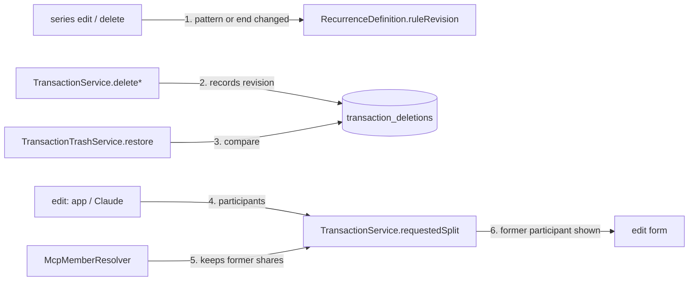
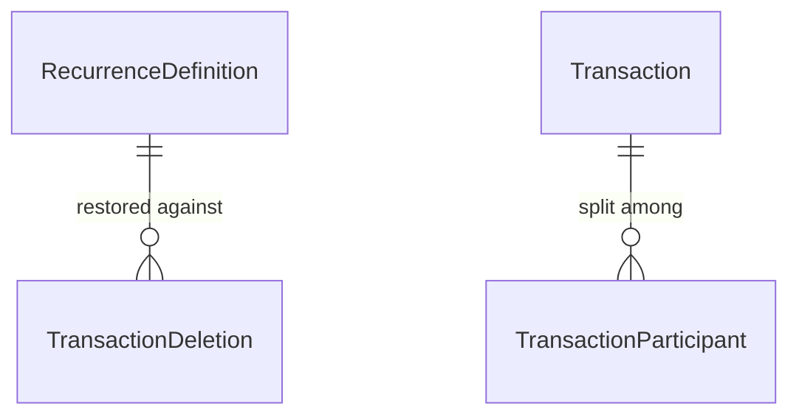

# Phase 1 follow-ups

**Approved**: 2026-11-19 - user: "Sim"

## Problem

Two rules shipped in phase 1 refuse what the owner considers normal use.

- Trash: a series deletion stores the series' optimistic-lock version, and a restore refuses (409
  `trash-series-changed`) when the version moved. Any later change to the series moves it - deleting another
  occurrence "only this", deleting a later tail, a flag change - so deleting March and then April leaves March
  unrestorable although nothing March depends on changed.
- Former members: `TransactionService.requestedSplit` accepts only current plan members as participants. A row or
  series already split with someone who left the plan therefore cannot be edited at all, in the app or through
  Claude (MCP C25 answers "This transaction is shared with someone who is no longer in the plan, so it cannot be
  changed through Claude."). The owner: "Pensa eu ficar com um gasto ali que pode estar errado, no meu plano, e não
  poder fazer nada a respeito".

When this ships, an older deletion stays restorable until the series' amount, rule or end changes, and a row shared
with a former member is edited like any other row.

## Shape

This reuses the deletion's stored comparison and the existing split resolver; both rules run in
`TransactionTrashService` and `TransactionService`, which the backend ITs reach.

1. a series edit -> `RecurrenceDefinition` (exists) - raises `ruleRevision` only when what an occurrence carries
   actually changes: amount, description, category, split, or the parcels of an installment series (door 1); an
   end date, an exception date, a flag, the trash and the generation mark leave it alone
2. `TransactionService` (exists) - a deletion records the definition's `ruleRevision` instead of its version
3. restore -> `TransactionTrashService` (exists) - 409 only when it would bring back stale data: the recorded
   revision differs, the occurrence's date lies outside the series' current range, or a tail's end moved since its
   cut
4. an edit with participants -> `TransactionService.requestedSplit` (exists) - accepts a current member, or a member
   already on the row or series being edited; a former member on a new row stays 422 `participant-not-member`
5. `McpMemberResolver` (exists) - stops refusing rows shared with a former member and sends their shares on
6. out: the edit form lists a former participant with their stored name and "(fora do plano)", so their share can
   be seen, changed or removed

**Changes underneath**

| Front | What changes |
| --- | --- |
| domain | `TransactionDeletion.definitionVersion` meant the series' lock version, now means its rule revision - read only by `TransactionTrashService.undoSeriesChange` and `followSeriesCategoryMove` |
| stored data | new `recurrence_definitions.rule_revision` starts at 0; existing deletions' `definition_version` is reset to 0 for active series in the migration, so deletions made before it become restorable unless the rule changes later |
| readers | the trash restore; the transaction and series edit endpoints; the MCP `update_transaction`; the edit form |

New: `recurrence_definitions.rule_revision`. One-way constraints: `rule_revision bigint not null default 0` (door 1).

## Surface

None - no route or signature changes; `PUT` transaction and series accept former participants already on the row.

## Landing

| One-way door | Literal shape | Alternative rejected |
| --- | --- | --- |
| 1. a rule revision on the series | `V28`: `alter table recurrence_definitions add column rule_revision bigint not null default 0`; `update transaction_deletions set definition_version = 0 where definition_trashed = false` | a snapshot of amount, rule and end on each deletion: four more columns that every new series field would have to join |
| 2. the end a "this and following" deletion cut the series to (added mid-build, V28 unshipped) | `V28`: `alter table transaction_deletions add column cut_parcels_number integer`, `add column cut_end_date date`; existing tail deletions take the series' current end | comparing a counter that also rises on a cut: it cannot let a tail restore and an earlier "only this" deletion both pass, in either order |

- Nothing else in this change is hard to reverse

## Criteria

### S1: restore survives unrelated series changes (P1)

An older deletion comes back unless the series it belonged to was rewritten.

**Acceptance Criteria**

1. WHEN a member restores an occurrence or tail deletion after later "only this" deletions or "only this" edits of other occurrences of the same series THEN the system SHALL restore it (200)
   - delete March, then April "only this" → restore March 200; delete March, then edit May "only this" → restore March 200
2. IF the series' amount, description, category, split or installment parcels changed after the deletion, or the
   deleted occurrence now lies outside the series (after its end date, or beyond its last parcel), or a "this and
   following" deletion's cut end has moved since THEN the restore SHALL answer 409 `trash-series-changed` and change
   nothing
   - delete March, then edit all with a new amount → 409; 6 parcels, delete parcel 3, then edit all to 8 parcels → 409;
     delete May, then edit all with an end in April → 409; delete "June and following", then move the series' end →
     restore of the June deletion 409
   - delete March, then delete "June and following" → restore March 200 (March is inside the series), then restore
     June 200 and the series ends where it did before; delete March, delete "June and following", restore June, then
     March → 200
3. WHEN a series edit changes only the confirmation flag THEN an older deletion SHALL stay restorable (200)
4. WHEN a deletion made before this change is restored and the series' rule has not changed since THEN the system SHALL restore it (200)

### S2: rows shared with a former member stay editable (P1)

A former member's share never freezes a row.

**Acceptance Criteria**

5. WHEN a member edits a row split with a former member, keeping that participant THEN the system SHALL save it (200) with the former member's share recalculated from the new amount
   - 100.00 equal with Ana (left) → edit to 120.00 → Ana 60.00
6. WHEN a member edits a series split with a former member, keeping that participant THEN the system SHALL save it (200)
7. IF a request puts a former member on a row they are not already on THEN the system SHALL answer 422 `participant-not-member`
8. WHEN Claude updates a row shared with a former member THEN the tool SHALL change it and keep the former member's share
9. WHEN a member opens the edit form of a row split with a former member THEN the form SHALL list them with their name and "(fora do plano)", and saving without touching the split SHALL keep their share

## Out of scope

| Excluded | Why |
| --- | --- |
| Re-adding a former member after removing them in the same edit | the form only lists who is on the saved row; they come back only by cancelling the edit |
| Trash restore after a category deletion | already handled by `followSeriesCategoryMove`; unchanged |

## Assumptions

| Assumption | Chosen default | Rationale | Confirmed? |
| --- | --- | --- | --- |
| What "a série mudou" covers | amount, description, category, split, installment parcels; plus, for a restore, whether the occurrence is still inside the series and whether a tail's end is where its cut left it | the owner chose "Permitir" (2026-11-19): a restore is refused only when it would bring back stale data | y |
| Flag-only edits | do not block | the restored rows keep their own status | y |
| Former participant label | "(fora do plano)" / "(no longer in the plan)" | the owner approved keeping their share visible | y |

**Open questions:** none - all resolved or logged above.

## Sources

- Owner answers 2026-11-19 in chat: trash "Só bloquear se a série mudou"; former members "Se o plano é meu, por que eu não poderia editar?", "Cara, pra mim faz sentido"; plan approved "Sim".
- `.specs/features/transaction-trash/plan.md` AC 9; `.specs/features/mcp-capture-hub/checks.md` C25.
