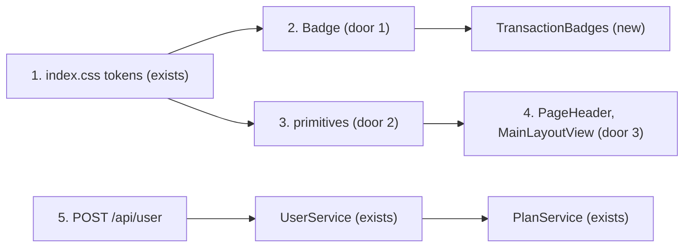
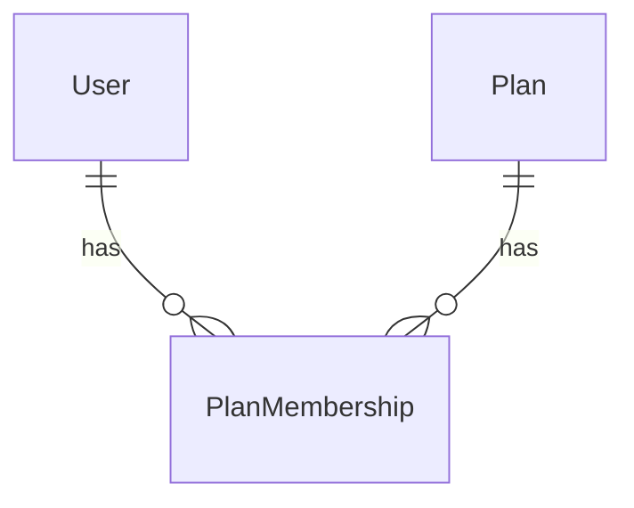

# Phase 2 foundations

**Approved**: 2026-11-23 - user: "Yes" (asked: "Do you approve the plan, including those four assumptions?")

## Problem

The visual system has drifted, and it costs every later screen (DESIGN-PLAN.md Track 3 and Track 4, survey 2026-11-17, measured again 2026-11-23):

- **Badges:** a "Previsto" marker and a category are the same outline pill, so a forecast reads as a category. "Pendente" is built from a class override on `outline`. Each screen picks `secondary` or `outline` by habit. A transaction split into line items shows no marker at all.
- **Dead tokens:** five chart ambers, eight `--sidebar-*` tokens and `--font-serif` are defined in both themes and used nowhere.
- **Focus and fields:** the focus ring is amber at 50%, 1.45:1 against a card in the light theme. Field borders are 1.49:1. The minimum for both is 3:1 (WCAG 2.x SC 1.4.11). Nothing honours the OS "reduce motion" setting.
- **Touch:** on the phone, buttons are 36 px, the `sm` size 28 px and icon buttons 32 px. Confirm sits next to edit, and archive next to rename.
- **Page shell:** three of the four pages have no heading. The content edge jumps from about 1408 px (Overview, Transactions, Categories) to 736 px (Plans) between tabs. Categories shows two filled amber buttons 60 px apart.
- **Sign-up:** a new account's first plan is called "My plan" even on a Portuguese device, and its time zone is São Paulo until the first signed-in request.
- **Locale:** the split share in the category form reads "61.8%".

When this ships:
- every marker says what kind of thing it is;
- keyboard focus and empty fields are clearly visible;
- every phone control is a 44 px target;
- every page has a visible title and the same edges;
- a new Portuguese account starts with "Meu plano" in its own time zone.

## Shape

This reuses the existing primitives (`Badge`, `Button`, `Toggle`, `Input`, `InputGroup`, `NumberField`, `Select`, `Combobox`), `PageHeader`, `MainLayoutView` and the theme tokens in `index.css`, changing them in place rather than adding parallel components. The rules that decide what a user sees run in those primitives' variants, which stories reach. The sign-up defaults run in `UserService` and `PlanService`, which ITs reach.

1. theme tokens - `index.css` (exists): `--ring` and `--input` change in both themes, and the dead tokens go
2. `Badge` (exists) - gains the `status`, `tag` and `meta` families (door 1); `TransactionBadges` (new) is the one badge row the table and the phone list render
3. primitives (exist) - a 44 px touch tier below `sm` inside their size variants (door 2), and a solid focus ring
4. `PageHeader` (exists) - gains a context slot; `MainLayoutView` (exists) caps the content width (door 3); the four pages render it
5. `POST /api/user` -> `UserService` (exists) - stores a valid device `Time-Zone`, then `PlanService` (exists) names the first plan from the device language

**Changes underneath**

| Front | What changes |
| --- | --- |
| domain | the first plan's name follows the device language; nothing branches on the name |
| stored data | nothing to migrate: existing plans and users keep their values |
| readers | the transaction table and phone list, the plan invitations list, the plans page, categories tree and spending list (badges); every screen with a field, button or toggle (focus, border, touch); Overview, Transactions, Categories and Plans (page shell); sign-up (plan name, time zone); the category limit fields (share percentage) |
| docs | the `component-creation` skill: badge families, touch tier, page shell |

New: nothing - existing columns get different values at sign-up.

## Surface

| Route | In | Out | Status | Who |
| --- | --- | --- | --- | --- |
| `POST /api/user` | headers `Time-Zone` and `Accept-Language` now read, both optional | unchanged | `201` unchanged; a missing or invalid header is ignored, never an error | anyone (public sign-up), unchanged |

## Landing

| One-way door | Literal shape | Alternative rejected |
| --- | --- | --- |
| 1. Badge families | `<Badge variant="status" tone="neutral" icon={<ClockIcon />}>`, with `tone` = `"neutral" \| "warning" \| "success" \| "destructive"`; `<Badge variant="tag">` for categories only; `<Badge variant="meta">` for roles, counts, series, kinds and items. The old `default`, `secondary`, `outline`, `success` and `destructive` badge variants are removed; the badge renders `data-variant` and, for `status`, `data-tone` | keep the five generic variants with class overrides: that is how a forecast and a category came to look the same |
| 2. Touch tier | inside each primitive's size variant, `max-sm:h-11` (and `max-sm:size-11` for icon sizes) before the desktop height, e.g. `sm: "max-sm:h-11 max-sm:min-w-11 h-7 …"`; the `min-w-11` keeps a button whose label is hidden on the phone 44 px wide (added after the walk) | an invisible hit-area pseudo-element: neighbouring targets overlap (user, 2026-11-23: "Grow them visibly") |
| 3. Page shell | `MainLayoutView` content `mx-auto w-full max-w-7xl` (1280 px); `<PageHeader title context actions />` as each page's first child | a width per page: the edge jumps between tabs |

- Nothing else in this change is hard to reverse

## Criteria

### S1: Badges say what they mark (P1)

**Acceptance Criteria**

1. WHEN a transaction is a forecast THEN the table and the phone list SHALL show "Previsto" as a `status` badge with tone `neutral`: a muted tinted background, a clock icon and no border
2. WHEN a transaction is pending THEN the table and the phone list SHALL show "Pendente" as a `status` badge with tone `warning`: a warning tint and a triangle-alert icon
3. The transaction table SHALL show a category as a `tag` badge (outline, no tint, no icon), and no badge other than a category SHALL use `tag`
4. WHEN a transaction has line items THEN the table and the phone list SHALL show a `meta` badge with the count
   - 1 item → "1 item"; 3 items → "3 itens"; 0 items → no badge
5. The table and the phone list SHALL render one shared badge row in the order status, kind, series, items
6. The series, kind, role, default plan, ongoing, trash-series, participants, member owner, "+N" overflow and active-filter count badges SHALL use `meta`
7. The plan invitations list SHALL show each status as a `status` badge: `PENDING` neutral with a clock icon, `ACCEPTED` success with a check icon, `EXPIRED` neutral with no icon, `REVOKED` destructive with an x icon
8. The theme SHALL define no `--chart-1` to `--chart-5`, no `--sidebar*` and no `--font-serif` token

### S2: Focus, fields and motion are visible (P1)

**Acceptance Criteria**

9. WHEN a button, toggle, input, select, combobox, number field or badge link takes keyboard focus THEN the system SHALL draw a solid ring in `--ring`, which SHALL be `#a14a07` in the light theme and `#f59e0b` in the dark theme, at 3:1 or more against card and background in both themes
10. WHEN a keyboard user focuses a clickable list row (a transaction in the phone list, a category row, a category spending row) THEN the system SHALL draw the same ring
11. The `--input` border SHALL reach 3:1 or more against card and background in both themes
12. WHILE the OS asks for reduced motion the system SHALL shorten every animation and transition to 0.01 ms

### S3: Phone controls are 44 px targets (P1)

**Acceptance Criteria**

13. WHILE the window is narrower than 640 px the system SHALL render every `Button` size at 44 px tall, and every icon size at 44 × 44 px
14. WHILE the window is narrower than 640 px the system SHALL render `Toggle` (chip included), `Input`, `InputGroup`, `NumberField`, the `Select` trigger and the `Combobox` input at 44 px tall
15. WHILE the window is 640 px or wider the system SHALL keep today's heights (`Button` default 36 px, `sm` 28 px, icon 32 px)

### S4: One page shell (P1)

**Acceptance Criteria**

16. The Overview, Transactions, Categories and Plans pages SHALL each start with a `PageHeader` whose `h1` reads "Visão geral", "Transações", "Categorias" and "Planos" (en: "Overview", "Transactions", "Categories", "Plans"), visible at every width
17. The page content SHALL be at most 1280 px wide and centred, so at 1440 px the four pages share the same left and right edges
18. The Categories page SHALL show "Nova categoria" and the Plans page "Novo plano" as outline buttons in the header's actions slot, so the global add is the only filled primary button on a page
19. WHEN a user uses the global add on any page, Categories included, THEN the system SHALL open the new transaction form

### S5: Sign-up defaults (P2)

**Acceptance Criteria**

20. WHEN someone signs up THEN the system SHALL name the first plan from the `Accept-Language` header's first language
   - "pt-BR,pt;q=0.9" → "Meu plano"; "pt-PT" → "Meu plano"; "en-US" → "My plan"; "fr-FR" → "My plan"; no header → "My plan"
21. WHEN someone signs up with a valid `Time-Zone` header THEN the system SHALL store that zone; IF it is missing or not a valid zone id THEN it SHALL store "America/Sao_Paulo"
   - "Europe/Lisbon" → "Europe/Lisbon"; "Mars/Base" → "America/Sao_Paulo"; none → "America/Sao_Paulo"
22. WHEN a user who lost their last plan gets a personal plan again THEN the system SHALL name it from the user's saved language, or "My plan" when none is saved
   - saved "pt-BR" → "Meu plano"; saved "en" → "My plan"; none → "My plan"

### S6: Locale fix (P2)

**Acceptance Criteria**

23. WHEN the category form shows a member's split share THEN it SHALL use the interface language's decimal separator
    - pt-BR 61.8 → "61,8%"; en 61.8 → "61.8%"; pt-BR 50 → "50%"

## Out of scope

| Excluded | Why |
| --- | --- |
| Chart series tokens and the over-limit stripe (rest of S10) | user, 2026-11-23: "With phase 5"; designed with O6/O13 |
| An `--info` colour | user, 2026-11-23: "Neutral + clock"; no consumer needs it |
| Renaming "Previsto"/"Pendente" ("A confirmar", C6) | the confirmation vocabulary is its own owner topic (phase 6) |
| Removable filter chips and selection idioms | S6, a later item; the chips only get the 44 px height here |
| Keyboard access to the click-to-edit table cells | not a focus-style change; noted for C-series daily flows |
| Existing plans named "My plan" | production data; the user can rename them |

## Assumptions

| Assumption | Chosen default | Rationale | Confirmed? |
| --- | --- | --- | --- |
| "Previsto" look | `status` neutral: muted tint, clock icon; no new colour | user, 2026-11-23: "Neutral + clock (Recommended)" | y |
| Items marker | `meta` badge "N itens", from the `items` the list already carries | user, 2026-11-23: "Yes, add it (Recommended)" | y |
| S10 scope now | delete the dead tokens; add only what the badges need | user, 2026-11-23: "With phase 5 (Recommended)" | y |
| Focus ring colour | light `#a14a07`, dark `#f59e0b`, solid | user, 2026-11-23: "Dark amber (Recommended)" | y |
| Field border | a warm grey `--input` at 3:1 or more, both themes | user, 2026-11-23: "Darker border (Recommended)" | y |
| Touch tier | grow controls visibly to 44 px below 640 px | user, 2026-11-23: "Grow them visibly (Recommended)" | y |
| Page title | visible at every width | user, 2026-11-23: "Visible everywhere (Recommended)" | y |
| Content width | one 1280 px cap, centred, Plans included | user, 2026-11-23: "One cap, ~1280 px (Recommended)" | y |
| Global add | always a new transaction; page creates become outline header actions | user, 2026-11-23: "Always a transaction (Recommended)" | y |
| First plan name | "Meu plano" / "My plan" from the device language | user, 2026-11-23: "'Meu plano' / 'My plan' (Recommended)" | y |
| Badge row order | status, kind, series, items | the most decisive first; both lists show series, kind, status today | y - approved with the plan, 2026-11-23 |
| Invitation status tones | pending neutral + clock, accepted success + check, expired neutral, revoked destructive + x | expired is a fact, not an alarm; revoked was an act | y - approved with the plan, 2026-11-23 |
| Reduced motion | honour the OS setting globally | the standard; no product choice in it | y - approved with the plan, 2026-11-23 |
| Dialogs and sheets | keep their own filled primary ("Salvar") | "one filled primary" is per page; a dialog is its own surface | y - approved with the plan, 2026-11-23 |

**Open questions:** none - all resolved or logged above.

## Sources

- `.specs/project/DESIGN-PLAN.md` Track 3 (S2, S3, S4, S10) and Track 4 (N5, N6), Track 5 (R12) - the request (a written survey item, no design)
- Contrast ratios computed from the theme tokens, 2026-11-23 (WCAG relative luminance)
- No capture or design comes with the request: screens get outcomes, not layout
