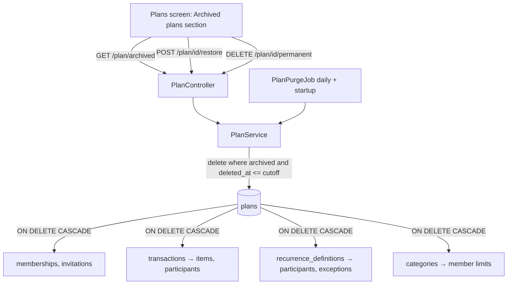

# Plan Deletion Design

**Spec**: `.specs/features/plan-deletion/spec.md`
**Status**: Approved (approach C, user 2026-11-03)

---

## Architecture Overview

A permanent deletion is one SQL statement, `DELETE FROM plans WHERE id = ? AND deleted_at IS NOT NULL AND deleted_at <= ?`. Every foreign key that points at `plans` becomes `ON DELETE CASCADE` (migration V21), so Postgres removes the plan's memberships, invitations, transactions (and, through their own cascades, items and participants), series definitions (participants, exceptions) and categories (member limits) in the same statement. The `WHERE` re-checks the archive inside the deleting transaction, which settles the restore-vs-purge race (spec Purge AC 4, Edge Case 1).

Two callers share that statement: "Delete now" (cutoff = now, so any archived plan) and the daily `PlanPurgeJob` (cutoff = now − 30 days, one plan per transaction).



Research (2026-11-03): Trello allows deleting only a closed board; GitLab keeps a deleted project "pending deletion" 7 days and a second delete removes it at once; GitLab's database guide asks for `ON DELETE CASCADE` on nearly every foreign key instead of application-side cascades, with an index on each FK column.

---

## Code Reuse Analysis

### Existing Components to Leverage

| Component | Location | How to Use |
| --------- | -------- | ---------- |
| `PlanService.getMembership` / `deletePlan` | `backend/.../plan/service/PlanService.java:108,200` | Same lookup shape; archived plans need a sibling lookup that accepts `deleted_at` set |
| `PlanAuthorization.requireCanManagePlan` | `plan/service/PlanAuthorization.java` | Not reused for archived plans: scope there is "OWNER or 404" (spec AC 4/5), checked by role directly |
| `SeriesTopUpJob` + `SeriesProperties` | `transaction/service/SeriesTopUpJob.java`, `transaction/config/SeriesProperties.java` | Copy the shape: `@Scheduled(cron)`, startup run unless `-`, per-item try/catch with `log.error` |
| `SeriesTopUpJobIT` | `backend/src/test/.../transaction/SeriesTopUpJobIT.java:39,57` | Builds the job with `Clock.fixed`; same for the purge job IT |
| `PlanAuthorizationMatrixIT` | `backend/src/test/.../plan/PlanAuthorizationMatrixIT.java` | Add the three endpoints × roles |
| `useDeletePlan` / `plan.handlers.ts` | `frontend/src/api/services/usePlanService.ts:177`, `plan.handlers.ts` | Pattern for the three new hooks and their MSW factories |
| `useConfirm` + Archive dialog | `frontend/src/features/plans/PlansPage.tsx:26` | Archive copy change; the typed-name dialog is a separate component (confirm has no input) |
| `PlanNameDialogView` | `frontend/src/features/plans/components/PlanNameDialogView.tsx` | Dialog + single text field layout to mirror for the delete dialog |
| `problems.ts` | `frontend/src/api/utils/problems.ts` | Copy for the new `plan-not-archived` type |

### Integration Points

| System | Integration Method |
| ------ | ------------------ |
| Database | V21 swaps the five FKs to `plans` for `ON DELETE CASCADE`; inner FKs (transactions → categories, items → categories, definitions → categories, transactions → definitions, categories → parent) stay `NO ACTION`, which Postgres checks at the end of the statement, after the cascade removed both sides |
| API contract | Three endpoints, one response record, one problem type; `openapi.json` regenerated in the same commit |
| Frontend types | Regenerated from the committed `openapi.json` |

---

## Components

### V21 migration `V21__cascade_plan_deletion.sql`

- **Purpose**: Make deleting a `plans` row remove everything scoped to it.
- **Location**: `backend/src/main/resources/db/migration/`
- **Interfaces**: drops and re-adds `fk_plan_memberships_plan`, `fk_plan_invitations_plan`, `fk_recdef_plan` (or its renamed name), `fk_transactions_plans`, `fk_categories_plans` with `ON DELETE CASCADE`, same names. The worker reads the current names from V2, V8, V13 and V16 before writing it.
- **Reuses**: naming convention of V13/V16.

### `PlanSchemaIT`

- **Purpose**: Fails when a foreign key to `plans` lacks `ON DELETE CASCADE`, so a future plan-scoped table cannot escape the purge.
- **Location**: `backend/src/test/java/com/lcs/findraco/plan/PlanSchemaIT.java`
- **Interfaces**: queries `pg_constraint` (`contype = 'f'`, `confrelid = 'plans'::regclass`) and asserts every `confdeltype = 'c'`.

### `PlanService` (extended)

- **Purpose**: The archived-plan use cases.
- **Location**: `backend/.../plan/service/PlanService.java`
- **Interfaces**:
  - `List<ArchivedPlanResponse> listArchived(long userId)` - archived plans where the user's membership is OWNER, newest archive first.
  - `PlanResponse restore(long planId, long userId)` - clears `deleted_at`; 404 unless an OWNER membership exists, 409 `plan-not-archived` when active.
  - `void deletePermanently(long planId, long userId)` - same guards, then `planRepository.deleteArchivedBefore(planId, clock.instant())`.
  - `List<Long> findPlanIdsArchivedBefore(Instant cutoff)` and `boolean purge(long planId, Instant cutoff)` - for the job; `purge` is `@Transactional` and returns whether a row went.
- **Dependencies**: `PlanRepository`, `PlanMembershipRepository`, `Clock`.

### `PlanRepository` (extended)

- `@Modifying @Query("delete from Plan p where p.id = :id and p.deletedAt is not null and p.deletedAt <= :cutoff") int deleteArchivedBefore(long id, Instant cutoff)`
- `@Query("select p.id from Plan p where p.deletedAt is not null and p.deletedAt <= :cutoff") List<Long> findIdsArchivedBefore(Instant cutoff)`
- `PlanMembershipRepository`: `findArchivedByUserIdAndRole(userId, OWNER)` (join fetch plan, `deletedAt is not null`) and `findByPlan_IdAndUser_Id`.

### `ArchivedPlanResponse`

- `record ArchivedPlanResponse(long id, String name, Instant archivedAt, Instant deletesAt)`; `deletesAt = archivedAt + PlanRetention.PERIOD`.

### `PlanRetention`

- **Purpose**: The 30-day period as one constant (AD-021 contract value).
- **Location**: `backend/.../plan/model/PlanRetention.java` - `public static final Duration PERIOD = Duration.ofDays(30)`; `Instant cutoff(Instant now)`.

### `PlanController` (extended)

- `GET /plan/archived` → 200 `ArchivedPlanResponse[]`
- `POST /plan/{id}/restore` → 200 `PlanResponse`
- `DELETE /plan/{id}/permanent` → 204

### `PlanPurgeJob` + `PlanPurgeProperties`

- **Location**: `plan/service/PlanPurgeJob.java`, `plan/config/PlanPurgeProperties.java` (`app.plans.purge-cron`, `@NotBlank`, default `0 0 4 * * *`, after the series top-up at 03:30).
- **Interfaces**: `run()`: cutoff from the clock, for each id `purge(id, cutoff)` in its own transaction, `log.error("Plan purge failed for plan {}", id, e)` on failure, then `log.info("Purged {} archived plans: {}", count, ids)`.

### Frontend service hooks (`usePlanService.ts`)

- `useGetArchivedPlans()` - key `["plans", "archived"]`.
- `useRestorePlan()` - invalidates `["plans"]` (prefix also refreshes the archived list).
- `useDeletePlanPermanently()` - invalidates `["plans", "archived"]`.
- MSW factories for the three in `plan.handlers.ts`.

### `ArchivedPlansSection` (container) + `ArchivedPlansListView` (presentational)

- **Location**: `frontend/src/features/plans/components/`
- **Purpose**: Fetches the archived list; renders nothing when empty, an inline error when the request fails, otherwise a `Card` "Archived plans" with one row per plan: name, "Archived on …", "Deleted permanently on …", Restore and Delete now buttons.
- Rendered by `PlansPageView` below the invitations card.

### `DeletePlanPermanentlyDialog` (container) + `DeletePlanPermanentlyDialogView`

- **Purpose**: Typed-name confirmation; the destructive button is disabled until the input equals the plan name exactly; submits `useDeletePlanPermanently`.
- **Reuses**: `PlanNameDialogView` layout, `FormField`, `Button variant="destructive"`.

---

## Data Models

```typescript
type ArchivedPlan = {
  id: number;
  name: string;
  archivedAt: string; // ISO instant
  deletesAt: string;  // archivedAt + 30 days
};
```

No new table; `plans.deleted_at` already exists (V4).

---

## Error Handling Strategy

| Error Scenario | Handling | User Impact |
| -------------- | -------- | ----------- |
| Restore / delete-now by a non-owner or on a missing plan | `PlanNotFoundException` → 404 `plan-not-found` | Existing copy "This plan no longer exists…" |
| Restore / delete-now on an active plan | new `PlanNotArchivedException` → 409 `plan-not-archived` | "This plan is no longer archived." and the lists refresh |
| Delete-now loses the race to a restore | `deleteArchivedBefore` returns 0 → 409 `plan-not-archived` | Same as above |
| Restore loses the race to a purge | lookup finds no plan → 404 | Existing copy; list refreshes |
| One plan fails in the job | caught per plan, logged by id, retried next run | None |
| Archived list request fails | section shows its own error | Active plans still usable |

---

## Risks & Concerns

| Concern | Location (file:line) | Impact | Mitigation |
| ------- | -------------------- | ------ | ---------- |
| `NO ACTION` inner FKs must not block the cascade | V13 (`fk_transactions_categories`), V7 (`fk_txn_items_category`), V8 (`fk_recdef_category`, `fk_transactions_recurrence_definitions`), `fk_categories_parent` | A purge failing with an FK violation | The delete-now IT seeds a plan with every row kind (child category, itemised transaction with a category, series with an exception, member limit, invitation) and asserts zero rows left per table; any violation fails the test |
| A hard `DELETE` on `plans` is now destructive | `PlanRepository` | Accidental data loss from a future query | The only delete query carries `deleted_at IS NOT NULL AND deleted_at <= :cutoff`; AD-023 records the rule |
| Plan setters are public | `plan/model/Plan.java:64` | Not a guarded aggregate | Out of scope; restore uses the existing setter, like `deletePlan` |
| Bulk JPQL delete bypasses the persistence context | `PlanService.deletePermanently` | Stale entities in the same transaction | The method loads nothing after the delete; the job runs one plan per transaction |
| Failure isolation in the job has no test without a fault | `PlanPurgeJob` | AC 3 asserted by review only | Recorded as a known test limit; mirrors `SeriesTopUpJob`, which has the same limit |

---

## Tech Decisions

| Decision | Choice | Rationale |
| -------- | ------ | --------- |
| Cascade mechanism | DB `ON DELETE CASCADE` on FKs to `plans` (option C) | Atomic, ordered by Postgres, future tables covered by `PlanSchemaIT`; A creates a plan ↔ transaction/category cycle, B hides the order in `@Order` |
| Retention | Code constant 30 days | AD-021: the dialog states it, so the frontend mirrors it |
| Delete-now route | `DELETE /plan/{id}/permanent` | `DELETE /plan/{id}` already means archive; changing it would break clients |
| Who may act | OWNER membership of the archived plan, checked directly | Archived plans are outside every other role's scope → 404 (AD-018) |

> **Project-level decision:** AD-023 (appended to `STATE.md` in T1): permanent plan deletion cascades in the database; every FK to `plans` is `ON DELETE CASCADE`, enforced by `PlanSchemaIT`; the archive (AD-006) still never cascades; the cascade is the accepted exception to AD-017's write-through-the-owner rule.
