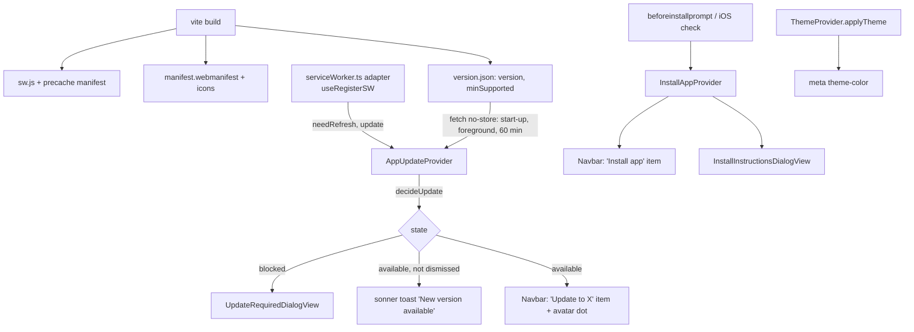

# PWA Design

**Spec**: `.specs/features/pwa/spec.md`
**Context**: `.specs/features/pwa/context.md`
**Status**: Approved (2026-11-01)

---

## Architecture Overview

`vite-plugin-pwa` (2.0, Workbox `generateSW`, `registerType: "prompt"`) generates the manifest, the icons and `sw.js` at build time. The app registers the worker through the plugin's React hook, wrapped in one adapter. Two global providers own the runtime behaviour: `AppUpdateProvider` (waiting worker + `version.json` → normal notice or blocking dialog) and `InstallAppProvider` (native prompt or iOS instructions). The navbar and the toaster only read them.



### Approaches considered

| Approach | Verdict |
| -------- | ------- |
| **`vite-plugin-pwa`, `generateSW` (chosen)** | Established Vite route: Workbox precache from the build graph, manifest and icons from one config, React hook for the prompt flow. Our code is only the decisions (when to show what). |
| `vite-plugin-pwa`, `injectManifest` (own worker source) | Needed only for custom worker logic (push, background sync). Nothing in scope needs it; switching later keeps the same registration side. |
| Hand-written `sw.js` | Reinvents precache versioning, cleanup of old caches and navigation fallback. Rejected. |

---

## Code Reuse Analysis

### Existing Components to Leverage

| Component | Location | How to Use |
| --------- | -------- | ---------- |
| `Toaster` / `ToasterView` | `src/app/layout/` | Update toast through `toast()` with `action`; add the mobile offset here |
| `Dialog` primitive | `src/components/dialog/base/Dialog.tsx` | Blocking dialog and iOS instructions dialog |
| `NavbarView` dropdown + `AppVersion` | `src/app/layout/NavbarView.tsx:52-70` | New items above the version line; dot on `Avatar` |
| `ThemeProvider.applyTheme` | `src/app/providers/ThemeProvider.tsx:6` | Also writes `theme-color` |
| Inline theme script | `frontend/index.html` | Also writes `theme-color` before first paint |
| `__APP_VERSION__` define | `vite.config.ts` | Running version compared against `version.json` |
| `lib/storage` (`storeItem`, `getItemFromStorage` + zod) | `src/lib/storage.ts` | Dismissed version, a new `STORAGE_KEYS` entry kept out of `clearSessionStorage` |
| `unreachable` session state | `src/app/providers/useAuthSession.ts:101` | Already covers the offline cold start; no new offline UI |

### Integration Points

| System | Integration Method |
| ------ | ------------------ |
| Vite build | `VitePWA({...})` in `vite.config.ts` + a small inline plugin that emits `version.json` |
| nginx (`frontend/nginx.conf`) | Cache headers per path |
| Test setup | `virtual:pwa-register/react` aliased to a fake in `src/test/` (external boundary) |

---

## Components

### Build: `VitePWA` config

- **Purpose**: Generate worker, manifest and icons.
- **Location**: `frontend/vite.config.ts`, `frontend/pwa-assets.config.ts`
- **Settings**:
  - `registerType: "prompt"`, `injectRegister: false` (registration happens in the adapter).
  - `manifest`: `name`/`short_name` "findraco", `start_url` "/", `scope` "/", `display` "standalone", `background_color` and `theme_color` `#f5f3ec` (manifest is static; the meta tag overrides it at runtime).
  - `workbox.globPatterns`: `**/*.{js,css,html,woff2,png,ico,svg,webmanifest}`; `globIgnores`: `findraco-logo.png` (1024 px source, 428 KB, never rendered); `navigateFallback` `index.html`; `navigateFallbackDenylist` `[/^\/api\//]`; no `runtimeCaching` (nothing under `/api` is ever cached). `version.json` is outside the glob, so never precached.
  - `devOptions.enabled` stays `false` (default): no worker under `vite dev` (PWA-02 AC 6).
  - `pwaAssets` (assets generator 2.x, `config: true` reading `pwa-assets.config.ts`): `public/findraco-logo.png` (it already leaves ~20% empty per side) with the `minimal-2023` preset and `padding: 0` overrides plus a `#f5f3ec` background on the maskable and apple assets (the preset defaults pad 30% on a white background), `overrideManifestIcons: true`, `includeHtmlHeadLinks: true`, `injectThemeColor: false` (we manage `theme-color`).
- **Reuses**: existing `define` block and `pkg` read.

### Build: `versionManifest` inline plugin

- **Purpose**: Emit `version.json` = `{ "version": pkg.version, "minSupported": pkg.findraco.minSupportedVersion }`.
- **Location**: `frontend/vite.config.ts` (build-only `generateBundle` → `emitFile`).
- **Rule**: fail the build if `minSupported` is greater than `version` (a typo would block every device, including the new one).
- **Source of `minSupported`**: a `findraco.minSupportedVersion` field in `frontend/package.json`, next to `version`, so raising it is one visible diff. Initial value = the first PWA release's version.

### `serviceWorker.ts` adapter

- **Purpose**: The single seam over `virtual:pwa-register/react`.
- **Location**: `src/app/providers/serviceWorker.ts`
- **Interfaces**:
  - `useServiceWorker(): { needRefresh: boolean; checkForUpdate(): Promise<void>; activateUpdate(): Promise<void> }` - `checkForUpdate` calls `registration.update()` when online (the plugin's documented periodic recipe); `activateUpdate` = `updateServiceWorker(true)`.
- **Dependencies**: `vite-plugin-pwa/react` types.
- **Verified against 2.0.0 types**: `useRegisterSW` returns `needRefresh`/`offlineReady` as `[value, setter]` tuples and `updateServiceWorker(reloadPage?)`, where the `reloadPage` argument is ignored (the page reloads when the new worker takes control; `onNeedReload` can override that). `RegisterSWOptions` adds `onNeedReload`, `onRegisteredSW(url, registration)` is the non-deprecated hook for the registration.
- **Test seam**: Vitest aliases the virtual module to `src/test/fakePwaRegister.ts` (controllable `needRefresh`, records calls).

### `appUpdate.ts` (pure rules)

- **Purpose**: Decide what the user sees.
- **Location**: `src/app/providers/utils/appUpdate.ts` (unit row "pure computation", with test)
- **Interfaces**:
  - `compareVersions(a: string, b: string): number` - SemVer 2.0.0 precedence incl. pre-release.
  - `parseVersionManifest(json: unknown): VersionManifest | null` - zod; malformed → `null`.
  - `decideUpdate(input: { running: string; manifest: VersionManifest | null; needRefresh: boolean; dismissedVersion: string | null }): UpdateState`
    - `manifest` null → `{ kind: "none" }` (fail open).
    - `minSupported > running` → `{ kind: "required" }`.
    - `needRefresh && manifest.version > running` → `{ kind: "available", version, showToast: dismissedVersion !== version }`.
    - otherwise `{ kind: "none" }`.

### `AppUpdateProvider` + `useAppUpdate`

- **Purpose**: Run the checks and expose the state.
- **Location**: `src/app/providers/AppUpdateProvider.tsx`, `useAppUpdate.ts`; mounted in `AppProvider` (inside `BrowserRouter`, outside `AuthProvider`, so auth screens get it too).
- **Interfaces**: `useAppUpdate(): { state: UpdateState; update(): void }`.
- **Behaviour**:
  - Triggers: mount, `visibilitychange` → visible, `setInterval` 60 min. Each trigger: `fetch("/version.json", { cache: "no-store" })` + `checkForUpdate()`.
  - `available` with `showToast` → `toast("New version available", { id: "app-update", duration: Infinity, action: { label: "Update", onClick: update }, onDismiss: store dismissed version })`. Fixed `id` keeps a single toast.
  - `required` → renders `UpdateRequiredDialogView` (one instance; state, not a stack).
  - `update()`: if a worker waits → `activateUpdate()`; else `checkForUpdate()`, wait up to 10 s for `needRefresh`, then activate; if none arrives (no worker support, install failed) → `location.reload()`. Reload happens only on a tap, so a failed install never loops (spec edge case).
- **Test**: flow test (container row) with MSW serving `/version.json` and the fake register module.

### `UpdateRequiredDialogView`

- **Purpose**: Blocking dialog "Update required" / "A new version of findraco is needed to continue." / "Update".
- **Location**: `src/app/layout/UpdateRequiredDialogView.tsx` + story.
- **Behaviour**: `Dialog` with no close button; `onOpenChange` ignores close requests (Escape, outside click).

### `InstallAppProvider` + `useInstallApp`

- **Purpose**: Know whether and how the app can be installed.
- **Location**: `src/app/providers/InstallAppProvider.tsx`, `useInstallApp.ts`; pure checks in `src/app/providers/utils/platform.ts` (with test).
- **Interfaces**: `useInstallApp(): { mode: "native" | "ios" | null; install(): void }`.
  - `platform.ts`: `isStandalone(matchMedia, navigator)` (`display-mode: standalone` or `navigator.standalone`), `isIos(userAgent, maxTouchPoints)` (iPhone/iPad, incl. iPadOS reporting as Mac with touch).
  - Captures `beforeinstallprompt` (`preventDefault`, keep the event) → `native`; iOS and not standalone → `ios`; `appinstalled` or accepted prompt → `null`.
- **Note**: the `beforeinstallprompt` listener must attach before React mounts, or an early event is lost; it is registered at module load in `index.tsx` and handed to the provider.

### `InstallInstructionsDialogView`

- **Location**: `src/app/layout/InstallInstructionsDialogView.tsx` + story.
- **Content**: two numbered steps with the iOS Share icon (`lucide` `Share`) and "Add to Home Screen".

### Navbar changes

- `NavbarView` gets `update?: { version: string; onUpdate(): void }` and `install?: { onInstall(): void }` props: "Update to <version>" and "Install app" items above the separator; a primary-colour dot on the avatar when `update` is set. Stories for: default, update waiting, installable, both.
- `Navbar` container reads `useAppUpdate` and `useInstallApp`.

### Standalone look

- `index.html`: `viewport-fit=cover`; `<meta name="theme-color">`; `<meta name="apple-mobile-web-app-capable" content="yes">`, `apple-mobile-web-app-status-bar-style` `black-translucent`, `apple-mobile-web-app-title` "findraco"; the inline theme script also sets `theme-color` from the computed `--background` after toggling `dark`. Head links for icons come from `pwaAssets`.
- `ThemeProvider.applyTheme` sets the same meta from the computed `--background` (single source: the CSS tokens).
- `NavbarView`: `pt-[env(safe-area-inset-top)]` and height `calc(4rem + env(safe-area-inset-top))`; `MainLayoutView` `pt-16` → `pt-[calc(4rem+env(safe-area-inset-top))]`. The inset is 0 outside a notched standalone view, so no platform branch.
- Toasts on mobile: `ToasterView` `mobileOffset={{ bottom: "var(--toast-mobile-bottom, 1rem)" }}`; `index.css` sets `--toast-mobile-bottom: calc(4rem + env(safe-area-inset-bottom) + 1rem)` on `:root:has([data-bottom-bar])`, and `BottomBarView` carries `data-bottom-bar`. The offset applies only where the bar exists (not on auth screens).

### Font

- Self-host Space Grotesk via `@fontsource-variable/space-grotesk` imported in `index.css`, replacing the Google Fonts `<link>`s. The `woff2` files enter the bundle and the precache, so the shell renders with its font offline; no runtime cache for a third-party origin.

### nginx

```
location = /index.html            { add_header Cache-Control "no-cache"; }
location = /sw.js                 { add_header Cache-Control "no-cache"; }
location = /version.json          { add_header Cache-Control "no-cache"; }
location = /manifest.webmanifest  { add_header Cache-Control "no-cache"; types { application/manifest+json webmanifest; } }
location /assets/                 { add_header Cache-Control "public, max-age=31536000, immutable"; }
location / { try_files $uri $uri/ /index.html; add_header Cache-Control "no-cache"; }  # SPA fallback = index.html
```

### `DEPLOY.md`

- How a release reaches installed apps; how to raise `findraco.minSupportedVersion` (and that it never goes above `version`).
- Emergency: replacing `sw.js` with a self-unregistering worker (clears caches, `registration.unregister()`, reloads clients), and how to roll it back.
- The installed iOS app asks for sign-in once (own cookie storage).

---

## Data Models

```typescript
type VersionManifest = { version: string; minSupported: string };

type UpdateState =
  | { kind: "none" }
  | { kind: "available"; version: string; showToast: boolean }
  | { kind: "required" };
```

Storage: `STORAGE_KEYS.dismissedUpdate` = `"dismissedUpdate"` (string version), not cleared on sign-out.

---

## Error Handling Strategy

| Error Scenario | Handling | User Impact |
| -------------- | -------- | ----------- |
| `version.json` offline / 5xx / malformed | `parseVersionManifest` → null → `none` | Nothing; next trigger retries |
| No service worker support | Adapter reports `needRefresh` false forever; `update()` falls back to reload | App works as today; a `required` state still blocks and reloads into the new bundle (served by nginx) |
| New worker fails to install after "Update" | 10 s wait, then plain reload | Same old version; notice returns at next check, no loop |
| `beforeinstallprompt` never fires | `mode` stays null | No "Install app" item (spec P2 AC 4) |
| Worker itself broken in production | `DEPLOY.md` self-destroying `sw.js` | Next open unregisters and reloads from network |

---

## Risks & Concerns

| Concern | Location (file:line) | Impact | Mitigation |
| ------- | -------------------- | ------ | ---------- |
| `env(safe-area-inset-*)` is 0 without `viewport-fit=cover`, so the bottom bar's padding is likely a no-op on iPhone today | `frontend/index.html:5`, `BottomBarView.tsx:28` | Bottom bar sits under the home indicator in standalone | Add `viewport-fit=cover` (this design); check the bottom bar in UAT on an iPhone |
| Toasts overlap the bottom bar on mobile | `ToasterView.tsx:22` | Existing toasts cover navigation | `mobileOffset` + `:has([data-bottom-bar])` (PWA-03 AC 9) |
| Third-party font not available offline | `frontend/index.html:6-8` | Shell renders in a fallback font offline | Self-host via Fontsource |
| Generated icons replace the hand-made `favicon.ico` (16 px) and `apple-touch-icon.png` | `frontend/public/` | Favicon and iOS icon look change slightly | Generator owns all icons from one source; review in the PR preview |
| Docs for `vite-plugin-pwa` show 1.2 while 2.0 is current; 2.0's only flagged change is the assets-generator peer range | plugin docs / releases | An API detail may differ | Confirm `useRegisterSW` options against the installed package's types in the first task |
| Chrome's auto install prompt needs a fetch handler | Chrome installability blog | — | Workbox's precache worker has one; no action |
| Sonner `mobileOffset` accepting a CSS `var()` string | `ToasterView.tsx` | Offset might not apply | Verify in the story/browser; fall back to a fixed `calc()` set from `MainLayout` if not |

---

## Tech Decisions (only non-obvious ones)

| Decision | Choice | Rationale |
| -------- | ------ | --------- |
| Where `minSupported` lives | `frontend/package.json` `findraco.minSupportedVersion` | Same file and diff as the version bump; build refuses min > version |
| Notice requires both a waiting worker and a newer `version.json` | `decideUpdate` | The label needs the version; with no manifest the spec says no notice |
| Single seam over the virtual module | `serviceWorker.ts` + Vitest alias to a fake | Testing rule: fakes at external boundaries, never `vi.mock` of our own modules |
| `theme-color` from computed `--background` | Inline script + `applyTheme` | One source of colour (CSS tokens), no duplicated hex |
| Self-hosted font | `@fontsource-variable/space-grotesk` | Offline shell keeps its font; drops a third-party request |

> No project-level decision (AD) needed: every choice is local to this feature and conforms to AD-009 (session cookie untouched), AD-013 (routes served by the navigation fallback) and AD-015 (test table).
