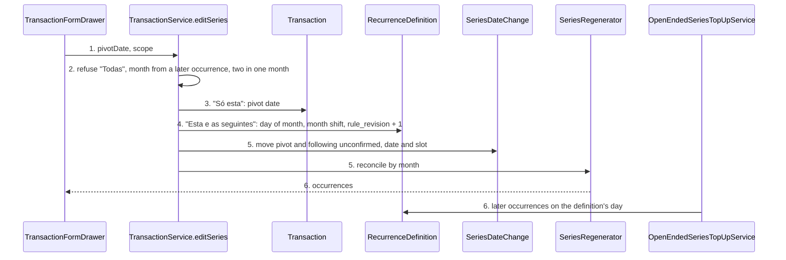
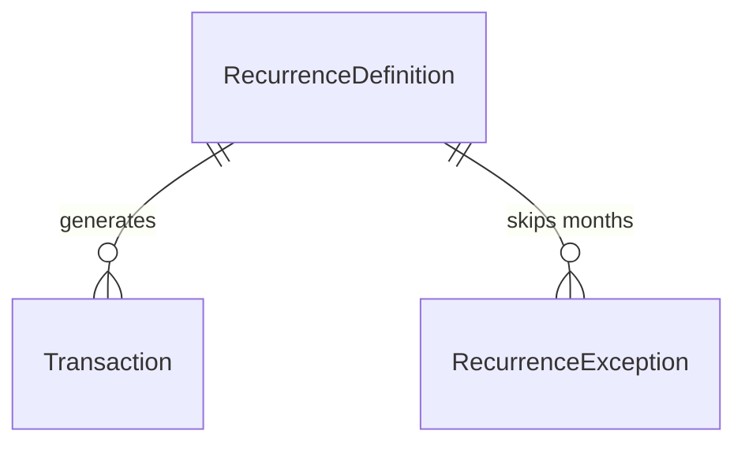

# Series date edit

**Approved**: 2026-11-23 - user: "Ok. Aprovo." (asked: "Aprova o plano assim, incluindo as duas suposições?")

## Problem

A series cannot move to another date. The series edit form hides the date, and the API takes `series.startDate` in
the edit request and drops it while answering 200 (`TransactionService.editSeries` never reads it; audit
`backend-quality-audit.md` H3). The owner moving two series from the 16th to the 18th (2026-11-02) had to edit each
occurrence or recreate the series, which loses its confirmations. The owner rated it important on 2026-11-22 ("gera
inconveniência") and named the real cases: the day changes, and the start month was registered wrong.

When this ships, a member opens an occurrence, changes its date and picks "Só esta" or "Esta e as seguintes": that
occurrence goes to the new date and, with "Esta e as seguintes", the following ones go to the same day (and, from the
first occurrence, the same number of months later). What already happened stays where it is.

## Shape

This reuses the series edit (`TransactionService.editSeries`, `RecurrenceDefinition`, `SeriesRegenerator.reconcile`)
and its scope dialog; the series stays one series, with no split. The rules - which occurrences move, the month-end
clamp, the refusals - run in the backend entity and services, which the backend ITs reach; the form only shows the
date and sends it.

1. a member changes the date of an occurrence and saves -> `TransactionFormDrawer` (exists) - shows the opened
   occurrence's date; when it changed, `SeriesScopeDialog` (exists) offers only "Só esta" and "Esta e as seguintes";
   sends `pivotDate`
2. `PUT /plan/{planId}/transaction/series/{seriesId}` -> `TransactionService.editSeries` (exists) - refuses a date
   change with "Todas", a month change from an occurrence that is not the first, and a change that leaves two
   occurrences in one month
3. "Só esta" -> `Transaction` (exists) - the pivot takes `pivotDate`; its slot stays
4. "Esta e as seguintes" -> `RecurrenceDefinition` (exists) - takes the new day of the month (door 1), shifts start,
   end and exceptions by the month difference when the pivot is the first occurrence, raises `rule_revision`
5. `SeriesDateChange` (new, in `transaction.service`) - checks the change against the occurrences, then moves the
   pivot and every following unconfirmed occurrence, date and slot, to the new day (and month) before
   `SeriesRegenerator` (exists) reconciles; confirmed ones keep their date; the regenerator matches slots and
   exceptions by month and never resets a date
6. out: the series' occurrences; `OpenEndedSeriesTopUpService` and `RecurringTransactionGenerator` (exist) create
   later occurrences on the definition's day, clamped to the month's last day

**Changes underneath**

| Front | What changes |
| --- | --- |
| domain | an occurrence's slot (`transactions.scheduled_date`) was fixed at creation; "Esta e as seguintes" now moves it - read by `SeriesRegenerator`, the trash restore (`TransactionTrashService`), the open-ended top-up and the series deletions |
| domain | slots and exceptions matched an occurrence by exact date; they now match by month (series are monthly only, `RecurrenceInterval.MONTHLY`) - so a day change does not refill a deleted month |
| domain | a series edit reset a forecast occurrence's date to its slot; it now leaves every existing date alone - dates change only by a date edit or a confirmation; an occurrence once confirmed and set back to forecast keeps the date it was confirmed on |
| domain | the day new occurrences fall on came from `start_date`; it now comes from the definition's day of the month (door 1) |
| stored data | `recurrence_definitions.day_of_month` added and filled from `start_date` (door 1); nothing else migrated |
| readers | transactions list and Overview (an occurrence moved to another month counts in that month), open-ended top-up, trash restore |

New: `RecurrenceDefinition.day_of_month`, not null, 1-31 (door 1).

## Surface

| Route | In | Out | Status | Who |
| --- | --- | --- | --- | --- |
| `PUT /plan/{planId}/transaction/series/{seriesId}` | new optional `pivotDate` (date): the pivot occurrence's new date; absent = unchanged | the series' occurrences | `200`; `422` `series-date-change-invalid` (a different `pivotDate` with "Todas", or another month from an occurrence that is not the first); `422` `series-month-collision` (two occurrences would share a month); existing `422`/`409`/`404` as today | members who may edit every occurrence in scope, as today |

## Landing

| One-way door | Literal shape | Alternative rejected |
| --- | --- | --- |
| 1. day of the month on the series | `V30__add_recurrence_day_of_month.sql`: `ALTER TABLE recurrence_definitions ADD COLUMN day_of_month SMALLINT`; `UPDATE recurrence_definitions SET day_of_month = EXTRACT(DAY FROM start_date)`; `SET NOT NULL`; `CONSTRAINT ck_recurrence_definitions_day_of_month CHECK (day_of_month BETWEEN 1 AND 31)` | changing the day of `start_date`: a series that starts in February cannot hold day 31 (`start_date` 28/02 would make every later month fall on the 28th), and re-anchoring `start_date` at the pivot breaks the installment numbering, which counts from it |
| 2. `pivotDate` in `UpdateSeriesRequest` | `LocalDate pivotDate` (nullable), committed in `backend/openapi.json` | reading `series.startDate`: it means the series' first date, which the app's form sends unchanged on every edit today, so it cannot also carry the pivot's new date |
| 3. no series split | one series, one definition; a date change moves occurrences and slots inside it | splitting at the pivot into two series (iCalendar, Google): a new series id per change, the trash and the installment labels rewritten, the size of the plan the owner turned down |

- Nothing else in this change is hard to reverse

## Criteria

### S1: changing the date of one occurrence (P1)

**Acceptance Criteria**

1. WHEN a member changes an occurrence's date with "Só esta" THEN that occurrence SHALL take the new date and every other occurrence SHALL keep its date
   - monthly 16/03-16/06/2026, April to 20/04 → 16/03, 20/04, 16/05, 16/06; April to 02/05 → April's occurrence on 02/05 and May's on 16/05, both shown in May
2. WHILE an occurrence was moved with "Só esta" WHEN the series is edited with "Todas" (amount, category) THEN that occurrence SHALL keep its date
   - April on 20/04, amount changed for all → April stays 20/04 with the new amount

### S2: changing the day from an occurrence on (P1)

**Acceptance Criteria**

3. WHEN a member changes an occurrence's day with "Esta e as seguintes" THEN that occurrence and every following unconfirmed one SHALL move to the new day in its own month, and the earlier ones SHALL keep their date
   - monthly 16/03-16/06/2026, from April to 18/04 → 16/03, 18/04, 18/05, 18/06, end 18/06/2026; from March (the first) to 18/03 → 18/03 to 18/06
4. WHILE a following occurrence is confirmed THEN a date change SHALL leave its date as it is
   - May confirmed on 16/05, from April to 18/04 → April 18, May 16, June 18
5. WHILE an occurrence was moved with "Só esta" WHEN a "Esta e as seguintes" date change reaches it THEN it SHALL move with the others
   - April on 20/04, from March to 18/03 → April 18/04
6. WHILE the new day does not exist in a month THEN that month's occurrence SHALL fall on its last day, and the next months SHALL keep the new day
   - day 31 from 16/01/2026 → 31/01, 28/02, 31/03, 30/04; a series starting 16/02/2026, day 31 from February → 28/02, 31/03, 30/04
7. WHILE a month's occurrence was deleted THEN a date change SHALL keep that month without an occurrence
   - April deleted "only this", from March to 18/03 → no occurrence in April
8. WHILE an open-ended series' day was changed THEN occurrences added later by the top-up SHALL fall on the new day, clamped to the month's last day
9. WHEN a series' date changes with "Esta e as seguintes" THEN restoring a deletion of that series made before the change SHALL answer 409 `trash-series-changed`

### S3: changing the start month (P1)

**Acceptance Criteria**

10. WHEN a member changes the first occurrence's date to another month with "Esta e as seguintes" THEN every unconfirmed occurrence SHALL move by the same number of months and take the new day, keeping the count, and the series' start, end and deleted months SHALL move with them
    - monthly 16/03-16/06/2026, first to 16/04 → 16/04 to 16/07, end 16/07/2026; installments 10x from 16/12/2026, first to 05/01/2027 → 05/01/2027 to 05/10/2027, still 1/10 to 10/10; April deleted, first to 16/04 → no occurrence in May
11. IF a date in another month comes from an occurrence that is not the first, or any different date comes with "Todas", THEN the system SHALL answer 422 `series-date-change-invalid` and change nothing
    - monthly from 16/03/2026: April to 18/05 "Esta e as seguintes" → 422; April to 18/04 "Todas" → 422; April to 18/04 "Esta e as seguintes" → 200; no `pivotDate` with "Todas" → 200 as today
12. IF a month change would leave two occurrences in one month THEN the system SHALL answer 422 `series-month-collision` and change nothing
    - monthly 16/03-16/06/2026 with April confirmed, first to 16/04 → 422; same series, nothing confirmed → 200

### S4: the form (P1)

**Acceptance Criteria**

13. WHEN a member opens an occurrence of a series to edit THEN the form SHALL show "Data" with that occurrence's date
14. WHEN the member changed the date and saves THEN the scope dialog SHALL offer only "Só esta" and "Esta e as seguintes"; WHEN the date is unchanged THEN it SHALL offer the scopes it offers today
15. WHEN the member changed both the date and the number of installments THEN the form SHALL refuse to save and say the two changes go in separate edits
16. WHEN the API answers `series-date-change-invalid` or `series-month-collision` THEN the form SHALL show its message in pt-BR and en

## Out of scope

| Excluded | Why |
| --- | --- |
| A month change from an occurrence that is not the first | the owner's case is the start month; a month change mid-series needs the series split (door 3) |
| A date change with "Todas" | owner 2026-11-22: date changes only with "Só esta" and "Esta e as seguintes", so the past never moves |
| `type`, `mode`, `interval`, `currentParcel` and `series.startDate` still dropped by the edit | the rest of audit H3 |
| Series edits through Claude | owner: "Depois (Recomendado)" |

## Assumptions

| Assumption | Chosen default | Rationale | Confirmed? |
| --- | --- | --- | --- |
| What moves | market table rows 1, 2, 3, 4, 6, 8: the day, the start month, one occurrence, from an occurrence on, confirmed stay, following move; not 5 ("Todas" only) and not 7 (past unconfirmed move) | owner 2026-11-22: "Quero 1, 2, 3, 4, 6, 8 e verifique a 9 pra gente decidir." | y |
| Day 31 in a short month | falls on the last day, and the next months go back to the day | YNAB's guide, Quicken users, findraco's create today; owner: "Por mim pode ser." | y |
| Scopes for a date change | "Só esta" and "Esta e as seguintes"; "Todas" keeps every other field | owner: "Por mim pode ser." | y |
| A month change that leaves two in one month | refused with 422 | owner: "Pra mim recusa, mas confirma ai pra gente se embasar."; no finance app documents it (YNAB and Quicken keep one schedule, so the case cannot happen there); loosening it later breaks nothing | y |
| An occurrence moved alone, then reached by "Esta e as seguintes" | moves with the others | owner: "Pra mim vai junto, e depois se quiser posso ajustar ela, mas novamente, confirma ai."; Outlook resets single-occurrence changes when the series changes; Google keeps them "in many cases" | y |
| "Só esta" to another month | allowed; the occurrence counts in the month of its date | confirming already accepts any date; Quicken lets one instance take any date; approved with the plan | y |
| A confirmed pivot | takes the new date | the member edits it on purpose; the rule that confirmed ones stay covers the others; approved with the plan | y |

**Open questions:** none - all resolved or logged above.

## Sources

- `.specs/project/DESIGN-PLAN.md` R18; `.specs/codebase/backend-quality-audit.md` H3; owner answers 2026-11-22.
- YNAB scheduled transactions (https://support.ynab.com/en_us/scheduled-transactions-a-guide-BygrAIFA9) - non-binding - month-end on the last day; "just this one" or "all future"
- Quicken (https://community.quicken.com/discussion/comment/20308987, https://info.quicken.com/mac/edit-an-existing-scheduled-transaction-in-the-regi) - non-binding - month-end clamp, one instance's date
- Outlook exceptions (https://www.slipstick.com/outlook/calendar/changing-date-recurring-appointments/), Google "all-following" (https://developers.googleblog.com/2013/12/changes-to-all-following-behavior-in.html) - non-binding - a single-occurrence change under a series change
