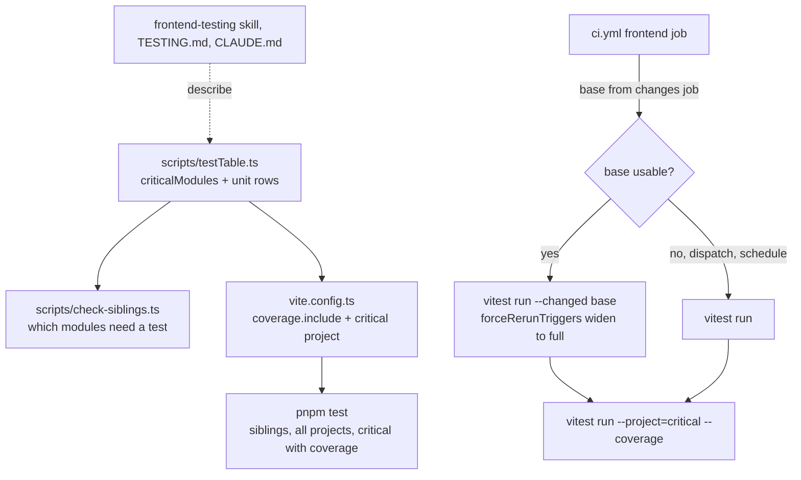

# Test Calibration Design

**Spec**: `.specs/features/test-calibration/spec.md`
**Context**: `.specs/features/test-calibration/context.md`
**Status**: Approved (user asked for an unattended run, 2026-10-20)

---

## Architecture Overview

The table lives once, as code, in `frontend/scripts/testTable.ts`. The sibling gate and the Vitest config read it; the docs describe it and point at it. CI runs the affected tests on a push and the full suite on a schedule; the coverage gate always runs on its own, over the critical modules' own tests only.

---

## Code Reuse Analysis

| Existing | Location | How it is used |
| --- | --- | --- |
| `changes` job (last green run as base) | `.github/workflows/ci.yml` | Already computes `base`; it becomes a job output for the frontend job |
| `hasLogic` content check | `frontend/scripts/check-siblings.ts` | Kept, but only inside table rows: a module in a row with no logic (types, constants, branchless wrapper) still needs no test |
| Container detection, markup check | `frontend/scripts/check-siblings.ts` | Unchanged |
| `--changed` and `forceRerunTriggers` | Vitest 3.2.7 | Measured 2026-10-20: a change to `money.ts` ran 14 related files. `forceRerunTriggers` is replaced, so the defaults are listed again |
| Story tags | Storybook 9.1.20 `storybookTest` | Measured: `tags: ["autodocs", "!test"]` on the meta skips the whole file; a story-level `tags: ["!test"]` skips that story. A second `tags` key on the meta silently overrides the first (16 metas already carry `tags: ["autodocs"]`): merge, never add a second key |
| Per-glob coverage thresholds | `@vitest/coverage-v8` 3.2.7 | One threshold entry per critical module |

---

## Components

### `scripts/testTable.ts` (new)

- **Purpose**: The table as code: which modules must have a sibling unit test.
- **Interfaces**:
  - `criticalModules: string[]` - paths relative to `src/`: `utils/money.ts`, `components/input/currencyDigits.ts`, `features/transactions/components/transactionForm.ts`, `features/categories/components/categoryForm.ts`, `api/clients/findracoApi.ts`. (A critical module moved during the audit is moved here too.)
  - `unitRows: { name: string; pattern: RegExp }[]` - business rule (`*Form.ts`, `*Forms.ts`, anything under a `utils/` folder), service hook (`api/services/use*Service.ts`), API client and API utils (`api/clients/*.ts`, `api/utils/*.ts`), URL params (`*Params.ts`), shared hook (`hooks/*.ts`).
  - `needsUnitTest(relativePath: string): boolean` - true for a critical module or a path matching a row.
- **Tests**: tooling project, through `check-siblings.test.ts` (one valid and one invalid case per row, CAL-02 tooling amount).

### `scripts/check-siblings.ts` (changed)

- `findMissingTests`: a module needs a sibling test when `needsUnitTest(path)` and (`hasLogic` or it is critical). Everything else passes, logic or not (CAL-03, CAL-04).
- `findMissingStories`: a component under a `base/` folder needs no story (CAL-07).
- Report text names the table: "Modules the test table requires a test for, without a sibling .test.ts".

### `vite.config.ts` (changed)

- `maxWorkers: process.env.CI ? <N> : "25%"` - N fixed by measurement on the CI runner (start at 2); local runs keep 25% (5 workers on a 20-core workstation) (CIT-01).
- `forceRerunTriggers`: Vitest's defaults (`**/package.json/**`, and the config glob written as `**/{vitest,vite}.config.*`: the default's trailing `/**` never matches the file, found in T6) plus `**/pnpm-lock.yaml`, `**/src/index.css`, `**/src/test/**`, `**/.storybook/**`, `**/scripts/testTable.ts` (CIT-03).
- `coverage.include`: the critical modules; `thresholds`: one `{ branches: 90 }` entry per critical module; no global number (CAL-05).
- New project `critical` (jsdom, `src/test/setupUnit.ts`, like `unit`) whose `include` is each critical module's sibling tests (`<module>.test.ts` and `<module>.*.test.ts`, which picks up `transactionForm.series.test.ts`). Coverage runs only in this project, so a critical module is always measured by its own tests (CIT-07).

### `package.json` scripts (changed)

- `test`: `node scripts/check-siblings.ts && vitest run --project=unit --project=tooling --project=storybook && vitest run --project=critical --coverage`.
- `test:coverage`: `vitest run --project=critical --coverage`.

### `.github/workflows/ci.yml` (changed)

- `on.schedule`: `cron: "0 6 * * 1"` (Mondays 06:00 UTC, 03:00 BRT); schedule runs on `main`.
- `changes` job: outputs `base` (empty when no usable base, and for `schedule` and `workflow_dispatch`).
- `frontend` job: checkout with `fetch-depth: 0` (the diff needs the base commit). Test step:
  - with `base`: `node scripts/check-siblings.ts && pnpm exec vitest run --changed "$BASE" --passWithNoTests --project=unit --project=tooling --project=storybook && pnpm exec vitest run --project=critical --coverage`;
  - without: `pnpm test`.
  - Deviation (T5): `tooling` runs whole, outside `--changed`. Vitest 3.2.7's related-file walk joins the bare `eslint` package import to the project root, hits the `eslint/` folder and fails with `EISDIR`. Tooling runs in ~1s, so running it whole costs nothing.
- `deploy`: unchanged; its `github.event_name == 'push'` condition already keeps the schedule from deploying (CIT-05).

### Docs (changed)

- `.claude/skills/frontend-testing/SKILL.md`: the table (CAL-01, CAL-02) replaces "What gets which test" and the logic criterion; stories split into test and catalog (CAL-06, CAL-07); flow scope (CAL-08); no library tests (CAL-09); E2E overlap (CAL-10); Specify guidance (PROC-03); coverage section on critical modules.
- `.specs/codebase/TESTING.md`: frontend sections, coverage matrix rows, matrix floor/ceiling (PROC-01), sensor scope (PROC-02), CI affected/full.
- `CLAUDE.md`: the Tests bullet and the sensor scope (PROC-02); "every component with its own visual has a story" gains the `base/` exemption.
- `.claude/skills/component-creation/SKILL.md`: the story rule matches CAL-06/CAL-07.
- `.specs/STATE.md`: AD-015 supersedes AD-012.
- `.specs/project/ROADMAP.md`: the two todos closed.

### Audit (`.specs/features/test-calibration/audit.md`, new)

One row per test and story file (182): file, kind, verdict (keep, cut, catalog, rewrite, move), rule, tests before → after. Totals per kind before/after, local wall time per project, CI test step time. Follow-ups (AUD-06) at the end.

**Verdict rules** (applied mechanically; a wrong result is fixed in the table, never per file):

| Test file of... | Verdict |
| --- | --- |
| A module `needsUnitTest` | keep; trim cases to one per rule plus named edges; cut cases that assert library behaviour or repeat another case's rule |
| Pure computation outside a row (e.g. `features/*/components/spendingRows.ts`) | move the module and its test to the feature's `utils/` folder; trim as above |
| A feature hook (`features/**/use*.ts`) | cut, when every decision it asserts is covered by its container's flow test or by a unit test of a moved pure module (cite the covering test in the report); otherwise keep and list it as a follow-up |
| Glue outside every row (column definitions, labels, class maps, route lists, storage wrappers) | cut |
| `base/` story file | catalog: merge `"!test"` into the meta's `tags` |
| Other story file | keep one story per state the component handles in its own code and stories with a `play` for the component's own interaction; variant showcases, extreme content and mobile viewports get story-level `tags: ["!test"]` when they help the catalog, otherwise are removed |
| Flow test (`.test.tsx`) | rewrite per CAL-08: keep container decisions; drop assertions on pure value rules that a unit test covers (cite it) |
| Tooling test | keep one valid and one invalid case per behaviour a rule promises |

---

## Error Handling Strategy

| Error scenario | Handling | Effect |
| --- | --- | --- |
| No usable base (dispatch, first run, force push, schedule) | `base` empty → `pnpm test` | Full suite, safe default |
| Affected set empty | `--passWithNoTests` | Test step passes; lint, build, siblings and critical coverage still run |
| A force-rerun file changed | Vitest widens `--changed` to every test | Full suite |
| A critical module only partly exercised by an unrelated test | Coverage only runs in the `critical` project | Never measured from unrelated tests |
| Fixed worker count times out `user-event` tests on CI | Lower N; never retries | Measured in T6 |
| Weekly run fails | Run ends red | GitHub's failed-run email to the user |

---

## Risks & Concerns

| Concern | Location | Impact | Mitigation |
| --- | --- | --- | --- |
| Duplicate `tags` key on a meta silently overrides | the 16 story files with `tags: ["autodocs"]` | A `!test` added as a second key is ignored and the file keeps running | Verdict rule says merge; the audit report's after-numbers (story test count) catch a miss |
| `--changed` relies on the import graph | `vite.config.ts` | A test depending on a non-imported file (CSS, setup, config) is skipped | `forceRerunTriggers` lists those files; weekly full run; local full gate at each phase end |
| Cutting a feature-hook test whose decision no flow covers | `features/**/use*.test.ts` | A real behaviour loses its test | Cut only with a cited covering test; otherwise keep and list (AUD-06) |
| Story-level catalog tag leaves an untested state | other story files | A state the component handles runs in no test | Verdict keeps every state the component's own code handles |
| `setupUnit.test.ts` cases depend on their order (Handoff low note) | `src/test/setupUnit.test.ts` | Could flake once more workers run on CI | Watch in T6's three runs; fix at the cause if it flakes |

---

## Tech Decisions

| Decision | Choice | Rationale |
| --- | --- | --- |
| Where the table lives | `scripts/testTable.ts`, read by the gate and the Vitest config | One source; docs point at it instead of restating patterns |
| Coverage invocation | Separate `critical` project, always run | Keeps the threshold meaningful in affected runs, and drops coverage instrumentation from the main run (~25% of `unit` time locally) |
| Local worker count | Unchanged (25%) | The fixed number targets the 4-vCPU runner; 25% of 20 cores is already 5 |
| Catalog mechanism | Storybook tags, not a path exclude | Works per story as well as per file, and the file itself says it is catalog |
| Schedule | Mondays 06:00 UTC | Off-hours, start of the week |

## CI measurements

Measured in T6 on `test-calibration` (4-vCPU `ubuntu-latest`, before the audit cut). Time is the frontend job's Test step, from the jobs API.

| Run | Trigger | N | Kind | Test step |
| --- | --- | --- | --- | --- |
| 39373349005 | push (no green base) | 2 | full | 95s |
| 39373598053 | dispatch | 2 | full | 144s |
| 39373607617 | dispatch | 2 | full | 139s |
| 39373953726 | push (`vite.config.ts`) | 3 | affected, 0 unit/story files | 17s |
| 39373963170 | dispatch | 3 | full | 103s |
| 39373971949 | dispatch | 3 | full | 127s |
| 39374330976 | push (trigger fix) | 3 | full via `forceRerunTriggers` | 149s |
| 39374717962 | dispatch | 3 | full | 140s |
| 39374710094 | dispatch | 3 | full | 136s |
| 39375055561 | push (`vite.config.ts`) | 2 | full via `forceRerunTriggers` | 153s |
| 39375064571 | dispatch | 2 | full | 100s |
| 39375424397 | push (comment in `features/overview/utils/scaleLimits.ts`) | 2 | affected | 27s |

- **N = 2.** Five green full runs each: N=2 mean 126s (95-153), N=3 mean 131s (103-149). Runner speed varies more than N moves it, so the lower count wins on the tie: fewer workers keep the `user-event` timeouts away. No timeout or flake in any run, `setupUnit.test.ts` included.
- **Affected run:** the probe ran 11 unit and story files (99 tests: `scaleLimits.test.ts`, `spendingRows.test.ts` and the overview stories importing them), plus tooling (4) and critical (6) whole; Test step 27s, under the 60s goal.
- **Full run is not yet ≤ 120s** (mean 126s, from 247s). The rest is expected from the audit cut (Phases 4-5); T15 measures again.
- **Fixed in T6:** run 39373953726 changed `vite.config.ts` and ran no unit or story test. Vitest's default config glob `**/vite.config.*/**` does not match the file; the trigger is now `**/{vitest,vite}.config.*` (commit 9cd669b), proven by run 39374330976.

> **Project-level decision:** AD-015 supersedes AD-012 (testing model): the closed table replaces the content-based criterion and the global per-file threshold.
