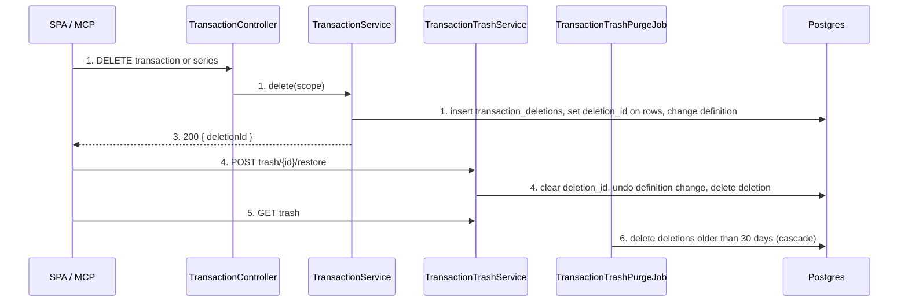
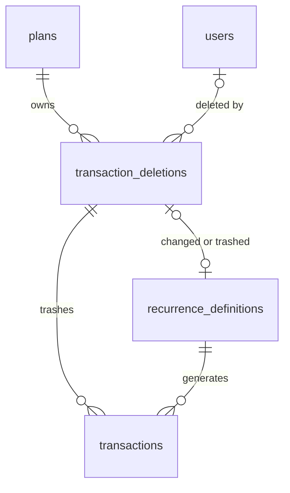
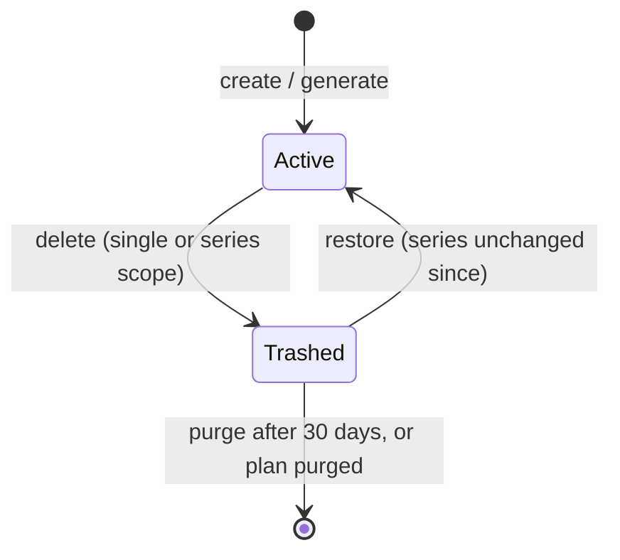

# Transaction Trash

**Approved**: 2026-11-18 - user: "Em seguida, escolher adequadamente entre lean e sdd e continuar com a fase 1. Sozinho, sem me chamar pra nada, até 9 da manhã"

> Unattended run: the user delegated the product decisions of phase 1 and reviews the result afterwards. Every
> decision taken on their behalf is an `Assumptions` row marked `user delegated`.

## Problem

Deleting a transaction removes the row for good (`TransactionService.java:290-295`, `transactionRepository.delete`), and
deleting a series removes every occurrence in scope and, for "all", the series itself (`:342-411`). A transaction has no
timestamps, so nothing records what was deleted or by whom. One wrong tap in the app, or a wrong call from Claude once the
MCP can delete (R9), is recoverable only from the nightly database dump, by hand. ROADMAP's 1.0 criterion "data safety"
requires that no known path loses data.

When this ships, every delete can be undone from the toast right away, and for 30 days from the plan's trash.

## Shape

This reuses the plan archive's pattern (explicit filters per finder, AD-006; a daily purge job with a 30-day retention,
AD-023) instead of a global Hibernate filter. The rules that decide what a user sees (which rows count, which are
listed, what restore brings back) run in the transaction service and the repositories, reached by `*IT` tests.

1. `DELETE …/transaction/{id}` or `DELETE …/transaction/series/{seriesId}` -> `TransactionController` (exists) -> `TransactionService` (exists) - checks the role as today, then, instead of deleting rows, creates one deletion record (door 1) and marks every row in scope with it (door 2); for a series it records what it changed on the `RecurrenceDefinition` (the EXDATE added, the previous end date or parcel count, or the whole definition trashed - door 3)
2. every finder that serves a screen, a total or a regeneration (`TransactionSpecification`, `TransactionRepository`, `DashboardReportRepository`, `CategorySpendingRepository`, `RecurrenceDefinitionRepository`) (exists) - ignores trashed rows and trashed definitions
3. out: `200 { "deletionId": n }`; the SPA shows the toast with "Desfazer"
4. `POST …/transaction/trash/{deletionId}/restore` -> `TransactionTrashService` (new) - checks the role per row, refuses if the series changed since, un-marks the rows, undoes the definition change, deletes the deletion record
5. `GET …/transaction/trash` -> `TransactionTrashService` (new) - lists the plan's deletions the caller may restore, newest first
6. daily `TransactionTrashPurgeJob` (new) - deletes deletion records older than 30 days; the database cascades to their rows and to a trashed definition

**Changes underneath**

| Front | What changes |
| --- | --- |
| domain | "Deleted" meant gone; now it means trashed for 30 days, then gone. `TransactionService.delete`, `deleteSeries` and every finder branch on it |
| domain | A single `DELETE …/transaction/{id}` on a series occurrence today removes the row without an EXDATE, so a later series edit recreates it (AD-022's original bug). It now records the EXDATE, as the series "only this" delete does |
| stored data | Nothing to migrate: existing rows have no deletion. New nullable columns only |
| readers | Transactions list and search, get/update/confirm by id, Overview summary, person breakdown, monthly trend, category spending and usage, Categories screen counts, series regeneration (edit, top-up, horizon), importer dedup, MCP list/confirm/update and summaries. Each gets a criterion or a row in `Out of scope` |
| readers | Category delete: usage counts ignore trashed rows; the move-to target (or no category) is applied to trashed rows and their items too, so a later purge never blocks on a category |
| contract | Both DELETE routes answer `200` with a body instead of `204` (`backend/openapi.json` regenerated) |

New: `transaction_deletions`; `transactions.deletion_id`; `recurrence_definitions.deletion_id`. One-way constraints:
`transactions.deletion_id` and `recurrence_definitions.deletion_id` cascade from `transaction_deletions` (door 2, 3);
`transaction_deletions.plan_id` cascades from `plans` (door 1).

## Surface

| Route | In | Out | Status | Who |
| --- | --- | --- | --- | --- |
| `DELETE /plan/{planId}/transaction/{id}` | - | `{ deletionId }` | `200`, `404` unknown or trashed, the existing role denial | as today: OWNER, EDITOR; CONTRIBUTOR on own rows |
| `DELETE /plan/{planId}/transaction/series/{seriesId}?scope=&pivotOccurrenceId=` | as today | `{ deletionId }` | `200`, `404`, the existing role denial | as today |
| `GET /plan/{planId}/transaction/trash?page=&size=` | page (default 0), size (1-100, default 20) | page of `{ id, kind, scope, description, count, amount, type, deletedAt, deletedBy, expiresAt }` | `200`, `403` VIEWER, `404` not a member | OWNER, EDITOR all deletions; CONTRIBUTOR the ones they made |
| `POST /plan/{planId}/transaction/trash/{deletionId}/restore` | - | `{ restored }` (row count) | `200`, `404` unknown, purged or not visible to the caller, `409` `trash-series-changed`, `403` VIEWER | who may modify every row in it |

## Landing

| One-way door | Literal shape | Alternative rejected |
| --- | --- | --- |
| 1. a deletion is a record of its own | `transaction_deletions(id bigserial pk, plan_id bigint not null fk plans on delete cascade, deleted_by_user_id bigint null fk users on delete set null, deleted_at timestamptz not null, kind varchar(16) not null check (kind in ('TRANSACTION','SERIES')), scope varchar(32) null, recurrence_definition_id bigint null, definition_version bigint null, exception_date date null, previous_end_date date null, previous_parcels_number int null, definition_trashed boolean not null default false)`, index `(plan_id, deleted_at desc)` | `deleted_at` on each row: a series delete could not be undone as one action (N rows, plus the EXDATE or shortened end on the definition), and "who deleted" would repeat per row |
| 2. trashed rows point at their deletion | `transactions.deletion_id bigint null fk transaction_deletions on delete cascade`, index `ix_transactions_deletion_id` | a status value on `transactions`: confirmation is derived (AD-025) and a stored lifecycle state would be read by every finder that today reads none |
| 3. a series deleted whole stays until purge | `recurrence_definitions.deletion_id bigint null fk transaction_deletions on delete cascade`; top-up and horizon skip it | hard-deleting the definition as today: its trashed occurrences reference it through a non-cascading FK, so the delete fails, and restore would have nothing to regenerate from |
| 4. both DELETE routes return a body | `200 application/json { "deletionId": <long> }` | `204` plus a separate "last deletion" lookup: racy between two members, and the MCP needs the id in the same call |
| 5. restore detects "series changed" by the definition's `@Version` (found mid-build) | `recurrence_definitions.generated_through` is excluded from optimistic locking (`@OptimisticLock(excluded = true)`), so the daily top-up and the read horizon do not bump the version a restore compares against; a series trashed whole is not compared (nothing can edit it). Unknown or purged deletion answers `404` slug `trash-entry-not-found` (a second new slug beside `trash-series-changed`). Indexes follow the repo's `idx_` prefix (`idx_transactions_deletion_id`), not `ix_` | comparing a copy of the pattern fields: more columns on `transaction_deletions` for the same answer; without the exclusion every open-ended series would answer `409` the day after a delete |

- Nothing else in this change is hard to reverse

## Criteria

### S1: Delete goes to the trash (P1)

Every delete is reversible as one action.

**Acceptance Criteria**

1. WHEN a member who may delete a transaction deletes it THEN the system SHALL answer `200` with `deletionId` and the row SHALL no longer appear in the transactions list, the Overview summary or category spending.
   - single expense of R$ 50 in November → list without it, November expenses down by 50
2. WHEN a member deletes a series with scope "only this", "this and following" or "all" THEN the system SHALL create one deletion holding every row removed from view and answer its `deletionId`.
   - 6-parcel series, "this and following" from parcel 4 → one deletion, 3 rows; parcels 1–3 stay
3. WHEN a single `DELETE …/transaction/{id}` targets a series occurrence THEN the system SHALL record that occurrence's date as an exception of its series, so a later "all" edit of the series does not recreate it.
4. IF a trashed transaction is requested by id (get, update, confirm, delete) THEN the system SHALL answer `404` `transaction-not-found`.
5. WHILE a series is trashed whole the system SHALL not generate new occurrences for it (top-up job, read horizon).
6. The system SHALL count no trashed row in the dashboard summary, person breakdown, monthly trend, category spending, category usage counts or the transactions list and search.

### S2: Undo and restore (P1)

The user brings back what they deleted.

**Acceptance Criteria**

7. WHEN a member restores a deletion THEN the system SHALL bring back every row of it with its original values and answer `restored` with their count, and the deletion SHALL leave the trash.
   - single expense → back in the list with the same amount, date, category, participants and items
8. WHEN a member restores a series deletion THEN the system SHALL undo its change to the series: remove the exception it added ("only this"), put back the previous end date or parcel count ("this and following"), or reactivate the series ("all").
   - 6-parcel series, "this and following" from parcel 4, restored → 6 parcels, parcel count 6
9. IF the series was edited or deleted again after a deletion THEN restoring it SHALL answer `409` `trash-series-changed` and change nothing.
10. IF a deletion is unknown, already restored, purged, or not visible to the caller THEN restore SHALL answer `404`.
11. IF the caller may not modify every row of the deletion THEN restore SHALL answer the same role denial the delete gives and change nothing.
12. WHEN the SPA deletes a transaction or a series THEN the success toast SHALL offer "Desfazer" (en "Undo"), and using it SHALL restore that deletion and show "Transação restaurada." (en "Transaction restored.").

### S3: The plan's trash (P1)

**Acceptance Criteria**

13. WHEN a member opens the trash THEN the system SHALL list the plan's deletions newest first with description, kind, row count, total amount, who deleted and the expiry date (deletion date + 30 days).
    - "all" of a 6-parcel series of R$ 300 → one entry, 6 rows, R$ 1.800,00
14. WHILE the caller is a CONTRIBUTOR the trash SHALL list only the deletions they made; a VIEWER SHALL get `403` and the SPA SHALL not show the trash.
15. WHEN a member uses "Restaurar" on a trash entry THEN the entry SHALL leave the list and its rows SHALL appear again on Transactions.
16. IF the trash is empty THEN the SPA SHALL show "Nada na lixeira. O que você excluir fica aqui por 30 dias." (en "Nothing in the trash. What you delete stays here for 30 days.").
17. IF loading the trash fails THEN the SPA SHALL show the error state with a retry, not an empty trash.

### S4: Retention and the edges (P1)

**Acceptance Criteria**

18. WHEN the purge job runs THEN the system SHALL delete every deletion whose `deleted_at` is 30 days old or more, with its rows (and their participants and items) and its trashed series.
    - deleted 30 days ago → purged; 29 days and 23 h ago → kept
19. WHEN a plan is purged THEN its deletions SHALL go with it (cascade).
20. WHEN a statement is imported again THEN a trashed imported row SHALL count as already imported and SHALL not come back.
21. WHEN a category is deleted THEN its usage count SHALL ignore trashed rows, and trashed rows and items in it SHALL move to the reassignment target or to no category.
22. WHEN a deletion is restored after its category was deleted THEN the rows SHALL come back in the target category, or with no category.

## Out of scope

| Excluded | Why |
| --- | --- |
| Deleting one entry from the trash for good, or emptying it | Purge covers retention; a second destructive action needs its own confirm design |
| MCP delete and restore tools | R9 (`mcp-capture-hub`), built on this |
| Trash for categories or plans | Plans already archive; categories reassign on delete |
| The "this and following" scope choosing rows by `startDate` while edit uses `scheduledDate` | Existing inconsistency (`TransactionService.java:366-370` vs `:466-469`); recorded for its own fix |
| Change history of a transaction | R13 |
| A "Mais"/settings home for the trash | N1; the trash lives on the Plans screen until then |

## Assumptions

| Assumption | Chosen default | Rationale | Confirmed? |
| --- | --- | --- | --- |
| Retention | 30 days, same as archived plans | One rule for "you can still get it back" | y - user delegated |
| Grouping | One trash entry per delete action | A series delete is one mistake; undoing it row by row is not an undo | y - user delegated |
| Where the trash lives | A "Lixeira" section of the active plan on the Plans screen, like archived plans; the toast "Desfazer" is the main path | Rare action out of daily space (DESIGN-PLAN N1, C15) | y - user delegated |
| Who sees what | OWNER/EDITOR: every deletion of the plan; CONTRIBUTOR: their own; VIEWER: none | Mirrors who may delete (`PlanAuthorization.canModifyTransaction`) | y - user delegated |
| Restore after the series changed | Refused with `409`, nothing changed | Merging an old occurrence into a series edited since can put a parcel past the new end; refusing is safe and rare | y - user delegated |
| Re-import of a trashed row | Skipped as already imported | The user removed it on purpose; the unique `(plan_id, source_ref)` index stays valid | y - user delegated |
| Toast copy | "Desfazer"; "Transação restaurada." | Plain verbs, same tone as the existing toasts | y - user delegated |

**Open questions:** none - all resolved or logged above.

## Differences from the source

None - no binding source.

## Sources

- `.specs/project/DESIGN-PLAN.md` R1 - the problem and the 1.0 data-safety criterion.
- `.specs/STATE.md` AD-006, AD-022, AD-023, AD-025 - soft delete by explicit filters, EXDATEs, 30-day purge, derived confirmation.
- User, 2026-11-18 - delegated phase 1 decisions ("Sozinho, sem me chamar pra nada").
